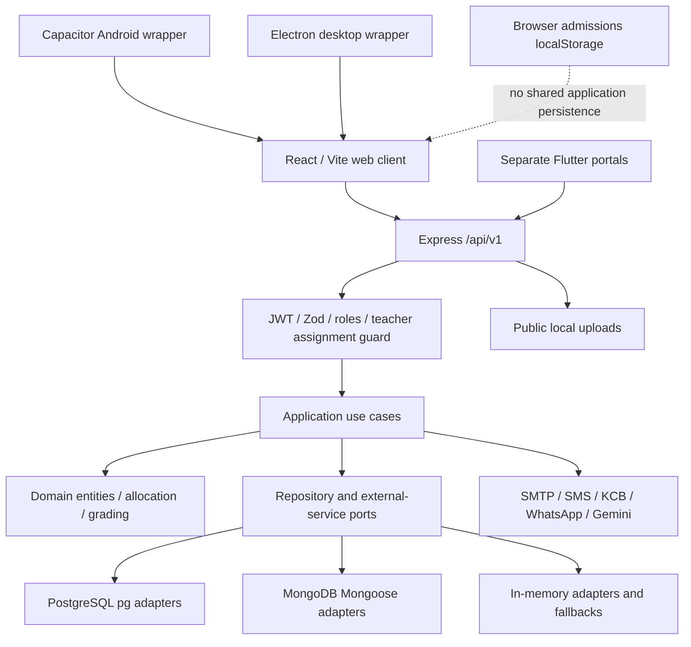

# SmartShule codebase audit

> **Authorized production update, 16 November 2026:** the missing F02 payroll/complaint fields and F03 reversal-request table have now been added and independently verified. See the production implementation record at the end. Existing records were preserved. F01/F13 permissions, F10 account linking and F04/F07/F11 workflow/configuration findings remain open.

> **Latest reconciliation, 16 November 2026:** see “Production database audit reconciliation” below for F01/F02/F03/F04/F07/F10/F11/F13 against main `b18836c643e8cb1cee0e42b65b9f1a0f7def16d2`. Review-only SQL proposals and isolated PostgreSQL/workflow evidence are included. Production is unchanged; deployed revision remains unverified.

> **Authorized follow-up, 15 November 2026:** the build/type errors and default unit/API test failures have now been fixed. The final default run passed **93 suites / 1,105 tests**. See the follow-up section at the end. The original audit below describes the pre-fix snapshot; source line numbers may have moved. Broader security, transaction, persistence and proposed curriculum findings are not all resolved by these verification fixes.

Audit date: 14–15 November 2026 (Africa/Nairobi). Scope: the complete repository's discovered application surfaces, including the uncommitted working tree. This is an audit, not an implementation change or production certification.

## Executive overview

SmartShule contains a substantial school management implementation: React web/packaged clients, an Express API with domain entities and repository interfaces, PostgreSQL and MongoDB adapters, and a separate Flutter client. Learner registration, guardian linking, academic setup, assessment capture, fee allocation, payroll, library, consent and concern workflows have real backend implementations. This is considerably more than a collection of screens. However, neither the current backend nor frontend passes its TypeScript check. A successful Vite bundle does not establish deployability or workflow correctness.

The isolated checks completed 453 passing unit assertions and 431 passing API assertions, with 11 unit and 71 API assertion failures plus 12 compile-blocked unit suites. Passing cases are qualified below; fixture/policy failures are distinguished from observed defects.

The highest risks are sensitive endpoints without sufficient ownership/role/school checks; a publicly reachable arbitrary email dispatch route; hardcoded fallback signing secrets; payment callbacks without an evident authenticated origin check; financial transactions whose business writes escape their transaction connection; and browser-only admissions that do not reach a different staff device. Several operational modules silently use volatile memory even in PostgreSQL mode. The Flutter app substitutes sample users and records after failures, making it unsuitable as an authoritative production portal in its current form.

The new curriculum planning code already implements calendars, timetable-derived slots, subject-assignment checks, draft allocations, coverage review, scheme generation, locking, revision checks, lesson links, weekly views and exports. It does **not** implement the entire proposed workflow: curriculum proposals/publication and identifiable outcome coverage are absent; lesson plans require approval; approved-version preservation is incomplete; record approval can overstate a whole week's coverage and its tracker synchronization is non-atomic.

**Evidence labels throughout:** **S** = static source inspection; **T** = executed existing automated tests; **R** = synthetic runtime probe using memory/mocks; **B** = build/type/analyzer execution; **U** = unverified deployment/service behavior. A module marked Working describes the stated narrow capability, not a guarantee of all edge cases. Production records, secrets, payment gateways and messaging recipients were not exercised.

## Repository identity, preservation and instructions

- Branch: `main`; HEAD: `8217fe17640f939102aadda3ea20126a22a8e42a`.
- At inspection there were 141 tracked-modified/untracked status entries. These include frontend/backend edits, planning services, migrations, scripts, documentation and tests. This report evaluates that combined state, not just HEAD. No reset, checkout, migration, seed, deployment or application-source fix was performed.
- No applicable `AGENTS.md` was found in this repository or checked ancestor locations. README describes intended architecture but contains stale bootstrap/administrator claims: the container's `ensureAdminAccounts`, `ensureSuperAdmin` and `ensureRoleAccounts` methods are no-ops.
- Source inventory: 384 TypeScript/TSX/Dart files under backend `src`, frontend `src`, and `Mobile/lib`, approximately 213,622 lines. There are 56 unit test files, 44 integration test files and 12 SQL migration files. Generated assets/dependency internals and private backup contents were not treated as application source.
- Local credentials, personal records, backup contents and WhatsApp session material are deliberately omitted. Environment **loading behavior and code/configuration** were examined; the audit did not print the live `.env` or open backup dumps.
- Artifact added: this report only. Build/test artifacts and synthetic fixtures are under `/tmp/smartshule-audit`. Existing application and production data were preserved.

## Architecture and entry points



| Layer / directory | Actual responsibility and limitations |
|---|---|
| `src/index.ts` | Loads dotenv, creates repository bundle/container, starts HTTP listener. Starting PostgreSQL mode runs schema initialization, so starting the server is a database write operation. |
| `src/infrastructure/http/app.ts` | Express middleware, uploads, health/readiness, `/api/v1`, and built frontend serving. |
| `src/infrastructure/http/routes/index.ts` | Central router; route-level roles and validation; aliases for CBC, concerns, occurrence book and trackers. Complete route inventory appears below. |
| `src/infrastructure/container.ts` | Dependency composition; explicit in-memory fallbacks where a database bundle lacks an adapter. |
| `src/application` / `src/core` | Use cases, business entities, repository contracts. Some newer services import `AppContainer`, weakening otherwise useful separation. |
| `src/infrastructure/database/postgres` | Operational persistence, runtime DDL, JSONB aggregates, specialized repositories. This is the active full-featured database implementation, with material gaps below. |
| `src/infrastructure/database/mongodb` | Alternative adapter set covering core academics/users/finance, with fewer operational repositories. Not feature-equivalent to PostgreSQL. |
| `prisma/schema.prisma`, `scripts/prisma-cli.ts` | Alternative schema/tool path, not selected by DatabaseFactory; Prisma packages/scripts are not installed as a normal supported build path. Schema lacks newer planning/consent/payroll/signature structures. Do not use `db push` as a substitute for reviewed SQL migrations. |
| `Frontend/smartshule/src/main.tsx`, `App.tsx` | React entry, authentication/public pages, role-selected dashboard, tab-based navigation and lazy views. `services/api.ts` centralizes API transport. |
| `Frontend/package.json` | Wrapper scripts; not a second independent frontend application. |
| `Mobile/lib/main.dart` | Independent Flutter app with teacher and parent screens, API singleton and shared-preferences session. Not the same app as the Capacitor wrapper. |
| `Frontend/smartshule/android`, `capacitor.config.ts` | Native Android host for the React bundle; network/UX requires native-device verification. |
| `Frontend/smartshule/electron` | Local frontend with sandbox/context isolation, limited preload IPC and external-browser links; hosted backend required. |
| `Dockerfile`, `docker-compose.yml`, `render.yaml` | Unified frontend/API container, local PostgreSQL Compose service, Render blueprint. GitHub workflow builds desktop packages. |
| `database/migrations`, `scripts`, `documentation`, `postman`, `backups` | SQL upgrades/repairs, imports/manual generators/browser investigations, existing narrative evidence, API collection and local backups. Prior reports/screenshots are historical context, not proof for this working tree. |

Dependencies: backend TypeScript/Express 5, Zod 4, pg, Mongoose, JWT/bcrypt, Baileys, Nodemailer, rate limiting and Helmet; frontend React 19/Vite 6/Tailwind 4, PDF generation, motion/icons, Capacitor 7, Electron 34; Flutter uses HTTP/provider/shared preferences. Lockfiles are present. Exact installed dependency versions and transitive vulnerability status were not independently verified against an advisory service; no claim of vulnerability-free dependencies is made.

Available commands: backend `npm run build`, `npm test`, `npm run test:coverage`, development/start commands; frontend `npm run build`, `npm run lint` (actually TypeScript checking), Vite preview; `cap:build`, `cap:assemble`, Electron packaging variants; Flutter/Dart analyze/test/build via the mobile toolchain. `bootstrap`, database switch commands and Docker startup can mutate environments/data and were not used.

## Status matrix and module-by-module behavior

For compactness, “PostgreSQL persisted” below means an adapter and matching table mapping exist in source; actual live persistence and deployed schema compatibility remain U unless stated. Cross-portal claims describe the common API/data path, not a completed browser/device acceptance test. Full view, API, use-case and migration inventories below make grouped modules explicit.

### Consolidated status matrix

These statuses apply to the scoped capabilities, with detailed evidence and limitations in the module sections and finding index.

| Capability | Status | Evidence / limiting condition |
|---|---|---|
| Authentication/users/permissions | **Partially Working** | Role/JWT/profile APIs; F02–F05 |
| Dashboards/sidebar/role portals | **Partially Working** | Record-derived aggregates; scope/cache/test limits |
| Shared admissions/slot applications | **Broken** | Browser-only persistence; F06 |
| Learners/guardians/archives | **Partially Working** | Real records; family-tree/demo-link defects F03/F07 |
| Staff onboarding/self-service | **Partially Working** | Profiles/corrections; partial provision/RBAC differences |
| Academic setup/assignments | **Partially Working** | School/year/term/class/stream and effective duties; migration U |
| Curriculum hierarchy/dictionary | **Partially Working** | Grade/area/strand/sub-strand + text outcomes |
| Curriculum proposals/publication | **Missing** | No proposed/published catalogue state; F12 |
| Timetable/calendar/coverage allocation | **Partially Working** | Slot/exception/revision engine; stable identity gap |
| Schemes/lesson plans/exports | **Partially Working** | Server review/links; lifecycle/metadata mismatch |
| Records and tracker progress | **Partially Working** | Review/weekly projections; F15 |
| Unique approved outcome coverage | **Missing** | Week/estimated lesson counts only |
| Formative/summative/imports | **Partially Working** | Persisted assessments; transactional import/test gaps |
| Report cards/broadsheets/analytics | **Partially Working** | Snapshots/ranks/verification; mapping and stale cache concerns |
| Attendance/absence follow-up | **Partially Working** | Registers and parent filtering; concurrency/SMS/date limits |
| Geofence/faculty clock-in | **Partially Working** | Server radius/time checks; live GPS/device U |
| E-diary/acknowledgements | **Partially Working** | Real PG adapter and shared feeds; historical migration U |
| Announcement CRUD | **Partially Working** | Volatile memory; F08 |
| Announcement SMS/WhatsApp broadcast | **Missing** | Empty hook; F09 |
| Fees/billing/arrears/payments/credits | **Partially Working** | Many passing calculations; transaction defect F10 |
| Financial approvals/reversals/reconciliation | **Partially Working** | Real workflows; transaction and durability limits |
| KCB/Daraja production settlement | **Unverified** | Mocks only; unauthenticated callback risk F04 |
| Scholarships/sponsorships | **Partially Working** | Persistent exemption; partial policy/RBAC mismatch |
| Payroll/leave/salary acknowledgements | **Partially Working** | Expense linkage/receipt feedback; IDOR/atomicity gaps |
| Inventory/procurement/assets/expenses | **Partially Working** | Operational records; legacy mutation and concurrency gaps |
| Lunch programme/ledger | **Partially Working** | Passing isolated domain/API cases; PG U |
| Consent request/response core | **Working** | Narrow memory behavior covered by passing tests; live PG U |
| Digital signing/OTP/batches | **Partially Working** | Hashes/records/OTP; canonical-document binding U |
| Library | **Partially Working** | Persisted loans; stock/delete atomicity gaps |
| Clinic authorization/durability | **Broken** | Cross-school synthetic parent write; volatile records |
| Discipline/clubs/occurrences | **Partially Working** | Incident workflows; authorization and volatile discipline |
| Concerns and parent help/media | **Partially Working** | Server concern workflow; local-success and public uploads defects |
| Audit logs | **Partially Working** | After-response audit/CSV; failure/retention limits |
| General notification delivery | **Unverified** | SMTP/SMS/WhatsApp source and mocks; real delivery not tested |
| Android/Electron packaging | **Unverified** | React bundle/host config inspected; binaries not installed |
| Flutter authoritative portal | **Broken** | Mock identity/data and false success; F25 |
| Migration/deployment/backup restore | **Unverified** | Source/configuration assessed; no database/production writes |

### 1. Authentication, users, roles and school isolation — Partially Working

**Users/purpose:** school leadership manages staff/parent identities; users sign in by identifier/phone/email, change passwords and recover access. Login/Register/ChangePassword/ResetPassword pages → `auth` API → `AuthUseCases` → user/guardian/teacher repositories; bcrypt hashes and JWT access/refresh tokens. UserManagementView → `/users` → admin CRUD/status/reset and profile synchronization. Roles include super admin, admin/school admin, head/deputy, admissions, bursar/accountant, teacher, parent/guardian and student.

**Implemented:** active-user checks at login and refresh; phone normalization helpers; password reset tokens/expiry/attempt checks; role alias handling; server role middleware; teacher profile creation for relevant roles. Existing domain/auth tests provide partial T evidence. The new teacher guard and `TeacherAssignmentAccess` enforce school/class/stream/subject/year/term checks on many teaching paths.

**Failures/limits:** access middleware trusts token claims without checking current user status/role, so a revoked user may retain access until expiry. Default signing secrets allow unsafe deployment configuration. Public registration allows teacher/student/parent roles and an arbitrary school ID; initial privileged registration protection checks existing SUPER_ADMIN/ADMIN, not a complete atomic bootstrap policy. Tenant checks are uneven outside teaching. `SUPER_ADMIN` bypasses role gates by design. Password-change enforcement in the UI does not constitute a general server gate. In-memory reset-attempt counters are per process. See F02, F03, F04, F05.

### 2. Dashboards, navigation, notices and shared UI — Partially Working

App chooses role dashboards, with navigation definitions in `utils/rbac.ts` and tab rendering in App. SuperAdmin/Dashboard/HeadTeacher/Deputy/Bursar/Admissions dashboards aggregate repository records through analytics/finance APIs; TeacherDashboard uses assigned context and teaching endpoints; ParentDashboard uses linked learners, fees, diaries, assessments, consent and library APIs. Shared Header, AcademicTermsModal, role-aware modules and notifications coordinate views. Dashboard analytics have 15-second caching/coalescing; frontend metadata has 30-second caching and in-flight GET deduplication.

**Working pieces:** lazy route chunks, shared API/error transport, substantial record-derived dashboards and role-specific surfaces exist (S/B). **Limits:** global App still fetches multiple datasets; errors are often converted to null/empty state. Sidebar visibility is not authorization. UI roles and server roles disagree on several actions; deputy onboarding is an example. Analytics accepts query-supplied school IDs. Frontend cache keys are URLs rather than user/session identities, and `setAuthToken` does not itself invalidate caches/in-flight requests. Native/browser planning layouts are intentionally separate. No complete live role-by-role screen tour was run. Notification banners are not evidence that an email/SMS was delivered.

### 3. Admissions, slot applications and public onboarding — Broken as a shared admissions workflow

Public Landing/Programmes/ApplyAdmissionSlot/LearnerOnboarding pages and SlotApplications/OnboardQueue/AdmissionsEnrolmentHub screens use `services/onboardingService.ts`. Application creation, tracking lookup, scheduling, approval/rejection and email history are stored in **localStorage**; browser events update local screens. Staff approval attempts `registerStudent`, which can create the actual server learner/guardian record. Sending an email is the only application-side server action at initial submission.

This means an applicant on device A is absent from the staff queue on device B, tracking is local, local storage loss removes dossiers, and browser manipulation can alter local workflow state. Email failure is caught after a local “sent” history entry is prepared. There is no durable admissions application API/table or server approval state matching these forms. A registered learner may exist even when the local workflow and email disagree; an approval attempt may mark local state before server enrolment succeeds. Reuse the existing form fields, queue UI and registerStudent pipeline, adding durable application records, secure tracking and a transactional enrolment transition (F06).

### 4. Learners, guardians, parent accounts and archives — Partially Working

StudentsView/register/edit/promote/archive modals → `/students` → `StudentUseCases` → students/users/guardians/academics/fees and archive repositories. Registration standardizes admission IDs, selects academic context, creates or links guardian accounts and optionally invoices; promotion adjusts class/year and fee carry-forward. Withdraw/suspend/reactivate/archive/restore/permanent-delete paths exist. ArchivedRecords and standalone archive screens use server archive dossiers. ParentProfile/ParentDashboard → guardian/me and linked data.

`GuardianIdentityResolver` attempts to reconcile user, guardian profile, learner guardian IDs, duplicate-phone profiles and active learners. Shared APIs allow parent changes to appear in staff views once reloaded. Linking/unlinking, duplicates, parent-family search and family trees exist. Many financial/linking unit assertions pass, but end-to-end tests importing the broken curriculum type were blocked in the checked run.

**Failures/limits:** resolver mutates relationships during reads and includes ungated demo identity fallbacks; phone/emergency-contact equality can bind profiles without proof of a family relationship. `/guardians/:parentUserId/family-tree` accepts another parent ID and does not enforce caller ownership or supplied school scope (R confirmed). Multi-record onboarding/promotion/archive operations are not one cross-repository transaction. Archive completeness calculations do not prove complete recovery of every operational subsystem. Unique admission numbers are globally constrained in initial SQL despite school-scoped search behavior. See F03/F07/F18.

### 5. Teaching/non-teaching staff onboarding and staff self-service — Partially Working

TeachersView/UserManagement/staff onboarding forms → teacher/user registration APIs → TeacherUseCases/AuthUseCases → users + teacher profile; role-specific fields, employee/TSC identity, employment and qualification metadata, parent dual-role links and notifications. TeacherProfile permits ordinary self edits and correction requests for protected fields; leadership reviews requests; audit history and assignment screens are present. Non-teaching staff are represented via the shared users/teacher/payroll model rather than a separate full HR application.

**Limits:** frontend role choices, route allowlists and use-case permissions need harmonizing; deputy admission/staff UI access is broader than POST route permissions. Generated passwords use Math.random in some paths and source contains historical identity defaults. Provisioning and notifications can partially succeed. No actual SMTP onboarding was tested. Staff profile tests exist; current full workflow is not certified.

### 6. School, academic years/terms, classes, streams and teaching assignments — Partially Working

School settings/AcademicTermsModal/ClassesView → `/academics` → AcademicUseCases → schools, years, terms, classrooms, streams, class_teacher_assignments and subject_teacher_assignments. Term initialization/activation/transition and closing dates are real APIs. LearningAreasView adds a global subject catalogue and grade-specific learning areas. Assignment services distinguish class-teacher supervision from subject teaching; current/historical period effective dates and school checks exist. Teachers request `/teacher/authorized-context` and planning options.

**Limits:** term naming compatibility is handled by ad hoc canonicalization (`-t3` versus `-3`, names versus IDs); historical rows may lack new links. The new one-active-class-teacher migration deactivates older duties, not merely adds a column. Apply only after assignment impact review. PostgreSQL assignment saving has a transaction in source; broad schema migration and concurrency behavior still require a disposable database. Global subject repairs are data transformations and must be reviewed separately (F18/F20).

### 7. Curriculum dictionary: learning areas, strands, sub-strands, outcomes — Partially Working; proposal/publication Missing

LearningAreasView/StrandsView → academics/CBC create/update/delete/list APIs → AcademicUseCases/CBCAssessmentUseCases → global subjects, learning areas, strands, sub-strands. Grade belongs to learning area/strand; sub-strands contain `specificLearningOutcomes: string[]`, with suggested experiences. Subject editors are assignment-checked, and school leadership can edit.

Teachers currently edit the live dictionary directly. There are no proposal/review/publish states, reviewer comments, independent outcome IDs or validated catalogue versions. Outcomes are copied strings in schemes/plans/records, so renaming cannot safely reconcile historical coverage. Direct dictionary deletion/editing also needs dependency protection for saved assessments and plans; not all references are relational foreign keys because many live inside JSON. No evidence that text entries have been validated against an authoritative curriculum publication. This audit checks the proposed workflow, not regulatory correctness (F12).

### 8. Timetables, calendar and syllabus coverage allocation — Partially Working

TimetableView → grid/slot endpoints → TimetableUseCases → timetable aggregate with JSON slots/periods/days. Class/stream selection, recurring periods, breaks/lunch and teacher conflict checks exist. SyllabusCoveragePlanView selects WebSyllabusCoveragePlanView or AppSyllabusCoveragePlanView for platform. These share planning panels and APIs.

Planning selection → authorized class/stream/subject/year/term → CalendarPlanningController → TeacherAssignmentAccess + CalendarPlanningService + TermAllocationService → planning-config documents and schemes.planning_state. Admin publishes a calendar matching term dates, teaching weekdays/extra dates and scoped holidays/closures/activities. The service chooses exactly one active timetable (preferring exact stream), filters breaks/closures, generates slots and a fingerprint, and blocks invalid/ambiguous setup. Draft allocations select sub-strands/combined sub-strands, lesson counts, optional explicit slots and content; expected revisions protect writes. Teachers submit coverage; leadership approves or rejects with comments. Optional learning-area sequence locks later subjects until earlier schemes are complete/submitted.

**Limits:** slot IDs are date/period keys, not a stable pedagogical lesson identity. Total allocation can exceed available slots; generation truncates excess pacing estimates. Draft progress is allocated sub-strands/lessons, not outcome coverage. Revision protection is stronger for planning saves than ordinary scheme/record writes. Approval task notifications were not found in this service. Published calendar changes can invalidate downstream lesson rows; the UI surfaces scheduling conflicts rather than automatically repairing all work. See F12–F16.

### 9. Schemes of work, lesson plans, weekly exports — Partially Working

Coverage approval → finalize API → scheduled scheme entries copied from selected sub-strands and timetable slots. Complete entries require outcomes, learning experiences and assessment methods. Finalize locks the plan and sets the scheme **SUBMITTED**, rather than generating a separately editable draft followed by submission. SchemesView and scheme-builder/weekly panels display/review; `/schemes/:id/review` checks supervisor role and submitted status. Non-managed legacy schemes still have entry creation/editing endpoints.

Approved scheme lesson → CreateLessonPlanModal → `/lesson-plans` → createLessonPlan → persisted lesson row with source entry, date/time, duration, roll, competencies, values, steps and PCIs. Source strand/sub-strand are read-only in the linked form, and server validates their titles and context; outcomes remain editable text. A lesson plan is DRAFT, must be submitted and leadership-approved, and only then counts as planned/permits “record taught.” Reflection is a separate update. Rejected plan “revision” can create another plan. Reschedule copies the lesson into a **new ID**, preserving the original.

**Limits:** this approval requirement contradicts the proposed no-approval lesson-plan workflow. There is no general lesson-content update API; old custom dictionary creation code is unreachable behind the required source-entry guard, not an active approval bypass. Source outcomes are not server-constrained to approved scheme outcomes. Ordinary approved legacy schemes can be edited without resetting approval; reopening managed plans loses the current approved state rather than retaining an immutable approved snapshot. PostgreSQL scheme read/save omits or fails to update review metadata (R mock confirmed). The `/export` and `/print` aliases for individual schemes/plans return JSON; weekly export genuinely produces PDF/DOCX, while frontend modals perform other print/PDF work. See F13–F16.

### 10. Records of work and legacy curriculum trackers — Partially Working

RecordsOfWorkView/linked record modal or record-taught action → `/curriculum/records-of-work` → RecordOfWorkUseCases → records_of_work. Forms/domain include date/week/period, topic/strand/sub-strand, objectives, activities, resources, reflection/comments and planningLink. States are DRAFT/SUBMITTED/APPROVED/RETURNED. Routes restrict approval/return to leadership, teacher guard checks assignments/ownership and link consistency, and prior-week progression may block submission pending approval or exemption.

Approval sets official coverage, then attempts to add a daily log and approve a week in CurriculumTracker. Legacy CurriculumTrackerView, tracker/week modals and API aliases remain; App's “CurriculumTrackerView” identifier now imports SyllabusCoveragePlanView, so the old component is not the main current tracker screen. Tracker APIs still support weekly plans, submitted/approved/returned coverage, exemptions/rescheduling, comments, daily teaching logs, reflection and endorsement.

**Failures:** record approval does not require SUBMITTED state in its use case/domain, and the anti-self-approval condition only tests TEACHER after that role has already been rejected. One approved lesson can approve an entire week; tracker lookup on approval omits stream; tracker failure is caught after record approval; re-approval returns early so it does not repair that failed sync. Progress uses weeks/estimated lessons, not unique outcomes. Prior-week record query lacks year/term filters. Approved records can be edited/deleted by supervisory roles without version approval. Partial/postponed/cancelled lesson history is not a complete linked event model (F14/F15/F17).

### 11. Formative assessments — Partially Working

FormativeAssessmentsView/assessment modals → `/CBC/formative` → recordFormativeAssessment → student, teacher, learning-area/sub-strand and assessment repositories. Input includes assessment method, EE/ME/AE/BE, specific outcome tested, remarks, evidence, competencies, values and period/date. Assignment guard and marks authorization restrict teacher scope; parent listings use linked learners. Assessments feed analytics and report composition.

**Limits:** outcomes are free text, with no stable curriculum-outcome relationship. Historical mapping depends on valid subject/sub-strand/grade records. Stronger immutable identity and cross-field validation are needed; UI text names and database IDs are not interchangeable. Current source compilation blocks some test suites; no actual classroom assessment session was performed.

### 12. Summative marks, CSV imports, grading, broadsheets, reports and competency analytics — Partially Working

SummativeAssessmentsView/UploadMarksModal → template, validate, commit and batch APIs → CBCAssessmentUseCases → summative rows. Validation checks admissions/learners/class/subject and score bounds, preserves blank missing marks, detects mappings and resolves canonical subjects. `AssessmentScore.ts` supplies historical-score verification. ReportCardsView → generate/read report API → CBC report snapshots and dynamic ranks/subject metadata; MasterBroadsheetView → BroadsheetUseCases → student/academic/assessment records. CompetencyAnalyticsView consumes actual CBC aggregates. Parent report access is linked and may be fee-clearance restricted.

**Limits:** marks commit loops row writes and is **not one transaction**, despite the route comment calling it transactional. Source uses fallback representative percentages for categorical performance (e.g. EE 84), which must be labeled as derived, not presented as measured marks. Report snapshots can diverge from subsequent assessment edits until regeneration; reads also recalculate some fields. Several existing subject/ranking tests fail due to plain-object mocks now lacking toJSON, and one subject inclusion expectation differs from implementation; these failures do not alone prove production data loss. CSV/import failure mid-loop can leave a partially updated class. Missing results, genuine zeroes and invalid historical raw/max scores require explicit acceptance cases across teacher/admin/parent portals (F19/F21).

### 13. Attendance, absence follow-up and faculty geofence — Partially Working

AttendanceRegisterView → `/attendance` → AttendanceUseCases → attendance registers with entries and marking identity; re-saving merges/replaces entry state. Teacher assignment checks and parent-child filtering exist. Absence follow-up/reports/dashboard sync are implemented. Optional SMS is sent to linked guardians before final register persistence. GeofenceView/TeacherGeofenceClockInCard/faculty roster → `/geofence` → GeofenceUseCases → school geofence config and teacher clock-in repository; location/radius/time/device metadata are checked in source.

**Limits:** repeated saves can resend absence messages; send-before-save can notify for a register that fails to persist. Daily/session identity and JSON aggregate writes risk concurrent overwrites. Register lookup/unique key does not distinguish multiple lesson IDs of the same type/date/cohort. UTC date truncation is common and can select the previous local day between midnight and 03:00 in Kenya. Browser GPS/device identifiers are client assertions, not tamper-proof presence. Live GPS, native permissions and SMS delivery remain U (F22/F23).

### 14. E-diary and parent acknowledgement — Partially Working

EDiaryView → `/ediary` → EDiaryUseCases → ediary_entries (PostgreSQL), with class/stream, teacher/year/term/date, multiple subject homework tasks, requirements and remarks. Parent feed resolves linked learners and class/stream relevance; acknowledgement stores parent-specific response/learner link. Teacher/admin/parent views use shared records. Migration explicitly removes one-entry-per-day uniqueness so multiple entries can coexist.

**Limits:** backward compatibility synthesizes old homework text; legacy user/profile IDs and streamless classes need tests. Notifications may partially fail; endpoint/read scoping varies across older identity helper code. One real PostgreSQL test uses a default non-disposable database and performs deletes, so it was excluded. In-memory API tests are useful but cannot validate this migration's live compatibility.

### 15. Announcements and communication — Partially Working; broadcasts Missing

AnnouncementsView/public notice surfaces → `/announcements` → AnnouncementUseCases → InMemoryAnnouncementRepository even in PostgreSQL mode. CRUD, published/draft/archive, audience/grade, priority, dates, pinning and acknowledgements are represented. Non-admin listing filters published audience.

**Failures:** notices/acknowledgements disappear on restart and differ across processes. SMS/WhatsApp broadcast flags call an **empty hook**, so they do not send. Direct-ID/admin actions lack a uniform school ownership check; public/default school IDs vary (`school-1`, `school-001`). This is distinct from the separately implemented WhatsApp message sending tool. See F08/F09.

### 16. Fee structures, billing, invoices, arrears and discounts — Partially Working

FeeStructureView/InvoicesMpesaView/LearnerFeeCollectionDesk/StudentFeeChecker/Arrears/FeeDeadlineBanner → `/finance` → FeeUseCases → structures, invoices, payments, credits and related records. Annual/term structures, individual draft/issue/cancel, bulk preview/execute/history, automatic billing, manual arrears, fee position, carry-forward, receipt printing and deadlines exist. Guardian-linked parent fee queries and finance-role writes are implemented. Most calculation-focused unit tests passed (T); actual PostgreSQL financial atomicity has defects.

**Limits:** grade-only fee structure fallback can select a different school's/year's structure. The allocation service accepts activeYearId but does not use it to partition opaque term IDs; overdue classification relies on term-string patterns and item-name matching. Draft invoice exclusion and future/current obligations need explicit policy. Invoice/receipt numbers have random short suffixes and uniqueness constraints, so collision handling matters. Public-facing balance formulas can mix invoice-paid totals and only recorded payment totals for historical ledgers. No production balance was reconciled. See F10/F11/F21.

### 17. Payments, allocation, credits, forwarded notices and reversals — Partially Working

Cash/bank/cheque/M-Pesa payment modal → recordPayment; allocation service pays arrears first, then current fees, then creates advance credit. Invoice updates, payment/receipt records, overpayment credit, credit applications and notifications feed parent and staff financial views. Forwarded transaction submission creates a pending notice for bursar verification. Credits have preview/manual/automatic application and separate receipts; reversal requests have admin approval/rejection/processing/retry, with a second OTP financial-approval path also present. Scheduled reconciliation is optional via environment flag.

**Strong pieces:** extensive unit coverage for precision, allocations, receipts, carry-forward, credit utilization, reversals and linking; unique payment references; advisory-lock intent; persisted reversal/billing histories. **Failures:** actual PG transaction does not contain business writes; reference duplicate check occurs before the learner lock, and duplicate unique rejection can arrive after invoice writes. Related finance/payroll/inventory corrections use several independent saves. DatabaseFactory also retries any pool.query after selected transient socket failures, including writes; an ambiguous disconnect after a committed non-idempotent write can replay the operation. Automatic reconciliation failure queues/counters are memory-only and per-process. Conflicting tests still expect overpayments to be rejected, while current design intentionally permits credit; those are requirements disagreements, not sufficient evidence to remove credit behavior. F10 is a confirmed defect independent of that policy conflict.

### 18. KCB Buni / legacy M-Pesa integration — Unverified external delivery; security defect observed

STK API → KcbBuniPaymentAdapter → OAuth/STK/status; callback/validate/confirm endpoints → FeeUseCases → invoice/payment allocation. Legacy MpesaDarajaPaymentAdapter is present, but container aliases paymentGateway to **KCB**, so a legacy route name does not prove a separate Daraja operational path. Config permits simulation when credentials are absent; Render blueprint defaults to UAT/sandbox.

No actual payment/STK/callback was sent. The inspected callback/confirmation route paths do not authenticate a provider signature/shared secret or independently verify settlement before trusting received fields. Parsing expected JSON and duplicate checks are insufficient proof of origin. Pending checkout mappings/retry behavior need durable storage and failure/replay tests. A successful simulated response must be clearly identified to operators (F04/F09).

### 19. Scholarships/sponsorships — Partially Working

SponsoredStudentsView → `/sponsorships` → StudentSponsorshipUseCases → sponsorship record plus fee invoices. Admin-only use-case access, sponsor/coverage/date metadata, confidential notes and status changes exist. Active institutional sponsorship blocks normal fee liability/payment in FeeUseCases and can cancel/waive invoices.

**Limits:** route permits bursar/accountant, use case accepts only super/admin/school admin. Coverage fields suggest flexible scholarship scope but payment logic treats active sponsorship as zero liability; partial/expired scholarships need a single documented rule. Sponsorship updates and financial adjustments are not a unified transaction. No scholarship financial migration was run.

### 20. Payroll, disbursement, leave and salary acknowledgements — Partially Working

PayrollManagementView → `/payroll` → PayrollUseCases → payroll_records/leaves. Generate monthly/custom salaries, allowances/deductions, approve, partial/batch pay, reverse and reconciliation are implemented. Salary disbursement posts an Expense into school finance before saving the payroll payment; salary acknowledgement/dispute screens resolve the logged-in staff member and record signature/receipt status and comments. Admin acknowledgement reports use those records. Leave application/review exists, including staff portal entry points.

**Limits:** payroll and finance expense saves are non-atomic; duplicate reference checks scan expenses without transactional uniqueness across all payout writes. `/teacher/:teacherId` and query-selected leave records expose staff data without self/ownership checks. Partial batch failures and reverse/payment concurrency need transaction-bound tests. Acknowledging receipt is not a bank transfer; no actual salary transfer service was observed. See F03/F10/F18.

### 21. Inventory, procurement, supplier payments, assets and expenditure — Partially Working

InventoryManagementView → `/inventory` → InventoryUseCases → items, purchase requests, GRNs, invoices/payments, stock movements and assets. Request/approve/reject, receive goods, supplier invoice/disburse/reverse, issue/adjust/dispose stock, low-stock/reports and fixed assets are real backend workflows. ExpensesView/CashFlowLedger/FinancialReports consume paid expenses and other income from FeeUseCases; salary/supplier payment links contribute to consolidated finance.

**Limits:** legacy `/inventory/transactions` remains auth-only, bypassing the newer role-gated stock operation paths. Its use case adjusts stock and writes a transaction without actor validation; it also writes item and movement separately. Purchase/receipt/payment aggregates have read-modify-write races and weak cross-school direct-ID checks. Lunch has its own ledger and should be reconciled deliberately rather than assumed included in general cashflow. See F03/F10/F18.

### 22. Lunch programme and lunch finances — Partially Working

LunchFeeManagementView and parent lunch panels → `/lunch` → LunchFeeUseCases → enrolments, daily/monthly payments and lunch_expenses. Role checks, enrol/bulk enrol/update, rates, daily/monthly collections, reversals, weekly/monthly reports, parent linked-child status, expenditure and net summaries exist. Unit tests cover enrolment/rates/expense RBAC and collection accounting.

**Limits:** this is a separate fee/payment subsystem, so consistency with ordinary invoices/sponsorship/payment reversals requires explicit reconciliation. Historical rate fields were added by migration; end-to-end PG behavior was not run. Many sums/load-all reports operate in application memory. No actual meal/payment acceptance run was done.

### 23. Parent consent forms — Working for narrow in-memory request/response behavior; persistence Unverified

AdminConsentManagementView → request create/update/targeting API → ParentConsentUseCases → consent request versions and responses. ParentConsentView/parent portal resolves linked learner, displays terms, records agree/decline and signature evidence; previous responses are retained and `isLatest` tracks current response. Admin sees response overviews. PostgreSQL adapter and migration exist; related unit assertions passed.

**Limits:** live PG latest-response concurrency, request re-versioning after text changes, signature storage access and deadline/date behavior remain U. These consent signatures are a different flow from the general document OTP signing vault. Do not assume a signed response approves a transaction or curriculum document.

### 24. Digital signatures and document signing center — Partially Working

MyDigitalSignatureView/DocumentSigningCenterView and print modals → `/signatures` → SignatureUseCases → signature profiles, OTP challenges, content hashes, records, signing policies, batches/items. Save/deactivate profile, challenge, verify/sign, document integrity comparison, policy configuration and batch retry exist; user consent and expiry/hash checks are represented. Signature/OTP unit tests passed where executed.

**Limits:** document content and identifiers are supplied by clients; a matching hash proves consistency with submitted content, not that content was loaded from and authorized against the canonical school record. Signature listing/direct document records need explicit tenant/document visibility enforcement. Production OTP/email delivery, concurrent challenge consumption and legal sufficiency were not assessed. Preserve immutable signed content versions when integrating revised approvals (F18/F20).

### 25. Library — Partially Working

LibraryView and parent library panels → `/library/books|loans|stats` → LibraryUseCases → books and book_loans. Catalogue/search/filter/pagination, issue/return, overdue/lost/damaged, fine flags and borrower types exist. Parent reads check linked borrower IDs. PostgreSQL schema has useful school/book/borrower/status indexes.

**Failures:** issuing decrements copies **before** loan save; returning increments before loan update; concurrent/failing operations can corrupt availability. `deleteLoan` does not restore copies for an active loan. Book deletion only checks status ISSUED, potentially omitting overdue obligations. No financial ledger integration for library fines was found. Direct-ID school checks are incomplete (F18).

### 26. Clinic and medical records — Broken access control; Partially Working functionality

ClinicManagementView → profile/visit/status/stats APIs → ClinicUseCases → **in-memory** clinic repository in every selected database bundle. Medical profile, symptoms/treatment/medication/referral and optional guardian alerts are implemented. Teacher assignment guard protects some teacher access only.

Parents/other authenticated roles bypass that teacher guard, while the routes require only authentication and controllers pass no caller context for profile reads/updates and visit IDs. An unlinked synthetic parent successfully updated another school's learner medical profile (R). Data is lost on restart. This is a security defect even if the sidebar hides ClinicManagement (F03/F08).

### 27. Discipline, clubs and occurrence book — Partially Working; access/persistence gaps

DisciplineClubsView → `/discipline` → DisciplineUseCases → in-memory clubs/incidents: club patron/category/members, merits/infractions/counseling, CBC value points and parent informed flags. OccurrenceBookView → `/occurrences` (alias occurrence-book) → OccurrenceUseCases → PostgreSQL occurrence records: student/staff incidents, descriptions, status, follow-up and daily summary; optional parent SMS.

**Limits:** discipline records are volatile, and its mutation routes are auth-only with teacher-only scope filtering. Parents can reach direct actions absent additional use-case actor checks. Occurrence mutations similarly need explicit role/tenant policy beyond teacher assignment filtering. Notifications can partially fail. Parent informed flags are not delivery receipts. Source has grade/value vocabulary differences across modules; a unified vocabulary would prevent inconsistent analytics.

### 28. Concerns/complaints and parent homework help — Partially Working; local-success fallback Broken

ConcernsView (ComplaintsView is a compatibility wrapper) → `/concerns` and `/complaints` alias → ComplaintUseCases → PostgreSQL complaints. Parent creates for a linked learner; reference, priority deadlines, acknowledgement, assigned officer, messages/visibility, escalation, resolution, close/reopen/dismiss and audit are represented. User participation checks exist. Unit concern/complaint scenarios passed. Due dates are calculated; an automatic durable escalation worker was not found.

VisualCBCView/parent help and photo panels → `/media` → VisualMediaUseCases → in-memory media repository plus ImageProcessingService. Parent submits homework help with image, teacher responds; teacher uploads progress evidence; parent sees linked child media. Uploads are stored locally and publicly served, with URL/base64 fallbacks.

**Limits:** the local concerns storage helpers remain in api.ts but are not themselves proof the current concern flow uses a fallback. Media metadata is volatile; image files can outlive the record that authorizes them. MIME checks accept arbitrary image types/SVG without decoding or sanitizing, use synthetic dimensions, and thumbnails reuse original files. Private child images have public URLs (F08/F24).

### 29. Audit logs, integrations, imports/exports, backups and jobs — Partially Working / Unverified operations

SystemLogsView → `/system-logs` → SystemLogUseCases → PostgreSQL logs and CSV download. Accountability middleware writes after response completion for mutations/sensitive GETs with actor, correlation/network metadata. User/device headers are client-provided; a web app cannot reliably prove a physical MAC address. Logging failures are caught, so a successful response does not guarantee an audit trail. Some service logs contain full message/callback contents; retention/redaction is not consistently enforced.

WhatsAppBotView → admin-only management/config/QR/status/simulate/send/template/AI APIs → WhatsAppService + Baileys client manager or Meta Graph. Parent phone resolution queries actual learner finance/attendance/assessment/diary records; account and free-tier counters/session files are local. Gemini drafts messages from selected personal/financial data and requires an API key; no AI call was made. SMTP supports templates/test capture/retries; SMS catches provider failures and returns success via logging fallback. Announcement broadcasts are empty, distinct from this service. No durable general message outbox/worker was found.

CSV marks imports, print/PDF receipts/reports and weekly DOCX/PDF exports exist. Scripts include admission-number standardization/rollback, PP1 marks SQL, class/stream repairs, production investigation scripts and manual/screenshot generators. These are operational tooling, not automatically safe read-only tests. None was run. Postman collection is much smaller than current API and is not a complete contract. Backup files exist locally and are gitignored; no verified restore, scheduled backup policy, retention, encryption or recovery-time evidence was established. `/system/purge-all` exists and is super-admin gated; it is not a backup/restore mechanism and was not invoked.

### 30. Android, desktop and Flutter applications — Partially Working packaging; Flutter authoritative workflows Broken

Capacitor wraps the React build; Android platform config disables cleartext/mixed content and enables splash/status/network integration. Electron loads local dist, disables nodeIntegration, enables sandbox/context isolation, guards navigation and exposes limited IPC. Both use hosted API resolution and the same React business UI. Desktop CI builds Linux/Windows/macOS and can publish releases on tags/manual option. No binaries were built, installed, signed or released here, and no physical-device permissions/printing/navigation were exercised.

The independent Flutter client has teacher dashboard/attendance/assessment/announcements, parent dashboard/fees/academics/attendance, and profile/auth screens. API requests point to a hosted server by default. Login expects `token` but backend returns `accessToken`; failed login produces a synthetic user/token anyway. Empty/error GETs return sample learners/fees/assessments/notices; exceptions on attendance/assessment writes return true. Payloads use incompatible fields (formative `learningArea`, `scoreCode`, etc.; attendance omits required class/year/entries structure). Parent attendance uses hardcoded history and its absence dialog only displays a success snackbar. Role switching constructs mock identities and stores sessions in shared preferences. These features are prototypes, not persisted school workflows. Dart analysis finds only two style infos; that does not detect these business failures (F25).

## Proposed curriculum workflow: detailed comparison

| # | Expected behavior | Existing implementation / evidence | Gap and recommended reuse |
|---|---|---|---|
| 1 | Grade → area → strand → sub-strand → outcome | Grade-scoped areas/strands, sub-strand foreign key, outcome string arrays (S). | Introduce stable outcome IDs and catalogue versions; migrate existing strings with reviewed mapping, retain original text snapshots. |
| 2 | Teacher proposes, admin validates/publishes | Assigned teacher directly creates/edits/deletes live strands/sub-strands (S). | Add proposal, review comments, publication and revision states. Reuse StrandsView and subject-editor checks. |
| 3 | Select assigned class/stream/area/year/term | Authorized context, options/workspace and assignment service exist; effective-dated school duties (S). | Validate all roles and historical assignments in PG/native tests; harmonize ID/name aliases. |
| 4 | Timetable/calendar lesson slots | Published calendar, exceptions, stream fallback, active-timetable conflicts, breaks and slot fingerprints implemented (S). | Stable lesson identity separate from dated slot; retain calendar/timetable versions. |
| 5 | Select outcomes, allocate/order lessons, save draft | Sub-strand allocations, combined sub-strands, lesson counts, content and explicit slot reservations with revision checks (S). | Actual selection is largely copied/edited outcome text. Add outcome IDs, explicit teaching-order model and distinguish planned coverage from actual. |
| 6 | Admin approve/return coverage with comments | coverageReviewStatus DRAFT/SUBMITTED/APPROVED/REJECTED; supervisor and return-comment validation (S). | Add durable reviewer task/notification and immutable submission snapshots; retain comments across reload. |
| 7 | Approved coverage generates draft scheme | finalize requires approved coverage and complete timetable allocation; generates entries but calls scheme.submit immediately (S). | Generate DRAFT with teacher completion step; keep existing slot-generation/validation engine. |
| 8 | Teacher completes/submits scheme, admin approves | Entry forms, submit/review endpoints and completeness checks exist (S). | Managed locked scheme lacks the clean expected completion stage; PG review metadata does not round-trip. Make locked content and review states coherent. |
| 9 | Lesson plan from approved scheme, no admin approval | Approved scheme/source context required, but lesson plans themselves must be submitted/approved (S). | Replace lesson approval with validated READY/DRAFT state; retain approved scheme guard. Outcome changes outside approved source should create a scheme amendment. |
| 10 | Actual date/content/outcomes/status/remaining work | Linked record modal has date/week/period, objectives, activities, reflections and planning IDs (S). | Add outcome-ID coverage, completion status, remaining outcomes/work and follow-up link. Current notes alone cannot represent these reliably. |
| 11 | Admin approve/return record with comments | Role-gated endpoints exist, return messages and official flag (S). | Approve only submitted version, enforce school ownership for all roles, reject self-review per policy, use expected revision. |
| 12 | Submitted reported progress; approved confirmed coverage | Status counts exist; approved records update tracker/weekly lesson taught flags (S). | Centralize projections; avoid entire-week approval from one lesson; separate reported and confirmed outcome sets with replayable events/outbox. |
| 13 | Partial/postponed/cancelled history and follow-up | Legacy tracker has delayed/rescheduled/exempted and daily statuses; calendar conflicts/archive and copied rescheduling retain some rows (S). | No complete lesson execution lifecycle or stable follow-up relation; introduce explicit events retaining old schedule, reason and remaining work. |
| 14 | Approved revision requires approval and prior approved version remains | Planning revisions/history and archived replaced entries exist; approved teacher records locked (S). | Reopen changes same scheme status; supervisor can change approved work; no complete approved snapshot chain. Use append-only document versions with separate approvedVersionId/currentDraftId. |
| 15 | Repeat teaching counts once per scoped outcome | Week/estimated lesson statistics and taught slot booleans (S). | Missing distinct-outcome coverage. Count unique approved outcome IDs per school/class/stream/area/curriculum-version/year/term policy scope; preserve repeated teaching events. |

**Server enforcement and bypass assessment:** teaching assignments and coverage/scheme/lesson review roles are checked server-side, not just hidden in UI. The new HTTP guard validates a record's immutable planning links for teachers. However, it explicitly skips other roles. Service tests sometimes omit optional access dependencies, meaning a unit pass in that setup does not exercise production authorization. Linked lesson creation verifies strand/sub-strand titles and slot, but not exact source outcome IDs/text equality; editable outcomes can diverge from approved scheme. Because current lesson approval still exists, this is divergence with a review gate, not proof that the current endpoint silently edits the approved scheme. Removing lesson approval without adding approved-source validation would create a bypass. The old custom strand save branch in CreateLessonPlanModal is unreachable after its source-entry requirement and should be removed only after authorized cleanup.

**Stable identity:** slot ID is `${date}:p${periodNumber}`; moving a lesson changes that scheduling identity. Scheme entries reuse IDs only for the same slot and curriculum; replacements are archived. Lesson rescheduling creates a new lesson-plan ID. Existing work is partly retained, but no explicit supersedesLessonId/continuation chain guarantees stable identity or outcome deduplication.

**Reuse path:** retain assignment service, calendar/slot engine, allocation revision checks, planning panels, linked lesson/record forms, weekly view/export and existing reviewer UI. Add normalized outcomes/proposals and versioned approval documents first; then update planning/generation, then lesson readiness and records/progress projections. Avoid a second parallel curriculum tracker as the new source of truth.

## Prioritized observed findings

Severity: Critical = credible financial integrity/privacy/control compromise; High = major data loss/security/workflow failure; Medium = reliability/performance/contract weakness; Low = maintenance/documentation. Severity describes impact if the affected path/configuration is used, not a claim that production was exploited. Reproductions below are for an isolated fixture environment only.

### F01 — High: current source fails both TypeScript checks

**Affected:** all deployers; curriculum/teaching users. **Evidence B:** backend TS2339 at `RecordOfWorkUseCases.ts:191,206` accesses `record.streamId` absent from the local parameter type. Frontend TS2367 at `Frontend/smartshule/src/components/modals/ViewTrackerWeekModal.tsx:24` compares an excluded `EXEMPTED` status. Backend Docker build runs tsc and therefore fails for this tree; Vite alone still bundles.

**Reproduce:** run the noEmit backend check and frontend lint command below. **Fix:** correct shared types/status contract and run checked tests; do not suppress type errors as implementation. No migration needed.

### F02 — Critical conditional: fallback signing secrets and unsafe bootstrap policy

**Affected:** every account if secrets are absent/default. **Evidence S:** JwtAuthTokenService constructor has hardcoded access/refresh fallback keys; Compose supplies literal defaults. Public registration can bootstrap privileged roles based on non-atomic existing-admin checks and does not require proof of school membership for ordinary roles.

**Reproduce:** isolated startup with JWT secret variables absent uses source-known fallback; isolated registration can claim teacher and school ID. **Fix:** fail startup for missing/default production secrets; reviewed one-time bootstrap invitation; restrict registration/enrolment to verified invitations and server school context. Rotate secrets after configuration remediation; this report redacts values. Whether deployed secrets are safe is U.

### F03 — Critical: sensitive direct APIs lack role/ownership/tenant checks

**Affected:** learners/parents/staff and medical, family and salary privacy. **Evidence S/R:** clinic profile update passes only ID/body to use case; route auth only and teacher guard skips PARENT. Parent family tree passes route-selected parent ID; school argument is unused in use-case selection. Synthetic controller calls returned 200 for an unlinked parent updating another school's medical profile and reading another parent's family tree. Payroll teacher-by-ID and leave query do not enforce self-read; legacy inventory transaction auth-only mutation lacks actor check. Discipline/occurrence mutation policies are also incomplete.

**Reproduce:** with fixture parent token, request another fixture student's clinic profile/update; request another parent's family-tree; access another teacher's payroll endpoint; call legacy stock transaction. Runtime probes were controller-level, not live HTTP exploitation; routing confirms no additional parent guard on the first two paths.

**Fix:** centralized deny-by-default module policies and tenant-constrained repository queries; explicit allowed roles and record ownership for every direct ID, export and mutation. Cover parent/teacher/admin cross-school IDs. Preserve legitimate linked-child access. Migration may add school keys/composite constraints.

### F04 — Critical: unauthenticated communications and payment trust boundaries

**Affected:** school sender reputation, payment ledger and recipients. **Evidence S:** onboarding send-email accepts arbitrary to/subject/body/htmlBody without auth; email-config exposes SMTP identity/host. KCB confirm/callback and legacy callback routes have no visible provider-origin verification and use parsed supplied transaction data. General API rate limiting is not sender authorization or provider authentication.

**Reproduce:** isolated routes permit anonymous onboarding dispatch to a stub notification service; inspect callback chain with forged fixture event. No real messages/payments were sent. **Fix:** require authorized staff for arbitrary emails; public application acknowledgements generated server-side from a stored application with recipient-bound rate control. Verify provider authenticity/settlement according to integration contract; durable event IDs, replay protection and quarantine unknown/unverified transactions. Actual deployed reverse-proxy/provider protections are U and must be checked.

### F05 — High: access claims remain valid after account/role change; weak perimeter configuration

**Affected:** school admins/users. **Evidence S:** authMiddleware only verifies JWT, 24h default access expiry; refresh checks user status but issued access is not revoked. CORS callback allows origins in both branches despite allowlist; trust proxy=true accepts forwarded client IP without a bounded trusted-proxy policy. Login limiter omits `identifier` from account key and per-process memory stores are not shared.

**Reproduce:** issue fixture token, disable/change user, use existing access token; simulate disallowed Origin and spoof forwarded IP in isolated HTTP test. **Fix:** session/token version or short-lived access with revocation checks, robust refresh lifecycle, exact configured origins and known proxy hops, shared limiter keyed on normalized identifier. CORS permissiveness alone is not a replacement for evaluating token theft/CSRF; bearer storage is localStorage, so XSS remains relevant.

### F06 — High: admissions dossiers are local browser state

**Affected:** applicants/admissions staff. **Evidence S:** onboardingService get/create/schedule/review persist localStorage; public form and staff queue call that same browser service. No durable application API/table was found.

**Reproduce:** submit in isolated browser profile A; queue/tracking in B is empty. **Fix:** persisted server applications with protected tracking, documents, review history and one-time enrolment; reuse existing rich forms. Import local dossiers only with explicit user review and deduplication; never assume all browsers contain the same history.

### F07 — High: guardian resolver performs ungated demo adoption and read-time relinking

**Affected:** learner privacy/family integrity. **Evidence S:** GuardianIdentityResolver special demo account branch chooses a default/first learner and writes guardian links without NODE_ENV gate; phone/emergency-contact matching rebinds guardian user IDs; fallback adopts unlinked candidates. Similar legacy media/diary helpers remain. Commented “test fixture” intent is not runtime isolation.

**Reproduce:** synthetic user with the reserved demo identity and no guardian; resolve links against synthetic unrelated learner. **Fix:** remove production demo branches, make explicit reviewed family linking authoritative, require verified phone ownership and school scope, separate repair jobs from reads. Backfill/review existing links before tightening visibility; do not silently delete family relationships.

### F08 — High: selected database mode does not ensure persistence

**Affected:** all operational users. **Evidence S:** PostgreSQL factory supplies InMemoryAnnouncementRepository, omits media; container always creates in-memory clinic and discipline repositories and falls back for missing features. MongoDB omits many more repositories (payroll/library/lunch/consent/records/tracker/planning etc.).

**Reproduce:** create fixture records, recreate container/process; volatile modules empty. Multi-worker instances diverge. **Fix:** explicit persistent adapters with contract tests and startup capability reporting/fail-fast; choose and support one production adapter. Export existing memory/local datasets before replacement. Never describe a volatile save as durable.

### F09 — High: success indications exceed actual notification/payment work

**Affected:** parents/staff/finance. **Evidence S:** announcement broadcast hook empty; SMS gateway exceptions/errors fall through to success logging; onboarding email log created before fire-and-forget dispatch; KCB can simulate absent credentials. **Fix:** explicit simulated/queued/delivered/failed statuses; persisted outbox with retries/idempotency and delivery receipts; gate production simulation. Reproduce with stub gateway failure and broadcast flags. No external sending verification was performed.

### F10 — Critical: PostgreSQL finance lock transaction does not contain financial writes

**Affected:** bursars/parents/payroll/inventory. **Evidence S/R:** PostgresFeeRepository.withLock opens a client transaction and advisory lock, but operation() uses methods calling pool.query. Synthetic trace: client BEGIN → client advisory lock → **pool DELETE** → client ROLLBACK. A rollback on that client cannot undo the independent pooled write. recordPayment updates invoice(s), credit(s) and payment in sequence. Duplicate reference check is before the lock; uniqueness failure can follow balance changes.

**Reproduce:** disposable DB inject failure after invoice update/before payment insert; balances may change without payment. Two simultaneous same-reference payments can both pass precheck and one fails after writes. **Fix:** unit of work binding every repository call to the transaction client; transaction-scoped locks and uniqueness/idempotency inside transaction; persist outbox after commit. Add failure injection and parallel-process tests. Existing PG records need read-only reconciliation of invoice/allocations/credits/payments before any approved correction.

### F11 — High: fee structure fallback is not safely school/year scoped

**Affected:** multi-school billing and historical invoices. **Evidence S:** PostgresFeeRepository.findFeeStructure falls back from grade/year/term to grade/year and then grade alone without school predicate; allocation uses string-pattern term matching and does not use activeYearId argument. **Reproduce:** two schools/years with same grade or opaque term IDs, missing current structure. **Fix:** mandatory school/year context and explicit period relationships; refuse absent structure; migrate historical period aliases with preview/approval. Keep carry-forward obligation deduplication intact.

### F12 — High requirement gap: curriculum approval and unique outcome coverage absent

**Affected:** teachers/academic leadership. **Evidence S:** live dictionary edits with outcome string arrays; tracker summary uses covered weeks/total weeks; no outcome entity/publication/proposal/version model. **Fix:** normalized outcome catalogue, proposal review and version publication; approved work/outcome junction keyed to curriculum/cohort/period. Distinguish full coverage from partial/submitted/repeated instruction. This is a proposed requirement gap, not evidence existing week-count UI is mathematically broken for its own definition.

### F13 — High requirement mismatch: generated scheme/lesson approval lifecycle differs

**Affected:** teachers/reviewers. **Evidence S:** finalize generates and immediately submits scheme; lesson creation requires approved scheme, then lesson approval is required before reflection/record-taught. **Fix:** generate draft scheme, complete/submit/review, then teacher-owned validated lesson readiness without admin review. Server must compare allowed outcome IDs/source revision before removing current review gate. Retain current calendar and form validation.

### F14 — High: approved work is mutable and review metadata does not fully persist

**Affected:** teachers/admins/auditors. **Evidence S/R:** add/update legacy scheme entry does not require draft/rejected or reset approved status; managed reopen calls scheme.draft on same object; supervisor edits/deletes approved records allowed. PG scheme findById/findAll omit submitted/review fields, conflict update saves entries/status/time only, not review metadata; savePlanning also omits scheme reviewer fields. Mock SQL probe confirms missing review-remarks update.

**Reproduce:** approve a saved fixture scheme, reload from PG: reviewer/comments missing; edit legacy approved entry; reopen managed approved plan: no immutable approved snapshot. **Fix:** versioned approved documents and draft amendments; persist/read metadata; enforce review transitions on server with revision checks. Add columns/tables additively, preserve original statuses/history and backfill only recoverable metadata.

### F15 — High: record approval can overstate or desynchronize coverage

**Affected:** academic leadership/teachers. **Evidence S:** approveDiaryEntry calls approve regardless of existing non-approved state; sets official record first, catches tracker sync failures, and returns early on later re-approval. Lookup for tracker sync omits stream; one approved lesson calls approveWeekCoverage for the entire week with default plannedLessons=4. Prior-week record lookup lacks year/term scope. **Fix:** submitted-version-only transition; atomic work/outcome event + replayable projection; strict stream/year/term IDs and scoped uniqueness; reconcile failed sync. No retroactive production percentage corrections without reviewing scope/policy.

### F16 — Medium: rescheduling preserves rows but changes lesson IDs without a continuity chain

**Affected:** teachers and coverage/audit users. **Evidence S:** slot ID derived from date/period; finalize reuses entry only when slot and curriculum match; rescheduleLessonPlan creates new ID with copied content. **Fix:** stable lesson execution identity with schedule events, supersedes/continuation linkage and immutable old approved content. Continue to retain archived entries and original work records; do not rewrite taught dates.

### F17 — Medium: curriculum outcomes can diverge between scheme and lesson

**Affected:** teachers/admin reviewers. **Evidence S:** server compares strand/sub-strand titles and slot but accepts submitted specificLearningOutcomes independently; linked modal allows outcome textarea edits. **Reproduce:** approved fixture scheme, create a lesson with unrelated outcome text but same titles/date. **Fix:** allow pedagogical elaboration separately from approved outcome selection; use outcome IDs and explicit amendments when curriculum changes. Current lesson approval still gates later use, so this is not a demonstrated automatic scheme edit.

### F18 — High: multi-record operations outside finance have integrity/IDOR risks

**Affected:** library, HR, inventory, admissions and multi-school administrators. **Evidence S:** library issue/return persists stock then loan separately; deleteLoan simply deletes; payroll saves finance Expense before payroll; inventory legacy adjusts item before transaction; guardian enrol/archive/provisioning crosses repositories without a unit of work. Multiple direct-ID use cases lack caller school context. **Fix:** transactional commands, database constraints/version checks, explicit school ownership and safe compensating workflows. Concurrent issue/return/disburse and injected failures should leave invariants intact. Preserve archive and payout history rather than deleting financial evidence.

### F19 — High: marks upload is not transactional and historical mappings remain sensitive

**Affected:** teachers/learners/parents. **Evidence S/T:** commitMarksUpload validates then sequentially calls recordSummativeAssessment; no wrapping transaction. Existing subject-display/report tests fail; some use plain objects incompatible with new toJSON contract. **Fix:** atomic/import-batch staging and commit, stable subject mapping, consistent missing/zero/category definitions; repair test mocks and verify real PG rows rather than declaring every mock failure a product defect. Preserve raw/max scores and report versions.

### F20 — High operational risk: competing schemas and startup DDL

**Affected:** deployment/database admins. **Evidence S:** factory runs initializeSchema on every PG startup; runtime initializer and dated migrations overlap; Prisma schema diverges. Latest assignment migration deactivates duties; global-subject migration repairs references. No applied-migration ledger/checksum enforcement was found in the runtime path. **Fix:** one reviewed migration source and release step, schema version checks, least-privileged runtime user, disposable historical-schema upgrade/rollback tests. Keep additive columns/history; validate NOT VALID constraints only after data review. Startup health alone does not prove all feature tables/adapters work.

### F21 — Medium: test suite expectations conflict and do not validate production persistence

**Affected:** maintainers/release confidence. **Evidence T:** checked unit run has 37 passing/19 failing suites, 453 passing/11 failed assertions; 12 suites compile-blocked. Failure categories include policy disagreements on overpayment, plain-object assessment mocks, inclusion/display decisions, runtime-date attendance expectations and minus glyph formatting. **Fix:** specify intended policies, update contracts/fixtures, freeze time, use adapter contract tests and meaningful multiportal acceptance scenarios. Do not change product behavior merely to satisfy stale tests. Tests in `/integration/postgres_ediary_repository.test.ts` use a default database and cleanup deletes; require disposable-only configuration.

### F22 — Medium: scaling and concurrent aggregate updates

**Affected:** larger schools/slow connections. **Evidence S/B:** PG lessonPlanRepository.findAll ignores filters and SELECTs all; planScope and workspace scan all schemes; nested class/stream/subject/teacher/record lookups and response-filter authorization repeat queries; many reports load full tables/JSON aggregates. Metadata/dashboards already cache/coalesce, but main frontend chunk is ~995.88 kB (~213.49 kB gzip), PDF vendor ~625.71 kB (~184.93 kB gzip); static UploadMarksModal import defeats SummativeAssessmentsView dynamic split. **Fix:** indexed server-side scope/pagination/aggregates, source-entry lookups, batch authorization, bounded date ranges; measure query plans before choosing composite/JSONB indexes. Use optimistic revision for JSON aggregates. Do not claim missing indexes everywhere: several operational indexes already exist.

### F23 — Medium: dates, stale session caches and duplicate notifications

**Affected:** teachers/parents/admins. **Evidence S:** many `new Date().toISOString().split('T')[0]` defaults use UTC date; school is Africa/Nairobi. Frontend API cache/in-flight maps keyed only by URL; token setter does not clear them. Attendance sends absence SMS before record persistence and on each save. **Fix:** explicit school timezone/date-only handling, session-scoped caches cleared on auth changes with request cancellation, outbox/idempotency keyed to attendance event/version. Test midnight/term boundaries, user switching and repeated saves.

### F24 — High: child media is public and uploads are not really validated/processed

**Affected:** learner/family privacy. **Evidence S:** `/uploads` static unauthenticated serving; ImageProcessingService accepts SVG/any image/* MIME without decoding, same URL for thumbnail, synthetic dimensions/URL sizes, synchronous disk writes. Storage-provider enum does not implement S3/Cloudinary behavior here. Render local storage blueprint declares no persistent disk. **Fix:** authenticated/signed object access, decode/reencode safe raster images with content/size checks, controlled attachment types, real thumbnails/metadata and durable storage lifecycle. Existing images/URLs require inventory and migration before changing access policy.

### F25 — High: Flutter silently substitutes mock identity/data and reports failed writes as successful

**Affected:** mobile teachers/parents. **Evidence S/B:** ApiService.login fallback issues synthetic users after any non-200/error; token lookup disagrees with backend `accessToken`; write catch returns true; getters substitute sample records, including legitimate empty results; parent attendance is hardcoded/snackbar-only. **Reproduce:** isolated mock server rejecting login or failing writes; Flutter still appears logged in/saved. **Fix:** remove/gate explicit demo mode, correct DTOs and bearer token parsing, distinguish empty/error/offline, persist queued writes with acknowledgement if offline is intended, bind roles to server. Add mock-server contract and device tests. Dart style success cannot verify this.

### F26 — Medium: export routes, error contracts and maintenance documentation drift

**Affected:** teachers/maintainers/support. **Evidence S:** scheme/lesson export/print aliases return JSON; frontend performs separate PDF paths; Zod v4 dependency but generic error handler reads err.errors instead of issues (direct controller parse errors can lose field details); unhandled/database error messages expose internal details. README bootstrap claims differ from no-op methods, Postman is incomplete, duplicate/legacy tracker and schema paths persist. **Fix:** explicit content-type/export contracts, consistent sanitized error schema, Zod version-aware handling, route/API-generated docs and removal of abandoned branches after approved migration.

### F27 — High: concerns client converts server failures into local success

**Affected:** parents and concern-handling staff. **Evidence S:** `Frontend/smartshule/src/services/api.ts:2979` getConcerns catches errors, retries its alias and returns local records; createConcern at line 3025 similarly constructs and locally saves a SUBMITTED record; deleteConcern at line 3200 returns success after only local deletion. All errors are treated alike, including 403 and validation failures. Local keys are not scoped by user/school and no synchronization queue is implemented.

**Reproduce:** with an isolated browser and mocked API returning 403/500, submit a concern; it appears successful locally while the staff API has no record. Delete while offline may leave the server record intact. **Fix:** propagate authorization/validation failures; explicitly display offline draft/pending state, scope any local store to authenticated user/school, and use durable server acknowledgements/idempotent replay if offline submission is intended. Preserve/export pending local concerns for review before migration.

## Proposed enhancements and implementation order

These are recommendations, not authorization to implement. Fix confirmed defects separately from adopting the proposed teaching process.

| Order | Work and outcome | Relative effort | Dependencies / migration considerations |
|---|---|---|---|
| 1 | Restore backend/frontend type checks; preserve and commit/review current working tree separately from this audit. | Small | No data migration. Establish reproducible CI before release. |
| 2 | Close sensitive endpoint ownership/role/school gaps, public arbitrary email and payment authenticity boundary; fail unsafe secrets. | Medium–Large | Inventory legitimate consumers; verify provider/reverse-proxy contract; rotate secrets deliberately, review suspicious links/events without altering records automatically. |
| 3 | Bind finance/payroll/inventory/library writes to real transactions; move idempotency inside; add failure/concurrency tests. | Large | Shared unit-of-work foundation; additive constraints only after duplicate/balance audit. Never reset ledgers to make tests pass. |
| 4 | Durable admissions, announcements, clinic, discipline and media metadata; explicit supported DB capability matrix. | Large | Export/review browser/memory records; preserve IDs and history; avoid empty new tables silently replacing active memory. |
| 5 | Decide curriculum process and identity/version model; normalize outcomes and add proposal/publication. | Large | Review catalogue mappings; maintain string snapshots and legacy IDs; no automatic claims that old free text equals validated outcome. |
| 6 | Reuse calendar/allocation UI to generate draft schemes and separate teacher lesson readiness; immutable approved revisions. | Medium–Large | Depends on #5 and transaction/revision semantics. Backfill version 1 from known approved snapshots; retain unresolved provenance. |
| 7 | Linked execution status/remaining work/follow-up and distinct reported/confirmed outcome projections. | Large | Depends on #5–6; reconcile old week statistics separately, preserve original historical percentages. |
| 8 | Durable notification outbox, retries/failed queues, delivery receipts and background worker ownership. | Medium–Large | After transactional command boundaries; prevent replay sending duplicate parent notifications. |
| 9 | Correct Flutter contracts/demo separation; browser/Capacitor/Electron acceptance and secure storage/packaging checks. | Medium–Large | Backend contracts stable; no live-school requests from test builds. Maintain React/native parity tests. |
| 10 | Performance budgets, scoped queries/indexes/pagination, timezone/session cache fixes, audit retention, deployment/backup runbooks. | Medium | Measure on anonymized disposable data; rehearsal restore and historical migration before production scheduling. |

Release gates recommended: all type checks and policy tests pass; cross-tenant/direct-ID/export test matrix; forced failures leave ledgers/stock unchanged; duplicate requests produce one effect; PostgreSQL round-trip preserves approvals; admissions reaches a different browser; teacher assignment changes revoke access; parent portals show only linked persisted records; outcome repetition counts once; native clients never fabricate success; isolated restore/migration rehearsal completed. These are concrete verification targets, not completed acceptance claims.

## Verification, limits and unresolved questions

The initial Jest CLI invocation from `/tmp` failed to resolve configuration; a subsequent attempt found the config but ts-jest's relative tsconfig path failed. An absolute-path config then needed explicit Jest/Node type roots because the test cwd was outside the repository. Final checked run retained TypeScript diagnostics and used the original test settings with only path-resolution changes. These harness failures are not counted as product failures.

| Check | Command / execution | Result and limitation |
|---|---|---|
| Repository/instructions | `git status --short`, `git branch --show-current`, `git rev-parse HEAD`, `rg --files`, ancestor/repository instruction search | main/commit recorded above; 141 pre-existing status entries. No applicable AGENTS instructions. |
| Backend type check | `./node_modules/.bin/tsc --noEmit --pretty false` | FAIL, exit 2: two TS2339 streamId errors at RecordOfWorkUseCases 191/206. No build output written. |
| Frontend type/lint | `npm run lint --prefix Frontend/smartshule` | FAIL, exit 2: ViewTrackerWeekModal 24 TS2367 EXEMPTED status. This script is tsc, not ESLint. |
| Frontend production bundle | in frontend: `./node_modules/.bin/vite build --outDir /tmp/smartshule-audit/frontend-dist` | PASS, 15.85 s; static/dynamic SummativeAssessments import warning; main 995.88 kB and PDF vendor 625.71 kB uncompressed. Does not type-check or test workflows. |
| Existing checked unit tests | Programmatic Jest runCLI, original config plus absolute paths/type roots, testPathPatterns=[tests/unit], runInBand | 56 suites: 37 pass, 19 fail; 464 assertions: 453 pass, 11 fail; 12 suites blocked by backend compile error. 46.079 s. JSON output /tmp/smartshule-audit/unit-results.json. |
| Synthetic audit probes | Programmatic Jest on `/tmp/smartshule-audit/smoke.test.ts`, ts-jest diagnostics=false | One synthetic test/probe group completed: clinic/family-tree authorization gaps, transaction-client trace and scheme review SQL omission demonstrated. Memory/mock connections only; no real PG or HTTP server. Source type failures remain defects. |
| In-memory API integration | Programmatic Jest, tests/integration, excludes postgres_ and _local.test.ts, diagnostics=false | 37 suites: 20 pass, 17 fail; 502 assertions: 431 pass, 71 fail; 96.549 s. Sandbox Supertest first failed listen EPERM; rerun used permission for temporary local sockets, sanitized environment and only memory adapters. This is runtime regression evidence, not a checked build or PG contract verification. |
| Dart mobile analyzer | `dart analyze Mobile` | Initial sandbox failure writing ~/.dartServer/.plugin_manager; permission-assisted rerun completed exit 0: two informational curly-braces style findings, parent dashboard 230 and teacher assessment 212. No API/native behavior established. |
| PostgreSQL/MongoDB | No server startup or DB integration execution | Unverified: schema upgrades, live constraints, RLS/role configuration, real transaction behavior/recovery, performance plans, cross-adapter parity. No disposable database was provisioned; existing configured databases were not assumed disposable. |
| External integrations | No real SMTP/SMS/WhatsApp/Gemini/KCB/Daraja operations | Unverified credentials, provider delivery, webhook origin controls outside application, settlement, session reconnect and retries. Simulations/mocks are not delivery proof. |
| Packaging/deployment/backups | Source/configuration inspection only | No Docker run/build, migrations/seeds, package release, Android/iOS/desktop build/install/signing, production deployment or backup restore. Native permission/offline/print flows remain unverified. |

Reproducible isolated test harness (paths shown explicitly so it does not load the repository .env):

```js
// Run with cwd=/tmp and a cleared environment, retaining only tool PATH and HOME=/tmp.
// Set NODE_ENV=test, DB_TYPE=in-memory, SMS_PROVIDER=simulator,
// EMAIL_TEST_MODE=true, WHATSAPP_SESSION_PATH=/tmp/smartshule-audit/whatsapp,
// UPLOAD_DIR=/tmp/smartshule-audit/uploads. Do not pass gateway/database credentials.
const root = '/home/don/Documents/VELLOX TECH PROJECTS/SmartShule';
const config = require(root + '/jest.config.js');
config.rootDir = root;
config.transform = {
  '^.+\\.tsx?$': [root + '/node_modules/ts-jest', {
    tsconfig: {
      ...require(root + '/tsconfig.json').compilerOptions,
      types: ['jest', 'node'], typeRoots: [root + '/node_modules/@types'],
      rootDir: root, baseUrl: root + '/src'
    }
  }]
};
require(root + '/node_modules/jest').runCLI({
  config: JSON.stringify(config), runInBand: true,
  testPathPatterns: ['tests/unit'], json: true,
  outputFile: '/tmp/smartshule-audit/unit-results.json'
}, [root]);
// Integration variant: transform tsconfig=root+'/tsconfig.json', diagnostics=false;
// config.testPathIgnorePatterns=['/node_modules/','postgres_','_local.test.ts'];
// testPathPatterns=['tests/integration']; use a distinct JSON output file.
```

The test suite uses forceExit; a pass does not demonstrate clean shutdown/no leaked resources. Unit tests writing WhatsApp session files were pointed at /tmp. Tests that inspect frontend source still resolved the original source paths through __dirname. The isolated direct-node smoke attempt produced no completed assertions; only the subsequent Jest probe is used as runtime evidence. Setup/harness failures are recorded separately from completed runs.

### Unit failure classification

| Suite | Result interpretation |
|---|---|
| `whole_term_school_report.test.ts` | Blocked before assertions by backend TS2339; workflow not executed. |
| `whatsapp.test.ts` | 1 failed assertion(s). Attendance expectation differs; current-date/live fixture mapping needs review. |
| `teacher_scoping_and_idor.test.ts` | Blocked before assertions by backend TS2339; workflow not executed. |
| `teacher_diary_pipeline_end_to_end.test.ts` | Blocked before assertions by backend TS2339; workflow not executed. |
| `teacher_assignments_promotion_and_marks_upload.test.ts` | Blocked before assertions by backend TS2339; workflow not executed. |
| `system_wide_data_integrity_fixes.test.ts` | 3 failed assertion(s). Old no-overpayment policy expectation conflicts with advance-credit implementation. |
| `system_enhancements_lunch_withdrawal_archive_password.test.ts` | Blocked before assertions by backend TS2339; workflow not executed. |
| `subject_display_optimization.test.ts` | 3 failed assertion(s). Subject inclusion expectation differs; decide intended displayed curriculum versus assessed-only columns. Mock/domain contract mismatch (toJSON). |
| `report_card_class_position_and_ranking.test.ts` | Blocked before assertions by backend TS2339; workflow not executed. |
| `pp1_grade_assignment_regression.test.ts` | Blocked before assertions by backend TS2339; workflow not executed. |
| `marks_upload_portal_and_subject_access.test.ts` | Blocked before assertions by backend TS2339; workflow not executed. |
| `lunch_program_ui_and_contributions.test.ts` | Blocked before assertions by backend TS2339; workflow not executed. |
| `headteacher_dual_role_parent_isolation.test.ts` | Blocked before assertions by backend TS2339; workflow not executed. |
| `fee_payment_overpayment_allocation.test.ts` | 1 failed assertion(s). Zero-obligation/advance-credit expected value differs; allocation/auto-billing semantics need review. |
| `examination_eight_subjects_broadsheet_and_summative.test.ts` | 2 failed assertion(s). Mock/domain contract mismatch (toJSON). |
| `director_fee_collection_simplified.test.ts` | 1 failed assertion(s). Formatting: ASCII hyphen versus Unicode minus; amount agrees. |
| `deleted_student.test.ts` | Blocked before assertions by backend TS2339; workflow not executed. |
| `curriculum_progression_gating.test.ts` | Blocked before assertions by backend TS2339; workflow not executed. |
| `attendance_dashboard_and_followup.test.ts` | Blocked before assertions by backend TS2339; workflow not executed. |

### Completed API runtime regression results

The isolated in-memory API run completed **431 passing and 71 failing assertions in 37 suites (20 passing, 17 failing)**. Seven database suites were excluded. Source compilation was deliberately disabled **only for this secondary runtime run**, since the separate checked unit/type checks already establish compilation failure. No passing result here certifies a checked release.

Many failures are upstream fixture/scope failures: old tests create teacher records without the new current-term class/subject context or linked approved scheme, receive 403, then request an undefined resource and receive 404. These are not 71 independent confirmed product defects. The new guard must be tested with valid contemporary assignments and calendar/linked lesson fixtures before declaring those teacher workflows working or broken. No source was changed to accommodate fixtures.

| Suite | Passing / failing assertions | Interpretation / limitation |
|---|---|---|
| `tests/integration/access_controls_and_roles.test.ts` | 32 / 6 | Unlinked lesson creation denied; later 404s cascade. Daily parent register returns 200 with filtering while old policy expects 403; inspect payload before claiming exposure. |
| `tests/integration/staff_and_teacher_onboarding_pipeline.test.ts` | 24 / 0 | All assertions in this in-memory runtime suite passed; external sending, native UI and PG persistence remain unverified. |
| `tests/integration/new_features.test.ts` | 29 / 5 | Teacher media/e-diary paths denied by new scope checks; dependent acknowledgement has no created ID. |
| `tests/integration/payroll_finance_integration.test.ts` | 10 / 0 | All assertions in this in-memory runtime suite passed; external sending, native UI and PG persistence remain unverified. |
| `tests/integration/security_hardening.test.ts` | 20 / 9 | Old independent diary/scheme/lesson fixtures rejected by new linked planning guard; downstream undefined-ID assertions cascade. |
| `tests/integration/inventory_audit_and_control.test.ts` | 15 / 0 | All assertions in this in-memory runtime suite passed; external sending, native UI and PG persistence remain unverified. |
| `tests/integration/examination_persistence_and_finance.test.ts` | 10 / 3 | Batch marks fixtures receive 403 before validation/persistence; grade/class/period assignment fixture needs review. |
| `tests/integration/lunch_fee_management.test.ts` | 30 / 0 | All assertions in this in-memory runtime suite passed; external sending, native UI and PG persistence remain unverified. |
| `tests/integration/student_fee_accounts_and_credits.test.ts` | 5 / 2 | Invoice expectation 14,500 versus 9,000 after automatic credit application; unbilled account expectation 12,000 versus 0. Policy/response semantics require review, not assumed financial loss. |
| `tests/integration/teacher_admin_attendance_sync.test.ts` | 1 / 5 | Teacher 403 prevents register creation; dependent dashboard/duplicate counts fail. One later login is rate-limited (429). |
| `tests/integration/director_executive_dashboard.test.ts` | 6 / 5 | Error wording differs; comparison/attendance/approval/audit expectations fail. Cache freshness and fixture data mappings need targeted follow-up. |
| `tests/integration/teacher_profile_management.test.ts` | 12 / 0 | All assertions in this in-memory runtime suite passed; external sending, native UI and PG persistence remain unverified. |
| `tests/integration/term_initialization_rbac.test.ts` | 17 / 0 | All assertions in this in-memory runtime suite passed; external sending, native UI and PG persistence remain unverified. |
| `tests/integration/curriculum_tracker_api.test.ts` | 14 / 0 | All assertions in this in-memory runtime suite passed; external sending, native UI and PG persistence remain unverified. |
| `tests/integration/individual_invoicing_pipeline.test.ts` | 8 / 2 | Payment succeeds but selected individual invoice remains UNPAID. Allocation deliberately pays oldest arrears/current obligations across the learner ledger, so invoice-target UI/test promise must match the allocation policy. |
| `tests/integration/api.test.ts` | 15 / 10 | Admission formatting expects old prefixed value; teacher fixtures/scope now rejected or filtered; report generation and list assumptions no longer satisfied. |
| `tests/integration/attendance_and_notice_board_fixes.test.ts` | 7 / 0 | All assertions in this in-memory runtime suite passed; external sending, native UI and PG persistence remain unverified. |
| `tests/integration/cbc_strands_and_finance_audit.test.ts` | 5 / 9 | Initial teacher catalogue access denied; missing created IDs produce secondary 400/404 failures. |
| `tests/integration/complaint_system.test.ts` | 21 / 0 | All assertions in this in-memory runtime suite passed; external sending, native UI and PG persistence remain unverified. |
| `tests/integration/system_logs.test.ts` | 16 / 3 | Admission-number standardization changes message; teacher marks creation denied before audit event. |
| `tests/integration/universal_document_signing_pipeline.test.ts` | 11 / 0 | All assertions in this in-memory runtime suite passed; external sending, native UI and PG persistence remain unverified. |
| `tests/integration/signature_vault_pipeline.test.ts` | 14 / 0 | All assertions in this in-memory runtime suite passed; external sending, native UI and PG persistence remain unverified. |
| `tests/integration/phone_only_authentication.test.ts` | 7 / 0 | All assertions in this in-memory runtime suite passed; external sending, native UI and PG persistence remain unverified. |
| `tests/integration/promotion_and_balance_carry_forward.test.ts` | 4 / 2 | Setup registration data missing ID before bulk assertions; prefixed admissions can normalize to existing short IDs. No successful bulk-promotion conclusion. |
| `tests/integration/library_system.test.ts` | 12 / 1 | Teacher list filtered and expected loan not present. Validate assignment/borrower scope before declaring circulation failure. |
| `tests/integration/kcb_buni_payments.test.ts` | 10 / 0 | All assertions in this in-memory runtime suite passed; external sending, native UI and PG persistence remain unverified. |
| `tests/integration/sequential_ids.test.ts` | 20 / 0 | All assertions in this in-memory runtime suite passed; external sending, native UI and PG persistence remain unverified. |
| `tests/integration/student_profile_editing.test.ts` | 9 / 0 | All assertions in this in-memory runtime suite passed; external sending, native UI and PG persistence remain unverified. |
| `tests/integration/forgot_password_pipeline.test.ts` | 3 / 3 | Reset attempts return 400; repeated forgot/reset operations share rate-limiter state. Phone-only reset suite passes. Isolate time/limits/token issuance before attributing a reset defect. |
| `tests/integration/teacher_profile_and_role.test.ts` | 6 / 1 | Dual-role child count differs (0 vs 1); guardian-link fixture versus authoritative resolver requires targeted test. |
| `tests/integration/parent_data_isolation.test.ts` | 10 / 1 | Daily register expects 403, receives 200; current implementation filters linked child entries. This status difference alone does not prove cross-child leakage. |
| `tests/integration/timetable_persistence.test.ts` | 2 / 0 | All assertions in this in-memory runtime suite passed; external sending, native UI and PG persistence remain unverified. |
| `tests/integration/geofence_api.test.ts` | 10 / 0 | All assertions in this in-memory runtime suite passed; external sending, native UI and PG persistence remain unverified. |
| `tests/integration/occurrence_record_api.test.ts` | 2 / 4 | Initial teacher incident denied; sequence/list/summary expectations then use one record instead of two. |
| `tests/integration/delete_hanging_invoice.test.ts` | 5 / 0 | All assertions in this in-memory runtime suite passed; external sending, native UI and PG persistence remain unverified. |
| `tests/integration/deleted_students_api.test.ts` | 5 / 0 | All assertions in this in-memory runtime suite passed; external sending, native UI and PG persistence remain unverified. |
| `tests/integration/playgroup_class.test.ts` | 4 / 0 | All assertions in this in-memory runtime suite passed; external sending, native UI and PG persistence remain unverified. |

Test-derived follow-ups added to the improvement backlog: align invoice-target wording with learner-wide oldest-first allocation; invalidate dashboard cache after source changes or clearly display cache age; migrate old test fixtures to current assignment/period/planning requirements; isolate rate-limiter/time state; inspect guardian dual-role mapping and selected-term fee-account response semantics with real disposable PG fixtures. These are unresolved behavioral/test-contract questions rather than unqualified claims that every failing assertion is a product regression.

### Exact limits and open decisions

- This audit assessed every discovered functional module at architecture/data-flow level; it did not exhaustively inspect every expression in 213k source lines, execute every form, or certify absence of other defects. The indexes below state the inspected surfaces and their connections. Dependency source, generated/native boilerplate and historical report artifacts were not audited line by line.
- The checked unit result proves only executed cases. In-memory/mocked persistence cannot prove PostgreSQL mappings/constraints, Mongo feature parity, production isolation, concurrent callbacks or actual sends. Integration runtime used transpilation despite the separately recorded compilation errors.
- Seven database-dependent integration files were deliberately excluded: postgres_ediary_repository, postgres_subject_planning_draft, postgres_substrand_scope, postgres_term_date_persistence, assessment_investigation_local, calendar_assignment_planning_local, term_allocations_weekly_local. Some guard disposable URLs; the e-diary test does not. Actual applied migration versions and production-vs-working-tree code are unknown.
- Deployment environment, provider webhook access restrictions, configured secret strength, live payment settlement mode, database permissions/RLS policies, live message delivery and production data integrity remain unverified. Observed code weaknesses should be fixed even if additional infrastructure reduces exposure; severity is not proof of exploitation.
- Product decisions needed: outcome coverage scope across terms; partial scholarship behavior; annual/future invoice allocation; missing marks versus displayed unassessed subjects; whether supervisory staff may approve their own teaching; who may view medical/occurrence/leave/salary data; historical curriculum revisions and record-retention policy.
- A distinct-outcome percentage cannot be reconstructed accurately from free text/week flags without reviewed mapping. Prior approved versions not saved by the old code cannot be recreated with certainty. Preserve historical snapshots and flag unknown provenance.
- Local SQL/dump backups were located but not opened; no conclusion about their contents, encryption, freshness or successful restoration is justified. Repo gitignore excludes backups/data/.env; this does not prove they never existed in earlier commits or externally published artifacts. Full secret-history scanning was not performed.
- Existing scripts can contact production or repair data; names such as investigation/review are not authorization to run them. No such script was used for this audit.

## Evidence index for major findings

References below are generated against the audited working tree. Each reference identifies the exact file and starting line of the relevant function/statement; read the full function with the finding above. These are code evidence, not live production observations.

| Finding | Concrete source references |
|---|---|
| F01 | `src/application/curriculum-plans/RecordOfWorkUseCases.ts:191`; `Frontend/smartshule/src/components/modals/ViewTrackerWeekModal.tsx:24` |
| F02 | `src/infrastructure/services/JwtAuthTokenService.ts:10`; `src/application/auth/AuthUseCases.ts:89`; `docker-compose.yml:20` |
| F03 | `src/infrastructure/http/routes/index.ts:1284`; `src/infrastructure/http/controllers/ClinicController.ts:51`; `src/infrastructure/http/controllers/StudentController.ts:289`; `src/application/students/StudentUseCases.ts:1931`; `src/infrastructure/http/controllers/PayrollController.ts:295`; `src/infrastructure/http/routes/index.ts:1364` |
| F04 | `src/infrastructure/http/routes/index.ts:1580`; `src/infrastructure/http/routes/index.ts:784`; `src/infrastructure/http/controllers/FinanceController.ts:889`; `src/infrastructure/services/KcbBuniPaymentAdapter.ts:284` |
| F05 | `src/infrastructure/http/middlewares/authMiddleware.ts:16`; `src/infrastructure/http/app.ts:19`; `src/infrastructure/http/app.ts:62`; `src/infrastructure/http/middlewares/rateLimiter.ts:26` |
| F06 | `Frontend/smartshule/src/services/onboardingService.ts:192`; `Frontend/smartshule/src/components/views/SlotApplicationsView.tsx:309` |
| F07 | `src/application/shared/GuardianIdentityResolver.ts:55`; `src/application/shared/GuardianIdentityResolver.ts:50`; `src/application/media/VisualMediaUseCases.ts:63` |
| F08 | `src/infrastructure/database/DatabaseFactory.ts:177`; `src/infrastructure/container.ts:231`; `src/infrastructure/container.ts:234`; `src/infrastructure/container.ts:211` |
| F09 | `src/application/announcements/AnnouncementUseCases.ts:120`; `src/infrastructure/services/SmsNotificationAdapter.ts:94`; `src/infrastructure/services/KcbBuniPaymentAdapter.ts:65` |
| F10 | `src/infrastructure/database/postgres/PostgresRepositories.ts:3641`; `src/application/finance/FeeUseCases.ts:2342`; `src/application/finance/FeeUseCases.ts:2400` |
| F11 | `src/infrastructure/database/postgres/PostgresRepositories.ts:3684`; `src/core/domain/finance/FeePaymentAllocationService.ts:78` |
| F12 | `src/core/domain/cbc/CbcAssessment.ts:106`; `src/application/cbc/CbcAssessmentUseCases.ts:194`; `src/application/curriculum-tracker/CurriculumTrackerUseCases.ts:426`; `src/core/domain/curriculum-tracker/CurriculumTracker.ts:475` |
| F13 | `src/application/planning/TermAllocationService.ts:113`; `src/application/curriculum-plans/CurriculumPlanUseCases.ts:221`; `src/infrastructure/http/controllers/CalendarPlanningController.ts:39` |
| F14 | `src/application/curriculum-plans/CurriculumPlanUseCases.ts:139`; `src/application/planning/TermAllocationService.ts:154`; `src/infrastructure/database/postgres/PostgresRepositories.ts:3219`; `src/application/curriculum-plans/RecordOfWorkUseCases.ts:426` |
| F15 | `src/application/curriculum-plans/RecordOfWorkUseCases.ts:537`; `src/application/curriculum-plans/RecordOfWorkUseCases.ts:654`; `src/application/curriculum-plans/RecordOfWorkUseCases.ts:671`; `src/application/curriculum-plans/RecordOfWorkUseCases.ts:188` |
| F16 | `src/application/planning/CalendarPlanningService.ts:55`; `src/application/curriculum-plans/CurriculumPlanUseCases.ts:329` |
| F17 | `src/application/curriculum-plans/CurriculumPlanUseCases.ts:233`; `Frontend/smartshule/src/components/modals/CreateLessonPlanModal.tsx:322` |
| F18 | `src/application/library/LibraryUseCases.ts:177`; `src/application/library/LibraryUseCases.ts:313`; `src/application/payroll/PayrollUseCases.ts:409`; `src/application/inventory/InventoryUseCases.ts:1047` |
| F19 | `src/application/cbc/CbcAssessmentUseCases.ts:2274`; `src/application/cbc/CbcAssessmentUseCases.ts:1068`; `src/core/domain/cbc/AssessmentScore.ts:1` |
| F20 | `src/infrastructure/database/DatabaseFactory.ts:241`; `src/infrastructure/database/postgres/PostgresPlanningSchema.ts:4`; `database/migrations/20261114_one_active_class_teacher_duty.sql:4`; `prisma/schema.prisma:1` |
| F21 | `jest.config.js:15`; `tests/integration/postgres_ediary_repository.test.ts:14`; `tests/unit/system_wide_data_integrity_fixes.test.ts:251` |
| F22 | `src/infrastructure/database/postgres/PostgresRepositories.ts:3267`; `src/infrastructure/http/controllers/CalendarPlanningController.ts:61`; `src/infrastructure/http/middlewares/teacherAssignmentGuard.ts:131`; `Frontend/smartshule/src/components/modals/UploadMarksModal.tsx:30` |
| F23 | `src/application/attendance/AttendanceUseCases.ts:126`; `Frontend/smartshule/src/services/api.ts:163`; `Frontend/smartshule/src/services/api.ts:222`; `src/application/attendance/GeofenceUseCases.ts:132` |
| F24 | `src/infrastructure/http/app.ts:80`; `src/infrastructure/services/ImageProcessingService.ts:20`; `src/infrastructure/services/ImageProcessingService.ts:135`; `render.yaml:39` |
| F25 | `Mobile/lib/services/api_service.dart:51`; `Mobile/lib/services/api_service.dart:56`; `Mobile/lib/services/api_service.dart:188`; `Mobile/lib/screens/parent/parent_attendance_screen.dart:14`; `Mobile/lib/providers/auth_provider.dart:72` |
| F27 | `Frontend/smartshule/src/services/api.ts:2979`; `Frontend/smartshule/src/services/api.ts:3025`; `Frontend/smartshule/src/services/api.ts:3200` |
| F26 | `src/infrastructure/http/routes/index.ts:511`; `src/infrastructure/http/middlewares/errorHandler.ts:22`; `src/infrastructure/container.ts:504` |

## Complete discovered surface inventory

### Frontend screens and embedded views

Reachability below is a static relative-import graph from `src/main.tsx`. “Imported” is not a claim that a distinct sidebar entry exists or that its render branch is reachable for every role. Cards/subviews are embedded; App's tabs and rbac define visibility. API calls include imported APIs; a view can delegate its data calls to children/hooks. Empty API column is not proof of a mock.

| Screen / component | Connection and API evidence |
|---|---|
| `Frontend/smartshule/src/components/views/AdminConsentManagementView.tsx:1` | Imported in app graph. Calls: `getAdminRequests`, `createConsentRequest`, `getConsentResponses` |
| `Frontend/smartshule/src/components/views/AdmissionsDashboardView.tsx:1` | Imported in app graph. Delegates to shared state/components or renders static/local content; see module assessment. |
| `Frontend/smartshule/src/components/views/AdmissionsEnrolmentHubView.tsx:1` | Imported in app graph. Calls: `getOnboardings`, `getSlotApplications`, `createOnboarding`, `approveOnboarding`, `rejectOnboarding`, `scheduleStep`, `registerStudent` |
| `Frontend/smartshule/src/components/views/AnnouncementsView.tsx:1` | Imported in app graph. Calls: `getAnnouncements`, `createAnnouncement`, `updateAnnouncement`, `deleteAnnouncement`, `togglePinAnnouncement`, `acknowledgeAnnouncement`, `getSchool` |
| `Frontend/smartshule/src/components/views/AppSyllabusCoveragePlanView.tsx:1` | Imported in app graph. Calls: `getAcademicYears`, `getSchool`, `getTerms`, `planning` |
| `Frontend/smartshule/src/components/views/ArchivedRecordsView.tsx:1` | Imported in app graph. Calls: `getDeletedStudents`, `restoreStudent` |
| `Frontend/smartshule/src/components/views/ArrearsView.tsx:1` | Imported in app graph. Calls: `getArrearsSummary`, `addManualArrear`, `batchAddManualArrears` |
| `Frontend/smartshule/src/components/views/AssessmentsView.tsx:1` | Imported in app graph. Delegates to shared state/components or renders static/local content; see module assessment. |
| `Frontend/smartshule/src/components/views/AttendanceRegisterView.tsx:1` | Imported in app graph. Calls: `getGuardianPortalData`, `getStudentAttendanceSummary`, `getSchool`, `getCurrentContext`, `getClasses`, `getMyTeacherProfile`, `getStreamsByClass`, `getStudents`, `getDailyRegister`, `markAttendance` |
| `Frontend/smartshule/src/components/views/BursarDashboardView.tsx:1` | Imported in app graph. Calls: `getFinanceSummary`, `getCashFlowLedger`, `getDefaulters` |
| `Frontend/smartshule/src/components/views/CashFlowLedgerView.tsx:1` | Imported in app graph. Calls: `getCashFlowLedger`, `updateExpenseStatus`, `deleteExpense` |
| `Frontend/smartshule/src/components/views/ClassesView.tsx:1` | Imported in app graph. Calls: `getSchool`, `getClasses`, `getTeachers`, `getYears`, `getClassTeacherAssignments`, `getStreamsByClass`, `assignClassTeacher`, `deleteClass`, `deleteStream`, `createClass`, `createStream` |
| `Frontend/smartshule/src/components/views/ClinicManagementView.tsx:1` | Imported in app graph. Calls: `getClinicVisits`, `logClinicVisit`, `updateClinicVisitStatus`, `getStudentMedicalProfile`, `updateStudentMedicalProfile` |
| `Frontend/smartshule/src/components/views/CompetencyAnalyticsView.tsx:1` | Imported in app graph. Calls: `getDashboardAnalytics`, `getCurrentContext`, `getCBCAnalytics` |
| `Frontend/smartshule/src/components/views/ComplaintsView.tsx:1` | No import path from main.tsx; disconnected/legacy; compatibility wrapper for ConcernsView. Delegates to shared state/components or renders static/local content; see module assessment. |
| `Frontend/smartshule/src/components/views/ConcernsView.tsx:1` | Imported in app graph. Calls: `getConcerns`, `getConcernStats`, `getGuardianPortalData`, `getStudents`, `getUsers`, `getConcernById`, `createConcern`, `acknowledgeConcern`, `assignConcern`, `escalateConcern`, `sendConcernMessage`, `resolveConcern`, `reopenConcern` |
| `Frontend/smartshule/src/components/views/CurriculumTrackerView.tsx:1` | Imported in app graph; legacy tracker, App aliases its name to new planning view. Calls: `getClasses`, `getLearningAreas`, `getAll`, `getStrandsByLearningArea`, `getSubStrandsByStrand`, `getDailyLogs`, `updateDailyLog`, `addDailyLog`, `deleteDailyLog`, `endorseDailyLog`, `confirmCovered`, `submitWeek`, `approveWeek`, `returnWeek`, `updatePlan`, `updateComment`, `deleteTracker`, `getCurrentContext`, `create` |
| `Frontend/smartshule/src/components/views/DashboardView.tsx:1` | Imported in app graph. Calls: `getDashboardAnalytics`, `getClasses`, `getAttendanceReport` |
| `Frontend/smartshule/src/components/views/DeputyDashboardView.tsx:1` | Imported in app graph. Calls: `getLessonPlans` |
| `Frontend/smartshule/src/components/views/DisciplineClubsView.tsx:1` | Imported in app graph. Calls: `getClubs`, `getDisciplineIncidents`, `createClub`, `logDisciplineIncident`, `addClubMember`, `getClub`, `removeClubMember` |
| `Frontend/smartshule/src/components/views/DocumentSigningCenterView.tsx:1` | Imported in app graph. Calls: `getMySignature`, `getCurrentContext`, `getClasses`, `getSigningPolicies`, `getStudents`, `getSignatureRecords`, `prepareBulkSigning`, `initiateBulkChallenge`, `executeBulkSigning` |
| `Frontend/smartshule/src/components/views/EDiaryView.tsx:1` | Imported in app graph. Calls: `getSchool`, `getClasses`, `getStreamsByClass`, `getGuardianPortalData`, `getParentEDiaryFeed`, `getStreamEDiary`, `deleteEDiaryEntry`, `createEDiaryEntry`, `acknowledgeEDiary` |
| `Frontend/smartshule/src/components/views/ExpensesView.tsx:1` | Imported in app graph. Calls: `getExpenses`, `updateExpenseStatus`, `deleteExpense` |
| `Frontend/smartshule/src/components/views/FacultyAttendanceRosterCard.tsx:1` | Imported in app graph. Calls: `getFacultyDailyRoster`, `getTeachers`, `getGeofenceClockInRecords` |
| `Frontend/smartshule/src/components/views/FeeDeadlineBannerManagementView.tsx:1` | Imported in app graph. Calls: `getFeeBannerConfig`, `updateFeeBannerConfig` |
| `Frontend/smartshule/src/components/views/FeeStructureView.tsx:1` | Imported in app graph. Calls: `getFeeStructures`, `getSchool`, `deleteFeeStructure` |
| `Frontend/smartshule/src/components/views/FinancialReportsView.tsx:1` | Imported in app graph. Calls: `getSchool`, `getAcademicYears`, `getCurrentContext`, `getCashFlowLedger`, `getFinanceSummary`, `getDefaulters`, `getExpenses`, `getOtherIncome` |
| `Frontend/smartshule/src/components/views/FormativeAssessmentsView.tsx:1` | Imported in app graph. Calls: `getGuardianPortalData`, `deleteFormative` |
| `Frontend/smartshule/src/components/views/ForwardedPaymentsView.tsx:1` | Imported in app graph. Calls: `getForwardedTransactions`, `verifyForwardedPayment` |
| `Frontend/smartshule/src/components/views/GeofenceManagementSection.tsx:1` | No import path from main.tsx; disconnected/legacy; duplicate/older geofence management component. Calls: `getGeofenceConfig`, `getGeofenceClockInRecords`, `updateGeofenceConfig` |
| `Frontend/smartshule/src/components/views/GeofenceView.tsx:1` | Imported in app graph. Calls: `getGeofenceConfig`, `getGeofenceClockInRecords`, `updateGeofenceConfig` |
| `Frontend/smartshule/src/components/views/HeadTeacherDashboardView.tsx:1` | Imported in app graph. Calls: `getLessonPlans`, `getSchemes` |
| `Frontend/smartshule/src/components/views/InventoryManagementView.tsx:1` | Imported in app graph. Calls: `getInventoryItems`, `getPurchaseRequests`, `getGoodsReceivedNotes`, `getSupplierInvoices`, `getStockMovements`, `getFixedAssets`, `addInventoryItem`, `createPurchaseRequest`, `approvePurchaseRequest`, `rejectPurchaseRequest`, `receiveGoods`, `recordSupplierInvoice`, `disburseSupplierPayment`, `reverseSupplierPayment`, `issueStock`, `adjustStock`, `disposeStock`, `addFixedAsset` |
| `Frontend/smartshule/src/components/views/InvoicesMpesaView.tsx:1` | Imported in app graph. Calls: `deleteInvoice`, `getInvoices`, `getFinanceSummary`, `getSchool`, `getForwardedTransactions`, `verifyForwardedPayment`, `issueInvoice` |
| `Frontend/smartshule/src/components/views/LearnerFeeCollectionDesk.tsx:1` | Imported in app graph. Calls: `getLearnerFeePosition`, `addManualArrear`, `uploadPhoto`, `updateStudent`, `recordPayment` |
| `Frontend/smartshule/src/components/views/LearningAreasView.tsx:1` | Imported in app graph. Calls: `getSchool`, `getLearningAreas`, `getClasses`, `getTeachers`, `getYears`, `getSubjectTeacherAssignments`, `getGlobalSubjects`, `getStreamsByClass`, `assignSubjectTeacher`, `deleteSubjectTeacherAssignment`, `createLearningArea`, `createStream`, `createClass`, `deleteLearningArea` |
| `Frontend/smartshule/src/components/views/LibraryView.tsx:1` | Imported in app graph. Calls: `getBooks`, `getLoans`, `getStats`, `updateBook`, `createBook`, `deleteBook`, `issueBook`, `updateLoanStatus`, `returnBook` |
| `Frontend/smartshule/src/components/views/LunchFeeManagementView.tsx:1` | Imported in app graph. Calls: `getLunchEnrollments`, `getLunchSummary`, `getStudents`, `getLunchExpenses`, `getLunchFinancialSummary`, `getLunchDashboardMetrics`, `enrollStudentInLunch`, `bulkEnrollStudentsInLunch`, `recordLunchPayment`, `updateLunchEnrollment`, `recordDailyLunchPayment`, `recordMonthlyLunchPayment`, `getWeeklyLunchReport`, `getMonthlyLunchReport`, `reverseLunchPayment`, `deleteLunchEnrollment`, `recordLunchExpense`, `updateLunchExpense`, `deleteLunchExpense` |
| `Frontend/smartshule/src/components/views/MasterBroadsheetView.tsx:1` | Imported in app graph. Calls: `getAcademicYears`, `getTerms`, `getClasses`, `getMyTeacherProfile`, `getClassTeacherAssignments`, `getSubjectTeacherAssignments`, `getStreamsByClass`, `getStreamBroadsheet` |
| `Frontend/smartshule/src/components/views/MyDigitalSignatureView.tsx:1` | Imported in app graph. Calls: `getMySignature`, `saveMySignature`, `deactivateMySignature` |
| `Frontend/smartshule/src/components/views/OccurrenceBookView.tsx:1` | Imported in app graph. Calls: `getOccurrences`, `getOccurrenceDailySummary`, `getStudents`, `createOccurrence`, `updateOccurrenceStatus`, `deleteOccurrence` |
| `Frontend/smartshule/src/components/views/OnboardQueueView.tsx:1` | Imported in app graph. Calls: `getOnboardings`, `fetchEmailConfig`, `getClasses`, `getCurrentContext`, `getSchool`, `registerStudent`, `approveOnboarding`, `rejectOnboarding`, `scheduleStep`, `getEmailSender` |
| `Frontend/smartshule/src/components/views/ParentConsentView.tsx:1` | Imported in app graph. Calls: `getMyConsents`, `getMySignatureProfile`, `getMySignature`, `submitConsent` |
| `Frontend/smartshule/src/components/views/ParentDashboardView.tsx:1` | Imported in app graph. Calls: `getGuardianPortalData`, `getLunchEnrollments`, `getAnnouncements`, `getParentEDiaryFeed`, `acknowledgeEDiary` |
| `Frontend/smartshule/src/components/views/ParentProfileView.tsx:1` | Imported in app graph. Calls: `getGuardianPortalData`, `updateGuardianProfile`, `updateStudent` |
| `Frontend/smartshule/src/components/views/PayrollManagementView.tsx:1` | Imported in app graph. Calls: `getPayrolls`, `getLeaves`, `getTeachers`, `getSchool`, `generateMonthlyPayroll`, `createCustomPayroll`, `approvePayroll`, `getPayrollReconciliation`, `recordSalaryPayment`, `payPayrollBatch`, `reverseSalaryPayment`, `deletePayroll`, `applyLeave`, `reviewLeave` |
| `Frontend/smartshule/src/components/views/RecordsOfWorkView.tsx:1` | Imported in app graph. Calls: `getRecordsOfWork`, `getRecordOfWorkSummary`, `createRecordOfWork`, `updateRecordOfWork`, `submitRecordOfWork`, `exemptPreviousWeekForNoInstruction`, `approveRecordOfWork`, `returnRecordOfWork`, `deleteRecordOfWork` |
| `Frontend/smartshule/src/components/views/ReportCardsView.tsx:1` | Imported in app graph. Calls: `getGuardianPortalData`, `getStudents`, `getCurrentContext`, `getSchool`, `getLearningAreas`, `getReportCard`, `getStreamBroadsheet`, `getDocumentSignatures`, `generateReportCard` |
| `Frontend/smartshule/src/components/views/SchemesView.tsx:1` | Imported in app graph. Calls: `getSchool`, `getClasses`, `getLearningAreas`, `getMyTeacherProfile`, `getSchemes`, `getLessonPlans`, `reviewScheme`, `submitScheme`, `submitLessonPlan`, `reviewLessonPlan`, `deleteScheme`, `deleteLessonPlan` |
| `Frontend/smartshule/src/components/views/SlotApplicationsView.tsx:1` | Imported in app graph. Calls: `getSlotApplications`, `fetchEmailConfig`, `scheduleStep`, `approveOnboarding`, `registerStudent`, `rejectOnboarding`, `getEmailSender` |
| `Frontend/smartshule/src/components/views/SponsoredStudentsView.tsx:1` | Imported in app graph. Calls: `getSponsoredStudents`, `getSponsorshipStats`, `getStudents`, `updateSponsoredStudent`, `createSponsoredStudent`, `updateSponsoredStudentStatus`, `deleteSponsoredStudent` |
| `Frontend/smartshule/src/components/views/StandaloneArchivedRecordsPage.tsx:1` | Imported in app graph. Calls: `getDeletedStudents`, `restoreStudent`, `getArchiveCompletenessReport`, `permanentDeleteStudent` |
| `Frontend/smartshule/src/components/views/StrandsView.tsx:1` | Imported in app graph. Calls: `getLearningAreas`, `getTeacherAuthorizedContext`, `getStrandsByLearningArea`, `getSubStrandsByStrand`, `deleteStrand`, `deleteSubStrand`, `updateStrand`, `createStrand`, `updateSubStrand`, `createSubStrand` |
| `Frontend/smartshule/src/components/views/StudentFeeCheckerView.tsx:1` | Imported in app graph. Calls: `getCurrentContext`, `getFeeStructures`, `getStudentFeeAccounts`, `getLearnerFeePosition`, `getFeeStatement`, `generateInvoices`, `applyCreditToInvoice`, `reconcileCredits`, `deleteInvoice` |
| `Frontend/smartshule/src/components/views/StudentsView.tsx:1` | Imported in app graph. Calls: `syncFeeBalances`, `withdrawStudent`, `deleteStudent` |
| `Frontend/smartshule/src/components/views/SummativeAssessmentsView.tsx:1` | Imported in app graph. Calls: `getAcademicYears`, `getClasses`, `getLearningAreas`, `getTerms`, `listSummatives` |
| `Frontend/smartshule/src/components/views/SuperAdminDashboardView.tsx:1` | Imported in app graph. Calls: `getDashboardAnalytics` |
| `Frontend/smartshule/src/components/views/SyllabusCoveragePlanView.tsx:1` | Imported in app graph. Delegates to shared state/components or renders static/local content; see module assessment. |
| `Frontend/smartshule/src/components/views/SystemLogsView.tsx:1` | Imported in app graph. Calls: `getSystemLogs`, `getSystemLogStats`, `downloadSystemLogsCsv` |
| `Frontend/smartshule/src/components/views/TeacherDashboardView.tsx:1` | Imported in app graph. Calls: `getMyTeacherProfile`, `getCurrentContext`, `getClasses`, `getSchool`, `getStreamsByClass`, `getTeacherAuthorizedContext`, `getStudents`, `getDailyRegister`, `getTeacherTimetable`, `getSchemes`, `getLessonPlans`, `listFormatives`, `listSummatives` |
| `Frontend/smartshule/src/components/views/TeacherGeofenceClockInCard.tsx:1` | Imported in app graph. Calls: `getGeofenceConfig`, `getMyTodayClockIn`, `clockInTeacher` |
| `Frontend/smartshule/src/components/views/TeacherProfileView.tsx:1` | Imported in app graph. Calls: `getMyTeacherProfile`, `getMyTeacherCorrectionRequests`, `updateMyTeacherProfile`, `submitTeacherCorrectionRequest`, `changePassword` |
| `Frontend/smartshule/src/components/views/TeacherSalaryAcknowledgementCard.tsx:1` | Imported in app graph. Calls: `getMySalary`, `acknowledgeSalary` |
| `Frontend/smartshule/src/components/views/TeacherSalaryAcknowledgementView.tsx:1` | Imported in app graph. Calls: `getMySalary`, `getMySignatureProfile`, `getMySignature`, `acknowledgeSalary`, `disputeSalary` |
| `Frontend/smartshule/src/components/views/TeachersView.tsx:1` | Imported in app graph. Calls: `getClasses`, `getStreamsByClass`, `listTeacherCorrectionRequests`, `createClass`, `createStream`, `getCurrentContext`, `assignClassTeacher`, `assignStreamToTeacher`, `deleteTeacher`, `getTeacherById`, `getTeacherAuditHistory`, `adminUpdateTeacherProfile`, `reviewTeacherCorrectionRequest` |
| `Frontend/smartshule/src/components/views/TimetableView.tsx:1` | Imported in app graph. Calls: `getSchool`, `getCurrentContext`, `getClasses`, `getGuardianPortalData`, `getStreamsByClass`, `getMyTeacherProfile`, `getTeachers`, `getStreamTimetable`, `getTeacherTimetable`, `saveTimetableGrid`, `deleteTimetableSlot` |
| `Frontend/smartshule/src/components/views/TransactionReversalsView.tsx:1` | Imported in app graph. Calls: `listTransactionReversals`, `getReversalReceiptDocument` |
| `Frontend/smartshule/src/components/views/UserManagementView.tsx:1` | Imported in app graph. Calls: `getUsers`, `createUser`, `updateUser`, `setUserStatus`, `resetUserPassword`, `deleteUser` |
| `Frontend/smartshule/src/components/views/VisualCBCView.tsx:1` | Imported in app graph. Calls: `getSchool`, `getLearningAreas`, `getGuardianPortalData`, `getStudents`, `getHelpRequests`, `getProgressPhotos`, `uploadHelpRequest`, `respondHelpRequest`, `uploadProgressPhoto` |
| `Frontend/smartshule/src/components/views/WebSyllabusCoveragePlanView.tsx:1` | Imported in app graph. Calls: `getAcademicYears`, `getTerms`, `planning` |
| `Frontend/smartshule/src/components/views/WhatsAppBotView.tsx:1` | Imported in app graph. Calls: `getWhatsAppStatus`, `getWhatsAppRecentMessages`, `getStudents`, `getWhatsAppConfig`, `testWhatsAppMetaConnection`, `updateWhatsAppConfig`, `connectWhatsApp`, `disconnectWhatsApp`, `sendWhatsAppTemplate`, `sendActualWhatsAppMessage`, `draftWhatsAppWithGemini`, `dispatchWhatsAppWithGemini` |
| `Frontend/smartshule/src/components/landing/AdmissionsPage.tsx:1` | Imported in app graph. Delegates to shared state/components or renders static/local content; see module assessment. |
| `Frontend/smartshule/src/components/landing/ApplyAdmissionSlotPage.tsx:1` | Imported in app graph. Calls: `getOnboardingByTracking`, `createOnboarding` |
| `Frontend/smartshule/src/components/landing/CloudSky.tsx:1` | No import path from main.tsx; disconnected/legacy. Delegates to shared state/components or renders static/local content; see module assessment. |
| `Frontend/smartshule/src/components/landing/InteractiveLearningLab.tsx:1` | Imported in app graph. Delegates to shared state/components or renders static/local content; see module assessment. |
| `Frontend/smartshule/src/components/landing/LandingPage.tsx:1` | Imported in app graph. Delegates to shared state/components or renders static/local content; see module assessment. |
| `Frontend/smartshule/src/components/landing/LearnerOnboardingPage.tsx:1` | Imported in app graph. Calls: `fetchEmailConfig`, `createOnboarding`, `getOnboardingByTracking`, `getEmailSender` |
| `Frontend/smartshule/src/components/landing/ProgrammesPage.tsx:1` | Imported in app graph. Delegates to shared state/components or renders static/local content; see module assessment. |
| `Frontend/smartshule/src/components/auth/ChangePasswordPage.tsx:1` | Imported in app graph. Calls: `changePassword` |
| `Frontend/smartshule/src/components/auth/LoginPage.tsx:1` | Imported in app graph. Calls: `getSetupStatus`, `register`, `forgotPassword`, `resetPassword` |

### Application services: discovered operation inventory

Every application service below was inspected for entry points, repository dependencies and material validation/status/data-flow behavior. This operation index includes non-sidebar functions and compatibility methods; the grouped module assessments above describe their limitations. Method existence alone does not establish success.

| Service and source | Operations present |
|---|---|
| `src/application/academics/AcademicUseCases.ts:1` | `setupSchool`, `getSchool`, `getGeofenceConfig`, `updateGeofenceConfig`, `createAcademicYear`, `listAcademicYears`, `initializeAcademicTerm`, `createAcademicTerm`, `updateAcademicTerm`, `activateAcademicTerm`, `transitionTerm`, `listTermsByYear`, `listAllTerms`, `getCurrentAcademicContext`, `createClassRoom`, `listClassRooms`, `createStream`, `listStreamsByClass`, `createGlobalSubject`, `listGlobalSubjects`, `createLearningArea`, `listLearningAreas`, `deleteClass`, `deleteStream`, `deleteLearningArea`, `assignClassTeacher`, `listClassTeacherAssignments`, `assignSubjectTeacher`, `listSubjectTeacherAssignments`, `deactivateSubjectTeacherAssignment`, `getTeacherAuthorizedContext` |
| `src/application/academics/BroadsheetUseCases.ts:1` | `getClassAnalytics`, `getStreamBroadsheet`, `registerAssessedSubject`, `evaluateSingleStream`, `calculateSubjectSummaries`, `computeGenderStats`, `pointsFromLevel`, `generateRemark`, `scoreFromLevel`, `levelFromScore`, `shortLevelLabel`, `compareBroadsheetRows`, `getCanonicalDisplayName`, `getCanonicalDisplayCode`, `getSubjectCanonicalKey`, `assignCompetitionRanks`, `assignFn` |
| `src/application/analytics/AnalyticsUseCases.ts:1` | `clearDashboardCache`, `getSchoolDashboardSummary`, `computeSchoolDashboardSummary`, `getAttendanceTrends`, `getWholeTermReport` |
| `src/application/announcements/AnnouncementUseCases.ts:1` | `createAnnouncement`, `getAnnouncementById`, `listAnnouncements`, `updateAnnouncement`, `deleteAnnouncement`, `togglePin`, `acknowledgeAnnouncement`, `triggerBroadcast` |
| `src/application/attendance/AttendanceUseCases.ts:1` | `assertTeacherAssignedToClass`, `markAttendance`, `getDailyRegister`, `getAttendanceReport`, `recordAbsenceFollowUp`, `getStudentAttendanceSummary` |
| `src/application/attendance/GeofenceUseCases.ts:1` | `getGeofenceConfig`, `updateGeofenceConfig`, `clockInTeacher`, `getTodayTeacherClockIn`, `listClockInRecords`, `getFacultyDailyRoster` |
| `src/application/auth/AuthUseCases.ts:1` | `register`, `login`, `refreshToken`, `resolveGuardianLink`, `getProfile`, `changePassword`, `requestPasswordReset`, `isTokenMatching`, `verifyResetToken`, `resetPasswordWithCode`, `getUserById`, `listUsers`, `adminCreateUser`, `adminUpdateUser`, `adminSetStatus`, `adminResetPassword`, `adminDeleteUser`, `getSetupStatus` |
| `src/application/cbc/CbcAssessmentUseCases.ts:1` | `getBroadsheetEngine`, `getLinkedStudentIdsForUser`, `assertStrandEditor`, `assertSubStrandEditor`, `createStrand`, `updateStrand`, `getStrandsByLearningArea`, `createSubStrand`, `updateSubStrand`, `getSubStrandsByStrand`, `recordFormativeAssessment`, `listFormativeAssessments`, `getCanonicalSubjectKey`, `getCanonicalSubjectName`, `getEducationLevelForGrade`, `resolveValidLearningAreaId`, `recordSummativeAssessment`, `recordSummativeBatch`, `listSummativeAssessments`, `computeStudentRankings`, `generateStudentReportCard`, `getReportCard`, `getCBCAnalytics`, `deleteStrand`, `deleteSubStrand`, `deleteFormative`, `deleteSummative`, `assertTeacherAuthorizedForMarks`, `generateMarksTemplate`, `validateMarksUpload`, `commitMarksUpload` |
| `src/application/complaints/ComplaintUseCases.ts:1` | `generateReferenceNumber`, `calculateDeadlines`, `createComplaint`, `getComplaintById`, `listComplaints`, `updateComplaint`, `updateStatus`, `acknowledgeComplaint`, `assignComplaint`, `escalateComplaint`, `addMessage`, `resolveComplaint`, `closeComplaint`, `reopenComplaint`, `dismissComplaint`, `deleteComplaint`, `getStats` |
| `src/application/consent/ParentConsentUseCases.ts:1` | `getConsentsForParent`, `normalize`, `submitConsentResponse`, `createConsentRequest`, `updateConsentRequest`, `getAdminConsentOverview`, `getConsentDetailedResponses` |
| `src/application/curriculum-plans/CurriculumPlanUseCases.ts:1` | `authorize`, `planScope`, `validateEntries`, `createSchemeOfWork`, `assertSchemeAllocationsEditable`, `addEntryToScheme`, `updateSchemeEntry`, `archiveCancelledEntry`, `submitSchemeForReview`, `reviewScheme`, `getSchemeById`, `listSchemes`, `createLessonPlan`, `updateLessonPlanReflection`, `getLessonPlanById`, `submitLessonPlanForReview`, `reviewLessonPlan`, `rescheduleLessonPlan`, `listLessonPlans`, `deleteScheme`, `deleteLessonPlan` |
| `src/application/curriculum-plans/RecordOfWorkUseCases.ts:1` | `resolveEffectiveUserId`, `isSupervisoryRole`, `assertTeacherAssignment`, `assertSequentialProgression`, `createDiaryEntry`, `updateDiaryEntry`, `submitDiaryEntry`, `approveDiaryEntry`, `returnDiaryEntry`, `overrideProgression`, `exemptPreviousWeekForNoInstruction`, `listDiaryEntries`, `getDiaryEntryById`, `deleteDiaryEntry`, `getCurriculumProgressSummary`, `createRecord`, `getRecords`, `updateRecord`, `deleteRecord` |
| `src/application/curriculum-tracker/CurriculumTrackerUseCases.ts:1` | `createTracker`, `getTrackerById`, `listTrackers`, `updateWeekPlan`, `confirmWeekCovered`, `submitWeekForApproval`, `approveWeekCoverage`, `returnWeekCoverage`, `exemptOrRescheduleWeek`, `updateWeekComment`, `batchUpdateWeeks`, `getSummary`, `addDailyLog`, `updateDailyLog`, `endorseDailyLog`, `deleteDailyLog`, `getAllDailyLogs`, `deleteTracker`, `checkPermission` |
| `src/application/discipline/DisciplineUseCases.ts:1` | `listClubs`, `getClubById`, `createClub`, `addClubMember`, `removeClubMember`, `deleteClub`, `logIncident`, `listIncidents`, `markIncidentParentInformed`, `getStudentDisciplineProfile`, `getDisciplineStats` |
| `src/application/ediary/EDiaryUseCases.ts:1` | `createEntry`, `getGuardianForUser`, `getLinkedStudentIdsForUser`, `getFeedForParent`, `listEntriesForStudent`, `listEntriesForStream`, `acknowledgeEntry`, `deleteEntry` |
| `src/application/finance/FeeUseCases.ts:1` | `resolveTermNumber`, `resolveAcademicYearAndTerm`, `verifyBillingAuthorization`, `hasStudentBeenBilledAdmission`, `extractTermInvoiceItems`, `createFeeStructure`, `updateFeeStructure`, `getGraceSeedsTermItemsForGrade`, `getGraceSeedsDefaultItemsForGrade`, `initializeGraceSeedsFeeStructures`, `listFeeStructures`, `generateInvoices`, `previewBulkInvoices`, `executeBulkInvoices`, `getBulkBillingHistory`, `syncStudentFeeBalances`, `deleteInvoice`, `createIndividualInvoice`, `issueDraftInvoice`, `cancelInvoice`, `getInvoiceDetails`, `calculateAuthoritativeFeePosition`, `previewPaymentAllocation`, `recordPayment`, `generateReceiptHtml`, `generateReceiptWhatsAppText`, `generateReceiptPlainText`, `issuePaymentReceipt`, `reissuePaymentReceipt`, `getPaymentReceipt`, `reversePayment`, `initiateKcbBuniStkPush`, `initiateMpesaStk`, `handleKcbBuniCallback`, `handleMpesaCallback`, `resolveStudentFromBillRef`, `validateKcbBuniBillPayment`, `confirmKcbBuniBillPayment`, `queryKcbBuniStatus`, `getKcbBuniConfig`, `getLinkedStudentIdsForUser`, `getGuardianForUser`, `listInvoices`, `getStudentFeeStatement`, `getLearnerFeePosition`, `applyCreditToInvoice`, `getStudentCredits`, `autoReconcileStudentFeeCredits`, `Number`, `reconcileAllStudentCredits`, `getReconciliationStatus`, `retryFailedReconciliations`, `startScheduledCreditReconciliation`, `clearInterval`, `stopScheduledCreditReconciliation`, `activateAutomaticCreditUtilization`, `generateCreditReceiptNumber`, `generateCreditUtilizationReceiptHtml`, `previewFeeCreditUtilization`, `adminInitiateFeeCreditUtilization`, `getCreditUtilizationReceipt`, `getStudentCreditUtilizationReceipts`, `reverseCreditUtilization`, `generateOrRetryCreditUtilizationPdf`, `getCreditUtilizationReceipts`, `requestTransactionReversal`, `computeFinancialImpactPreview`, `getTransactionReversalPreview`, `getTransactionReversalRequests`, `getTransactionReversalById`, `rejectTransactionReversalRequest`, `approveAndExecuteTransactionReversal`, `retryFailedTransactionReversal`, `getReversalReceiptDocument`, `getStudentFeeAccounts`, `getFeeDefaultersReport`, `listPayments`, `getFinanceSummary`, `recordExpense`, `listExpenses`, `updateExpenseStatus`, `deleteExpense`, `recordOtherIncome`, `listOtherIncome`, `deleteOtherIncome`, `getCashFlowLedger`, `deleteFeeStructure`, `addOrUpdateManualArrear`, `batchAddManualArrears`, `getArrearsSummary`, `forwardPaymentTransaction`, `getForwardedTransactions`, `verifyForwardedTransaction`, `getFeeBannerConfig`, `updateFeeBannerConfig` |
| `src/application/finance/FinancialApprovalUseCases.ts:1` | `maskContact`, `requestApproval`, `verifyAndExecute`, `rejectApproval`, `getPendingApprovals`, `executePaymentReversal`, `executePaymentCorrection`, `executeInvoiceVoid`, `executeInvoiceCorrection`, `executePayrollReversal` |
| `src/application/finance/LunchFeeUseCases.ts:1` | `assertCanManageLunch`, `getLinkedStudentIdsForParent`, `enrollStudent`, `enrollStudentsBulk`, `updateEnrollment`, `deleteEnrollment`, `recordPayment`, `createHash`, `recordDailyPayment`, `recordMonthlyPayment`, `reversePayment`, `getWeeklyCollectionReport`, `getMonthlyCollectionReport`, `getLunchDashboardMetrics`, `getLunchList`, `getEnrollmentById`, `getLunchSummary`, `getParentChildrenLunchStatus`, `recordExpense`, `listExpenses`, `getExpenseById`, `updateExpense`, `deleteExpense`, `getLunchFinancialSummary` |
| `src/application/health/ClinicUseCases.ts:1` | `getMedicalProfile`, `updateMedicalProfile`, `logClinicVisit`, `listVisits`, `getVisitById`, `updateVisitStatus`, `getClinicStats` |
| `src/application/inventory/InventoryUseCases.ts:1` | `listItems`, `getItemById`, `addItem`, `updateItem`, `deleteItem`, `createPurchaseRequest`, `approvePurchaseRequest`, `rejectPurchaseRequest`, `listPurchaseRequests`, `getPurchaseRequestById`, `receiveGoods`, `listGrns`, `recordSupplierInvoice`, `listSupplierInvoices`, `getSupplierInvoiceById`, `disburseSupplierPayment`, `reverseSupplierPayment`, `issueStock`, `adjustStock`, `disposeStock`, `listStockMovements`, `recordStockTransaction`, `listTransactions`, `getLowStockAlerts`, `listAssets`, `addAsset`, `updateAsset`, `deleteAsset`, `getInventoryStats`, `getInventoryReports` |
| `src/application/library/LibraryUseCases.ts:1` | `getLinkedStudentIdsForUser`, `addBook`, `getBookById`, `getBooks`, `updateBook`, `deleteBook`, `issueBook`, `getLoanById`, `getLoans`, `returnBook`, `updateLoanStatus`, `deleteLoan`, `getStats` |
| `src/application/media/VisualMediaUseCases.ts:1` | `getGuardianForUser`, `getLinkedStudentIdsForUser`, `createHelpRequest`, `listHelpRequests`, `respondToHelpRequest`, `uploadProgressPhoto`, `processDirectPhoto`, `listProgressPhotos` |
| `src/application/occurrences/OccurrenceUseCases.ts:1` | `createOccurrence`, `listOccurrences`, `getOccurrenceById`, `updateOccurrenceStatus`, `updateOccurrence`, `deleteOccurrence`, `getDailyOccurrenceSummary` |
| `src/application/payroll/PayrollUseCases.ts:1` | `generateMonthlyPayroll`, `createCustomPayroll`, `listPayrolls`, `getPayrollById`, `approvePayroll`, `recordSalaryPayment`, `markPayrollPaid`, `payPayrollBatch`, `reverseSalaryPayment`, `getPayrollReconciliation`, `getTeacherPayrolls`, `deletePayroll`, `applyLeave`, `listLeaves`, `reviewLeave`, `getPayrollStats`, `getMySalaryRecords`, `acknowledgeSalaryReceipt`, `disputeSalaryPayment`, `getSalaryAcknowledgementsReport` |
| `src/application/planning/CalendarPlanningService.ts:1` | `key`, `admin`, `calendar`, `saveCalendar`, `sequence`, `saveSequence`, `draftSchedule`, `slots`, `validate`, `assertUnlocked`, `inspect` |
| `src/application/planning/PlanningRepository.ts:1` | `get`, `save` |
| `src/application/planning/TermAllocationService.ts:1` | `catalogue`, `get`, `find`, `revision`, `persist`, `checkAllocations`, `saveDraft`, `submitCoverage`, `reviewCoverage`, `describe`, `finalize`, `reopen`, `weekly`, `isPlanned` |
| `src/application/shared/ClassTeacherAssignmentPolicy.ts:1` |  |
| `src/application/shared/GuardianIdentityResolver.ts:1` | `resolveLinkedStudentIdsForUser` |
| `src/application/shared/TeacherAssignmentAccess.ts:1` | `context`, `assignments`, `can`, `editableLearningAreaIds`, `assertSubjectEditor`, `assertSubjectTeaching`, `assert` |
| `src/application/signature/SignatureUseCases.ts:1` | `maskEmail`, `validateSignatureData`, `computeDocumentHash`, `getSignatureProfile`, `saveSignatureProfile`, `deactivateSignatureProfile`, `initiateSigningChallenge`, `verifyAndSignDocument`, `getDocumentSignatures`, `verifyDocumentIntegrity`, `getSigningPolicy`, `listSigningPolicies`, `configureSigningPolicy`, `listSignatureRecords`, `computeBatchDigest`, `prepareBulkSigningBatch`, `initiateBulkSigningChallenge`, `executeBulkSigning`, `retryFailedBatchItems`, `getBatchDetails`, `listUserBatches` |
| `src/application/sponsorship/StudentSponsorshipUseCases.ts:1` | `verifyAdminAccess`, `createSponsorship`, `updateSponsorship`, `updateSponsorshipStatus`, `getSponsorshipById`, `getSponsorshipByStudentId`, `listSponsorships`, `deleteSponsorship`, `getStats` |
| `src/application/students/StudentUseCases.ts:1` | `hasStudentBeenBilledAdmission`, `registerStudent`, `updateStudent`, `getLinkedStudentIdsForUser`, `hydrateStudentAcademicMetadata`, `resolveBackendLearningAreaName`, `getTeacherAssignments`, `getStudentById`, `listStudents`, `linkGuardianToStudent`, `searchParents`, `linkParentToLearners`, `createAndLinkParent`, `unlinkParentFromLearner`, `getParentFamilyTree`, `resolveDuplicateParents`, `getGuardianPortalData`, `updateGuardianProfile`, `promoteStudent`, `promoteStudentsBulk`, `deleteStudent`, `getDeletedStudents`, `getDeletedStudentById`, `restoreStudent`, `withdrawStudent`, `suspendStudent`, `reactivateStudent`, `permanentDeleteStudent`, `getArchiveCompletenessReport` |
| `src/application/system-logs/SystemLogUseCases.ts:1` | `log`, `listLogs`, `getLogById`, `getStats`, `exportLogsCsv`, `escapeCsvField` |
| `src/application/teachers/TeacherUseCases.ts:1` | `registerTeacher`, `await`, `getTeacherById`, `getTeacherByUserId`, `listTeachers`, `assignStream`, `getMyTeacherProfile`, `updateMyTeacherProfile`, `submitCorrectionRequest`, `getMyCorrectionRequests`, `listAllCorrectionRequests`, `reviewCorrectionRequest`, `adminUpdateTeacherProfile`, `getTeacherAuditHistory`, `updateTeacherProfile`, `deleteTeacher` |
| `src/application/timetables/TimetableUseCases.ts:1` | `createTimetable`, `addOrUpdateSlot`, `saveTimetableGrid`, `deleteSlot`, `getStreamTimetable`, `getTeacherTimetable` |

### HTTP route inventory (including aliases and non-sidebar APIs)

Paths are relative to `/api/v1`. The source references identify the start of each router registration, including multiline registrations. Refer to the full route for validation/roles, and to controller/use-case checks for object ownership. Auth-only is insufficient authorization. The global teacher guard at routes/index.ts:254 covers selected modules for TEACHER only. Alias routes are grouped rather than counted as distinct business modules.

| Router / mount paths | Operations and registration lines |
|---|---|
| `authRouter` — `/auth` | `GET /setup-status` (L291); `POST /register` (L292); `POST /login` (L293); `POST /refresh` (L294); `GET /profile` (L295); `POST /change-password` (L296); `POST /forgot-password` (L297); `GET /verify-reset-token` (L298); `POST /reset-password` (L299) |
| `userRouter` — `/users` | `GET /` (L312); `GET /:id` (L313); `POST /` (L314); `PUT /:id` (L315); `PATCH /:id/status` (L316); `POST /:id/reset-password` (L317); `DELETE /:id` (L318) |
| `academicRouter` — `/academics` | `POST /school` (L325); `GET /school` (L326); `POST /years` (L327); `GET /years` (L328); `POST /terms/initialize` (L329); `POST /terms` (L330); `GET /terms` (L331); `PUT /terms/:id` (L332); `POST /terms/:id/activate` (L333); `POST /terms/transition` (L334); `GET /terms/by-year/:yearId` (L335); `GET /context` (L336); `POST /classes` (L337); `GET /classes` (L338); `POST /streams` (L339); `GET /streams/by-class/:classRoomId` (L340); `POST /global-subjects` (L341); `GET /global-subjects` (L342); `POST /learning-areas` (L343); `GET /learning-areas` (L344); `DELETE /classes/:id` (L345); `DELETE /streams/:id` (L346); `DELETE /learning-areas/:id` (L347); `POST /class-teacher` (L350); `GET /class-teacher` (L351); `POST /subject-assignments` (L352); `GET /subject-assignments` (L353); `DELETE /subject-assignments/:id` (L354); `GET /teacher/authorized-context` (L355) |
| `studentRouter` — `/students` | `POST /` (L363); `POST /promote-bulk` (L364); `POST /:id/promote` (L365); `GET /guardian/me` (L366); `PUT /guardian/me` (L367); `GET /deleted` (L368); `GET /deleted/:id` (L369); `GET /deleted/:id/completeness` (L370); `POST /deleted/:id/restore` (L371); `POST /deleted/:id/permanent-delete` (L372); `POST /:id/withdraw` (L373); `POST /:id/suspend` (L374); `POST /:id/reactivate` (L375); `GET /` (L376); `GET /:id` (L377); `PUT /:id` (L378); `PUT /guardian/students/:id` (L393); `DELETE /:id` (L400); `POST /link-guardian` (L401); `GET /guardians/search` (L404); `POST /guardians/link-learners` (L405); `POST /guardians/create-and-link` (L406); `POST /guardians/unlink-learner` (L407); `GET /guardians/:parentUserId/family-tree` (L408); `POST /guardians/resolve-duplicate` (L409) |
| `teacherRouter` — `/teachers` | `POST /` (L417); `GET /me/profile` (L420); `PUT /me/profile` (L421); `POST /me/correction-requests` (L422); `GET /me/correction-requests` (L423); `GET /correction-requests` (L426); `POST /correction-requests/:id/review` (L427); `GET /` (L430); `GET /:id/audit-history` (L431); `PUT /:id/admin-profile` (L432); `GET /:id` (L433); `PUT /:id` (L434); `POST /assign-stream` (L435); `DELETE /:id` (L436) |
| `CBCRouter` — `/CBC`, `/cbc` | `POST /strands` (L445); `PUT /strands/:id` (L446); `GET /strands/by-learning-area/:learningAreaId` (L447); `DELETE /strands/:id` (L448); `POST /sub-strands` (L451); `PUT /sub-strands/:id` (L452); `GET /sub-strands/by-strand/:strandId` (L453); `DELETE /sub-strands/:id` (L454); `POST /formative` (L457); `GET /formative` (L458); `DELETE /formative/:id` (L459); `POST /summative` (L461); `POST /summative/batch` (L462); `GET /summative` (L463); `DELETE /summative/:id` (L464); `POST /report-cards/generate` (L466); `GET /report-cards` (L467); `GET /analytics` (L468); `GET /marks-template` (L471); `POST /marks-upload/validate` (L472); `POST /marks-upload/commit` (L473) |
| `curriculumRouter` — `/curriculum` | `POST /lesson-plans/:id/reschedule` (L482); `POST /planning/record-taught` (L483); `GET /planning/calendar` (L484); `PUT /planning/calendar` (L485); `GET /planning/catalogue` (L486); `PUT /planning/allocations` (L487); `GET /schemes/:id/allocations` (L488); `POST /schemes/:id/allocations/submit` (L489); `POST /schemes/:id/allocations/review` (L490); `POST /schemes/:id/finalize` (L491); `POST /schemes/:id/reopen` (L492); `GET /schemes/:id/history` (L493); `GET /schemes/:id/weekly` (L494); `GET /schemes/:id/weekly/export` (L495); `PUT /lesson-plans/:id/reflection` (L496); `GET /planning/options` (L497); `GET /planning/workspace` (L498); `GET /planning/slots` (L499); `GET /planning/sequence` (L500); `PUT /planning/sequence` (L501); `GET /schemes/:id/validation` (L502); `POST /schemes/:id/entries/:entryId/archive` (L503); `PUT /schemes/:id/entries/:entryId` (L504); `POST /schemes` (L506); `POST /schemes/:id/entries` (L507); `POST /schemes/:id/submit` (L508); `POST /schemes/:id/review` (L509); `GET /schemes` (L510); `GET /schemes/:id/export` (L511); `GET /schemes/:id/print` (L512); `GET /schemes/:id` (L513); `DELETE /schemes/:id` (L514); `POST /lesson-plans` (L516); `POST /lesson-plans/:id/submit` (L517); `POST /lesson-plans/:id/review` (L518); `GET /lesson-plans` (L519); `GET /lesson-plans/:id/export` (L520); `GET /lesson-plans/:id/print` (L521); `GET /lesson-plans/:id` (L522); `DELETE /lesson-plans/:id` (L523); `GET /records-of-work/summary` (L526); `POST /records-of-work` (L527); `GET /records-of-work` (L541); `GET /records-of-work/:id` (L542); `PUT /records-of-work/:id` (L543); `POST /records-of-work/:id/submit` (L557); `POST /records-of-work/:id/approve` (L570); `POST /records-of-work/:id/return` (L583); `POST /records-of-work/:id/override` (L596); `POST /records-of-work/:id/exempt-previous-week` (L609); `DELETE /records-of-work/:id` (L616) |
| `timetableRouter` — `/timetables` | `POST /` (L636); `POST /slots` (L637); `POST /grid` (L638); `PUT /grid` (L639); `DELETE /:timetableId/slots/:slotId` (L640); `GET /stream` (L641); `GET /teacher` (L642) |
| `attendanceRouter` — `/attendance` | `POST /` (L649); `POST /:registerId/entries/:studentId/follow-up` (L650); `GET /daily` (L651); `GET /report` (L652); `GET /student/:studentId` (L653) |
| `geofenceRouter` — `/geofence` | `GET /` (L661); `PUT /` (L664); `POST /clock-in` (L673); `GET /today` (L681); `GET /records` (L684); `GET /roster` (L698) |
| `financeRouter` — `/finance` | `POST /structures` (L716); `PUT /structures/:id` (L717); `POST /structures/init-graceseed` (L718); `GET /structures` (L719); `DELETE /structures/:id` (L720); `POST /invoices/generate` (L721); `POST /invoices/bulk/preview` (L722); `POST /invoices/bulk/execute` (L723); `GET /invoices/bulk/history` (L724); `POST /invoices/individual` (L725); `POST /invoices/:id/issue` (L726); `POST /invoices/:id/cancel` (L727); `POST /sync-fees` (L728); `GET /invoices` (L729); `GET /invoices/:id` (L730); `DELETE /invoices/:id` (L731); `GET /summary` (L732); `POST /payments/preview-allocation` (L733); `GET /students/:studentId/payment-preview` (L734); `POST /payments` (L735); `POST /payments/:id/reverse` (L736); `GET /payments` (L737); `GET /payments/:id/receipt` (L738); `POST /payments/:id/issue-receipt` (L739); `POST /payments/forward-transaction` (L740); `GET /payments/forwarded` (L741); `POST /payments/forwarded/:id/verify` (L742); `GET /statements/:studentId` (L743); `GET /students/:studentId/fee-position` (L744); `GET /student-accounts` (L745); `GET /credits/:studentId` (L746); `POST /credits/apply` (L747); `POST /reconcile-credits` (L748); `GET /reconcile-credits/status` (L749); `POST /reconcile-credits/retry` (L750); `POST /credit-utilization/preview` (L751); `POST /credit-utilization/initiate` (L752); `GET /credit-receipts` (L753); `GET /credit-receipts/:receiptNumber` (L754); `GET /credit-receipts/:receiptNumber/pdf` (L755); `POST /credit-receipts/:receiptNumber/reverse` (L756); `GET /students/:studentId/credit-receipts` (L757); `POST /reversals/request` (L760); `GET /reversals` (L761); `GET /reversals/:id/preview` (L762); `GET /reversals/:id` (L763); `POST /reversals/:id/approve` (L764); `POST /reversals/:id/reject` (L765); `POST /reversals/:id/retry` (L766); `GET /reversals/:receiptNumber/receipt` (L767); `GET /defaulters` (L768); `POST /approvals/request` (L771); `POST /approvals/verify-and-execute` (L772); `POST /approvals/reject` (L773); `GET /approvals/pending` (L774); `POST /arrears` (L777); `POST /arrears/batch` (L778); `GET /arrears/summary` (L779); `POST /kcb-buni/stk-push` (L781); `POST /kcb-buni/callback` (L782); `POST /kcb-buni/validate` (L783); `POST /kcb-buni/confirm` (L784); `GET /kcb-buni/status/:checkoutRequestId` (L785); `GET /kcb-buni/config` (L786); `POST /mpesa/stk-push` (L789); `POST /mpesa/callback` (L790); `GET /cashflow-ledger` (L793); `GET /cash-flow-ledger` (L794); `POST /expenses` (L797); `GET /expenses` (L798); `PATCH /expenses/:id/status` (L799); `DELETE /expenses/:id` (L800); `POST /income` (L803); `GET /income` (L804); `DELETE /income/:id` (L805); `GET /fee-banner` (L808); `PUT /fee-banner` (L809) |
| `mediaRouter` — `/media` | `POST /help-requests` (L823); `GET /help-requests` (L824); `POST /help-requests/:id/respond` (L825); `POST /progress-photos` (L826); `GET /progress-photos` (L827); `POST /upload` (L828) |
| `ediaryRouter` — `/ediary` | `GET /parent-feed` (L835); `POST /` (L836); `GET /student/:studentId` (L837); `GET /stream/:streamId` (L838); `POST /:id/acknowledge` (L839); `DELETE /:id` (L840) |
| `whatsappRouter` — `/whatsapp` | `GET /status` (L849); `POST /test-connection` (L850); `GET /free-tier-usage` (L851); `POST /connect` (L852); `POST /disconnect` (L853); `POST /send` (L854); `POST /send-template` (L855); `POST /ai-draft` (L856); `POST /ai-dispatch` (L857); `GET /messages` (L858); `GET /webhook` (L859); `POST /webhook` (L860); `POST /simulate` (L861); `GET /config` (L862); `POST /config` (L863) |
| `analyticsRouter` — `/analytics` | `GET /dashboard` (L870); `GET /attendance/trends` (L871); `GET /reports/whole-term` (L872) |
| `systemRouter` — `/system` | `POST /purge-all` (L879) |
| `complaintRouter` — `/complaints`, `/concerns` | `POST /` (L945); `GET /` (L946); `GET /stats/summary` (L947); `GET /reports` (L948); `GET /:id` (L949); `PUT /:id` (L950); `PATCH /:id/status` (L951); `POST /:id/acknowledge` (L952); `POST /:id/assign` (L953); `POST /:id/escalate` (L954); `POST /:id/messages` (L955); `POST /:id/respond` (L956); `POST /:id/resolve` (L957); `POST /:id/close` (L958); `POST /:id/reopen` (L959); `POST /:id/dismiss` (L960); `DELETE /:id` (L961) |
| `systemLogRouter` — `/system-logs` | `GET /` (L979); `GET /stats` (L980); `GET /download` (L981); `GET /:id` (L982) |
| `lunchRouter` — `/lunch` | `POST /enrollments` (L994); `POST /enrollments/bulk` (L1002); `GET /enrollments` (L1010); `GET /summary` (L1017); `GET /my-children` (L1025); `GET /enrollments/:id` (L1032); `PUT /enrollments/:id` (L1039); `DELETE /enrollments/:id` (L1047); `POST /enrollments/:id/payments` (L1055); `POST /payments/daily` (L1063); `POST /payments/monthly` (L1071); `POST /payments/:id/reverse` (L1079); `GET /reports/weekly` (L1087); `GET /reports/monthly` (L1095); `GET /dashboard-metrics` (L1103); `POST /expenses` (L1112); `GET /expenses` (L1120); `GET /expenses/summary` (L1128); `GET /expenses/:id` (L1136); `PUT /expenses/:id` (L1144); `DELETE /expenses/:id` (L1152) |
| `libraryRouter` — `/library` | `GET /books` (L1175); `GET /books/:id` (L1176); `POST /books` (L1177); `PUT /books/:id` (L1178); `DELETE /books/:id` (L1179); `GET /loans` (L1182); `GET /loans/:id` (L1183); `POST /loans/issue` (L1184); `POST /loans/:id/return` (L1185); `PATCH /loans/:id/status` (L1186); `DELETE /loans/:id` (L1187); `GET /stats` (L1190) |
| `announcementRouter` — `/announcements` | `GET /` (L1207); `GET /:id` (L1208); `POST /` (L1211); `PUT /:id` (L1212); `DELETE /:id` (L1213); `POST /:id/pin` (L1214); `POST /:id/acknowledge` (L1217) |
| `payrollRouter` — `/payroll` | `GET /stats` (L1253); `GET /reconciliation` (L1254); `GET /acknowledgements-report` (L1255); `GET /my-salary` (L1256); `POST /:id/acknowledge` (L1257); `POST /:id/dispute` (L1258); `GET /` (L1259); `GET /:id` (L1260); `POST /generate` (L1261); `POST /custom` (L1262); `PATCH /:id/approve` (L1263); `PATCH /:id/pay` (L1264); `POST /:id/disburse` (L1265); `POST /batch/pay` (L1266); `POST /:id/reverse` (L1267); `DELETE /:id` (L1268); `GET /teacher/:teacherId` (L1269); `GET /leaves/list` (L1270); `POST /leaves/apply` (L1271); `PATCH /leaves/:id/review` (L1272) |
| `clinicRouter` — `/clinic` | `GET /stats` (L1282); `GET /profile/:studentId` (L1283); `PUT /profile/:studentId` (L1284); `GET /visits` (L1285); `POST /visits` (L1286); `GET /visits/:id` (L1287); `PATCH /visits/:id/status` (L1288) |
| `inventoryRouter` — `/inventory` | `GET /stats` (L1328); `GET /reports` (L1329); `GET /low-stock` (L1330); `GET /items` (L1333); `GET /items/:id` (L1334); `POST /items` (L1335); `PUT /items/:id` (L1336); `DELETE /items/:id` (L1337); `POST /purchase-requests` (L1340); `GET /purchase-requests` (L1341); `GET /purchase-requests/:id` (L1342); `POST /purchase-requests/:id/approve` (L1343); `POST /purchase-requests/:id/reject` (L1344); `POST /grn` (L1347); `GET /grn` (L1348); `POST /supplier-invoices` (L1351); `GET /supplier-invoices` (L1352); `GET /supplier-invoices/:id` (L1353); `POST /supplier-invoices/:id/pay` (L1354); `POST /supplier-invoices/:id/reverse` (L1355); `POST /issue` (L1358); `POST /adjust` (L1359); `POST /dispose` (L1360); `GET /movements` (L1361); `POST /transactions` (L1364); `GET /transactions` (L1365); `GET /assets` (L1368); `POST /assets` (L1369); `PUT /assets/:id` (L1370); `DELETE /assets/:id` (L1371) |
| `disciplineRouter` — `/discipline` | `GET /stats` (L1379); `GET /clubs` (L1380); `GET /clubs/:id` (L1381); `POST /clubs` (L1382); `POST /clubs/:id/members` (L1383); `DELETE /clubs/:id/members/:studentId` (L1384); `DELETE /clubs/:id` (L1385); `GET /incidents` (L1386); `POST /incidents` (L1387); `POST /incidents/:id/parent-informed` (L1388); `GET /student/:studentId` (L1389) |
| `broadsheetRouter` — `/broadsheets` | `GET /stream` (L1397); `GET /analytics` (L1398) |
| `occurrenceRouter` — `/occurrences`, `/occurrence-book` | `GET /daily-summary` (L1406); `GET /stats` (L1407); `GET /` (L1408); `GET /:id` (L1409); `POST /` (L1410); `PATCH /:id/status` (L1411); `PUT /:id/status` (L1412); `PUT /:id` (L1413); `DELETE /:id` (L1414) |
| `curriculumTrackerRouter` — `/curriculum-tracker`, `/curriculum-trackers`, `/syllabus-coverage` | `GET /summary` (L1423); `GET /daily-logs` (L1424); `GET /` (L1425); `GET /:id` (L1426); `POST /` (L1427); `POST /:id/daily-logs` (L1434); `PUT /:id/daily-logs/:logId` (L1441); `DELETE /:id/daily-logs/:logId` (L1448); `POST /:id/daily-logs/:logId/endorse` (L1454); `PUT /:id/weeks/:weekNumber` (L1461); `POST /:id/weeks/:weekNumber/confirm-covered` (L1468); `POST /:id/weeks/:weekNumber/submit` (L1475); `POST /:id/weeks/:weekNumber/approve` (L1481); `POST /:id/weeks/:weekNumber/return` (L1487); `POST /:id/weeks/:weekNumber/override` (L1493); `PUT /:id/weeks/:weekNumber/comment` (L1499); `PUT /:id/batch-weeks` (L1506); `DELETE /:id` (L1513) |
| `router` — `/` | `GET /docs/postman/collection` (L1527); `GET /docs/postman/environment` (L1536) |
| `onboardingRouter` — `/onboarding` | `GET /email-config` (L1550); `POST /send-email` (L1580) |
| `sponsorshipRouter` — `/sponsorships` | `POST /` (L1620); `GET /` (L1621); `GET /stats` (L1622); `GET /student/:studentId` (L1623); `GET /:id` (L1624); `PUT /:id` (L1625); `PATCH /:id/status` (L1626); `DELETE /:id` (L1627) |
| `signatureRouter` — `/signatures` | `GET /me` (L1637); `POST /me` (L1638); `DELETE /me` (L1639); `POST /challenge` (L1640); `POST /verify-and-sign` (L1641); `GET /records` (L1642); `GET /records/:documentId` (L1643); `POST /verify-document` (L1644); `GET /policies` (L1647); `GET /policies/:documentType` (L1648); `POST /policies` (L1649); `POST /bulk/prepare` (L1652); `POST /bulk/challenge` (L1653); `POST /bulk/execute` (L1654); `POST /bulk/retry` (L1655); `GET /bulk/batches` (L1656); `GET /bulk/batches/:batchId` (L1657) |
| `parentConsentRouter` — `/parent-consents` | `GET /my-consents` (L1668); `POST /respond` (L1669); `GET /admin/requests` (L1679); `POST /admin/requests` (L1680); `PUT /admin/requests/:id` (L1681); `GET /admin/requests/:id/responses` (L1682) |

### Persistence capability matrix

Source-based: PG = PostgreSQL adapter; M = memory fallback; Mongo = Mongoose adapter. Rows are repository capabilities, not promises of deployed tables. `DatabaseFactory.ts` and `container.ts` are authoritative for actual selection, not the README or Prisma models.

| Repository capability | PostgreSQL mode | MongoDB mode | Default memory mode |
|---|---|---|---|
| Users, students, guardians, teachers, academics, assessments, schemes, lesson plans, timetables, attendance, fees, deleted learners | PG | Mongo | M |
| Announcements | M | M | M |
| Clinic, discipline/clubs | M | M | M |
| Media/help/photo metadata | M | M | M |
| Records of work, complaints, system logs, lunch, library, teacher clock-in, curriculum tracker, payroll, inventory, consent, correction requests, financial approvals | PG | M fallback | M |
| Calendar/sequence planning | PG | M fallback | M |
| Sponsorship | PG | Mongo | M |
| Signatures/policies/OTP/batches | PG | M | M |
| Image files / WhatsApp session / browser admissions | Local filesystem or browser (not database-persisted by these repositories) | Same | Same |

PostgreSQL stores many lists/links/entries in JSONB rather than normalized child tables: timetable slots, scheme entries, outcome strings, attendance entries, invoice items, allocations, tracker weeks/logs. This supports flexible documents but weakens referential constraints, fine-grained updates, indexable joins and concurrency control. New planning config has RLS enabled/revocations; no universal tenant RLS guarantee was established across all tables.

### SQL migrations and historical compatibility

All migrations inspected statically; none executed. Column additions can be additive while accompanying UPDATE/constraint/index operations still change or reject existing data. Runtime initializer overlap is not proof the migrations were applied.

| Migration | Statements/tables and risk |
|---|---|
| `database/migrations/20261102_allow_multiple_ediary_entries.sql:1` | Drops old e-diary uniqueness; enables several diary entries per cohort/day; preserve IDs and acknowledgement links. |
| `database/migrations/20261102_ediary_entries.sql:1` | Creates structured e-diary table/indexes. Compare with runtime initialization and historical text fields. |
| `database/migrations/20261102_enhancements_lunch_withdrawal_archive.sql:1` | Adds lunch rates and learner withdrawal/archive fields; old rows need sensible historical defaults. |
| `database/migrations/20261102_payment_overpayment_allocation.sql:1` | Adds payment allocation breakdown and arrears/current/overpayment amounts. Historical payments may lack allocations; do not fabricate them. |
| `database/migrations/20261102_teacher_diary_pipeline.sql:1` | Extends record-of-work identity, scope, dates/status/approval/reflection fields; old row provenance is incomplete. |
| `database/migrations/20261104_global_subject_catalogue_and_reference_repair.sql:1` | Creates global subjects and repairs learning-area/assessment/report references with data updates. Requires preview and canonical mapping approval. |
| `database/migrations/20261107_finance_parent_linking_and_bulk_billing.sql:1` | Creates parent links/bulk-billing history and relationship repair updates; review possible stale/duplicate family edges. |
| `database/migrations/20261108_parent_consent_and_salary_acknowledgement.sql:1` | Creates request/response consent tables and salary receipt acknowledgement structures; verify latest-response uniqueness/concurrency. |
| `database/migrations/20261112_lesson_plan_document_metadata.sql:1` | Adds lesson_details JSONB; retains existing lesson fields/IDs; older rows have empty document metadata. |
| `database/migrations/20261113_calendar_curriculum_planning.sql:1` | Creates planning config/revision/RLS and record planning_link. Old records without source links cannot automatically meet new guard requirements. |
| `database/migrations/20261114_one_active_class_teacher_duty.sql:1` | Ranks and deactivates duplicate active teacher duties, clears obsolete stream links, adds partial unique index. Behavioral data migration, not read-only setup. |
| `database/migrations/20261114_syllabus_allocations_and_history.sql:1` | Adds planning_state JSONB and NOT VALID shape constraint; preserve plan history on rollback; existing schemes remain legacy without managed state. |

### PostgreSQL schema declaration inventory

The runtime initializer declares the following tables. Columns below are a compact declaration map, not the final deployed schema: later ALTER statements and dated migrations extend these definitions. JSONB arrays carry many child relationships; foreign keys/uniqueness must be checked against the applied historical schema before any upgrade. Additional `curriculum_planning_config` is declared in PostgresPlanningSchema.ts and the calendar migration; global_subjects and transaction_reversal_requests also have later initialization/migration paths. No live catalogue query was executed.

| Table | Declaration reference | Declared columns |
|---|---|---|
| `users` | `src/infrastructure/database/postgres/PostgresRepositories.ts:100` | `id`, `email`, `password_hash`, `first_name`, `last_name`, `role`, `phone`, `status`, `school_id`, `created_at`, `updated_at` |
| `students` | `src/infrastructure/database/postgres/PostgresRepositories.ts:114` | `id`, `admission_number`, `upi_number`, `first_name`, `middle_name`, `last_name`, `date_of_birth`, `gender`, `grade_level`, `classroom_id`, `stream_id`, `school_id`, `academic_year_id`, `guardian_ids`, `medical_conditions`, `special_needs`, `status`, `profile_photo_url`, `created_at`, `updated_at` |
| `teachers` | `src/infrastructure/database/postgres/PostgresRepositories.ts:137` | `id`, `user_id`, `tsc_number`, `employee_number`, `specialization`, `assigned_class_stream_ids`, `qualification`, `created_at`, `updated_at` |
| `guardians` | `src/infrastructure/database/postgres/PostgresRepositories.ts:149` | `id`, `user_id`, `national_id`, `occupation`, `relationship`, `emergency_contact`, `student_ids`, `created_at`, `updated_at` |
| `schools` | `src/infrastructure/database/postgres/PostgresRepositories.ts:161` | `id`, `name`, `code`, `center_code`, `motto`, `email`, `phone`, `address`, `logo_url`, `currency`, `latitude`, `longitude`, `geofence_radius`, `geofence_enabled`, `school_type`, `created_at`, `updated_at` |
| `teacher_clockins` | `src/infrastructure/database/postgres/PostgresRepositories.ts:181` | `id`, `school_id`, `teacher_id`, `teacher_name`, `date`, `clock_in_time`, `clock_out_time`, `status`, `latitude`, `longitude`, `distance_meters`, `in_compound`, `accuracy_meters`, `verified_by`, `created_at`, `updated_at` |
| `academic_years` | `src/infrastructure/database/postgres/PostgresRepositories.ts:200` | `id`, `name`, `start_date`, `end_date`, `is_current`, `school_id`, `created_at`, `updated_at` |
| `academic_terms` | `src/infrastructure/database/postgres/PostgresRepositories.ts:211` | `id`, `academic_year_id`, `term_number`, `name`, `start_date`, `end_date`, `is_current`, `created_at`, `updated_at` |
| `classrooms` | `src/infrastructure/database/postgres/PostgresRepositories.ts:223` | `id`, `name`, `grade_level`, `education_level`, `school_id`, `created_at`, `updated_at` |
| `streams` | `src/infrastructure/database/postgres/PostgresRepositories.ts:233` | `id`, `classroom_id`, `name`, `capacity`, `class_teacher_id`, `created_at`, `updated_at` |
| `class_teacher_assignments` | `src/infrastructure/database/postgres/PostgresRepositories.ts:243` | `id`, `school_id`, `academic_year_id`, `classroom_id`, `stream_id`, `teacher_id`, `assigned_by_user_id`, `effective_from`, `effective_to`, `is_active`, `created_at`, `updated_at` |
| `subject_teacher_assignments` | `src/infrastructure/database/postgres/PostgresRepositories.ts:260` | `id`, `school_id`, `academic_year_id`, `classroom_id`, `stream_id`, `learning_area_id`, `teacher_id`, `role`, `assigned_by_user_id`, `effective_from`, `effective_to`, `is_active`, `created_at`, `updated_at` |
| `learning_areas` | `src/infrastructure/database/postgres/PostgresRepositories.ts:279` | `id`, `name`, `code`, `education_level`, `is_elective`, `school_id`, `created_at`, `updated_at` |
| `strands` | `src/infrastructure/database/postgres/PostgresRepositories.ts:291` | `id`, `learning_area_id`, `grade_level`, `code`, `title`, `description`, `created_at`, `updated_at` |
| `sub_strands` | `src/infrastructure/database/postgres/PostgresRepositories.ts:302` | `id`, `strand_id`, `code`, `title`, `specific_learning_outcomes`, `suggested_experiences`, `created_at`, `updated_at` |
| `formative_assessments` | `src/infrastructure/database/postgres/PostgresRepositories.ts:313` | `id`, `student_id`, `teacher_id`, `learning_area_id`, `sub_strand_id`, `term_id`, `academic_year_id`, `assessment_date`, `assessment_method`, `performance_level`, `specific_outcome_tested`, `teacher_remarks`, `evidence_notes`, `targeted_competencies`, `values_observed`, `created_at`, `updated_at` |
| `summative_assessments` | `src/infrastructure/database/postgres/PostgresRepositories.ts:333` | `id`, `student_id`, `teacher_id`, `learning_area_id`, `term_id`, `academic_year_id`, `strand_scores`, `overall_performance_level`, `teacher_remarks`, `evaluation_date`, `created_at`, `updated_at` |
| `CBC_report_cards` | `src/infrastructure/database/postgres/PostgresRepositories.ts:348` | `id`, `student_id`, `term_id`, `academic_year_id`, `grade_level`, `stream_id`, `learning_area_assessments`, `core_competency_assessments`, `value_assessments`, `attendance_days_present`, `attendance_days_total`, `class_teacher_remarks`, `head_teacher_remarks`, `overall_average_score`, `overall_performance_level`, `closing_date`, `next_term_opening_date`, `class_position`, `class_population`, `stream_position`, `stream_population`, `overall_position`, `overall_population`, `total_marks`, `mean_points`, `mean_grade`, `created_at`, `updated_at` |
| `schemes_of_work` | `src/infrastructure/database/postgres/PostgresRepositories.ts:379` | `id`, `teacher_id`, `learning_area_id`, `classroom_id`, `stream_id`, `academic_year_id`, `term_id`, `title`, `entries`, `status`, `submitted_at`, `reviewed_by_user_id`, `reviewed_at`, `review_remarks`, `created_at`, `updated_at` |
| `lesson_plans` | `src/infrastructure/database/postgres/PostgresRepositories.ts:398` | `id`, `scheme_of_work_entry_id`, `teacher_id`, `learning_area_id`, `classroom_id`, `stream_id`, `lesson_date`, `duration_minutes`, `roll_boys`, `roll_girls`, `strand`, `sub_strand`, `specific_learning_outcomes`, `key_inquiry_questions`, `core_competencies_addressed`, `values_addressed`, `learning_resources`, `steps`, `extended_activity`, `teacher_self_reflection`, `status`, `submitted_at`, `reviewed_by_user_id`, `reviewed_at`, `review_remarks`, `created_at`, `updated_at` |
| `timetables` | `src/infrastructure/database/postgres/PostgresRepositories.ts:428` | `id`, `school_id`, `academic_year_id`, `term_id`, `classroom_id`, `stream_id`, `slots`, `periods`, `days`, `is_active`, `created_at`, `updated_at` |
| `attendance_registers` | `src/infrastructure/database/postgres/PostgresRepositories.ts:446` | `id`, `school_id`, `classroom_id`, `stream_id`, `academic_year_id`, `term_id`, `date`, `type`, `lesson_id`, `marked_by_teacher_id`, `entries`, `created_at`, `updated_at` |
| `fee_structures` | `src/infrastructure/database/postgres/PostgresRepositories.ts:464` | `id`, `school_id`, `academic_year_id`, `term_id`, `grade_level`, `title`, `items`, `due_date`, `created_at`, `updated_at` |
| `student_invoices` | `src/infrastructure/database/postgres/PostgresRepositories.ts:482` | `id`, `school_id`, `student_id`, `fee_structure_id`, `academic_year_id`, `term_id`, `invoice_number`, `items`, `amount_billed`, `discount_amount`, `amount_payable`, `amount_paid`, `balance`, `status`, `due_date`, `created_at`, `updated_at` |
| `payments` | `src/infrastructure/database/postgres/PostgresRepositories.ts:502` | `id`, `school_id`, `invoice_id`, `student_id`, `receipt_number`, `amount`, `payment_method`, `transaction_reference`, `mpesa_phone_number`, `payment_date`, `recorded_by_user_id`, `status`, `notes`, `arrears_paid`, `current_fees_paid`, `overpayment_amount`, `allocation_breakdown`, `created_at`, `updated_at` |
| `expenses` | `src/infrastructure/database/postgres/PostgresRepositories.ts:529` | `id`, `school_id`, `voucher_number`, `category`, `title`, `amount`, `payment_method`, `payment_reference`, `payee`, `expense_date`, `status`, `notes`, `recorded_by_user_id`, `approved_by_user_id`, `receipt_url`, `created_at`, `updated_at` |
| `other_incomes` | `src/infrastructure/database/postgres/PostgresRepositories.ts:549` | `id`, `school_id`, `receipt_number`, `source`, `title`, `amount`, `payment_method`, `payment_reference`, `received_from`, `income_date`, `notes`, `recorded_by_user_id`, `created_at`, `updated_at` |
| `records_of_work` | `src/infrastructure/database/postgres/PostgresRepositories.ts:566` | `id`, `school_id`, `teacher_id`, `teacher_name`, `academic_year_id`, `academic_year`, `term_id`, `term`, `classroom_id`, `class_name`, `stream_id`, `stream_name`, `learning_area_id`, `subject_name`, `strand_id`, `strand`, `sub_strand_id`, `sub_strand`, `week`, `week_number`, `day`, `period`, `lesson_period`, `lesson_date`, `subject_and_grade`, `strand_and_work_covered`, `lesson_topic`, `learning_objectives`, `learning_activities`, `resources`, `reference`, `status`, `reflection_data`, `comments`, `reflection`, `submitted_at`, `reviewed_by_user_id`, `reviewed_by_name`, `reviewed_at`, `review_remarks`, `return_reason`, `tracker_id`, `is_official_coverage`, `created_at`, `updated_at` |
| `complaints` | `src/infrastructure/database/postgres/PostgresRepositories.ts:646` | `id`, `school_id`, `title`, `description`, `category`, `priority`, `status`, `complainant_name`, `complainant_role`, `complainant_phone`, `complainant_email`, `complainant_student_id`, `assigned_to_user_id`, `resolution_notes`, `resolved_by_user_id`, `resolved_at`, `created_by_user_id`, `created_at`, `updated_at` |
| `system_logs` | `src/infrastructure/database/postgres/PostgresRepositories.ts:668` | `id`, `school_id`, `timestamp`, `level`, `category`, `action`, `actor_user_id`, `actor_email`, `actor_role`, `ip_address`, `mac_address`, `status`, `details`, `metadata`, `created_at`, `updated_at` |
| `lunch_enrollments` | `src/infrastructure/database/postgres/PostgresRepositories.ts:692` | `id`, `school_id`, `student_id`, `academic_year_id`, `term_id`, `plan_name`, `amount`, `amount_paid`, `balance`, `payment_status`, `dietary_notes`, `status`, `notes`, `enrolled_by_user_id`, `enrolled_at`, `created_at`, `updated_at` |
| `lunch_payments` | `src/infrastructure/database/postgres/PostgresRepositories.ts:712` | `id`, `lunch_enrollment_id`, `student_id`, `school_id`, `amount`, `receipt_number`, `payment_method`, `transaction_reference`, `payment_date`, `recorded_by_user_id`, `notes`, `created_at` |
| `lunch_expenses` | `src/infrastructure/database/postgres/PostgresRepositories.ts:732` | `id`, `school_id`, `title`, `category`, `amount`, `expense_date`, `payment_method`, `payment_reference`, `vendor_payee`, `receipt_voucher_number`, `term_id`, `academic_year_id`, `recorded_by_user_id`, `recorded_by_user_name`, `notes`, `receipt_url`, `created_at`, `updated_at` |
| `deleted_students` | `src/infrastructure/database/postgres/PostgresRepositories.ts:758` | `id`, `student_id`, `admission_number`, `first_name`, `middle_name`, `last_name`, `upi_number`, `school_id`, `grade_level`, `classroom_id`, `stream_id`, `academic_year_id`, `student_data`, `linked_data`, `pending_work_cleared`, `deleted_at`, `deleted_by_user_id`, `reason` |
| `books` | `src/infrastructure/database/postgres/PostgresRepositories.ts:784` | `id`, `school_id`, `title`, `author`, `isbn`, `category`, `publisher`, `publication_year`, `copies_total`, `copies_available`, `shelf_location`, `condition`, `grade_level`, `cover_image_url`, `description`, `created_at`, `updated_at` |
| `book_loans` | `src/infrastructure/database/postgres/PostgresRepositories.ts:808` | `id`, `school_id`, `book_id`, `book_title`, `borrower_type`, `borrower_id`, `borrower_name`, `borrower_admission_or_number`, `borrower_grade_or_class`, `issue_date`, `due_date`, `return_date`, `status`, `fine_amount`, `fine_paid`, `remarks`, `issued_by_user_id`, `received_by_user_id`, `created_at`, `updated_at` |
| `occurrence_records` | `src/infrastructure/database/postgres/PostgresRepositories.ts:836` | `id`, `school_id`, `occurrence_number`, `title`, `description`, `category`, `severity`, `date`, `time`, `location`, `reported_by_teacher_id`, `reported_by_teacher_name`, `reported_by_role`, `student_ids`, `student_names`, `witnesses`, `immediate_action_taken`, `status`, `resolution_notes`, `resolved_by`, `resolved_at`, `parent_notified`, `parent_notification_method`, `created_at`, `updated_at` |
| `curriculum_trackers` | `src/infrastructure/database/postgres/PostgresRepositories.ts:869` | `id`, `school_id`, `teacher_id`, `teacher_name`, `learning_area_id`, `subject_name`, `classroom_id`, `class_name`, `stream_id`, `stream_name`, `academic_year`, `term`, `total_weeks`, `items`, `daily_logs`, `status`, `created_at`, `updated_at` |
| `fee_banner_configs` | `src/infrastructure/database/postgres/PostgresRepositories.ts:897` | `id`, `school_id`, `deadline_date`, `banner_title`, `custom_message`, `paybill_number`, `bank_account_number`, `bank_name`, `is_enabled`, `show_only_to_defaulters`, `academic_term_id`, `academic_year_id`, `updated_by_user_id`, `updated_by_user_name`, `created_at`, `updated_at` |
| `student_sponsorships` | `src/infrastructure/database/postgres/PostgresRepositories.ts:916` | `id`, `school_id`, `student_id`, `admission_number`, `student_name`, `grade_level`, `stream_name`, `gender`, `sponsorship_type`, `sponsorship_status`, `coverage`, `sponsor_name`, `sponsor_contact`, `termly_subsidy_amount`, `annual_subsidy_amount`, `start_date`, `end_date`, `academic_year_id`, `approval_reference`, `approved_by_user_id`, `approved_by_user_name`, `reason_notes`, `confidential_notes`, `created_at`, `updated_at` |
| `student_fee_credits` | `src/infrastructure/database/postgres/PostgresRepositories.ts:950` | `id`, `school_id`, `student_id`, `originating_payment_id`, `originating_receipt_number`, `academic_year_id`, `term_id`, `amount`, `amount_used`, `balance`, `status`, `notes`, `created_at`, `updated_at` |
| `fee_credit_applications` | `src/infrastructure/database/postgres/PostgresRepositories.ts:971` | `id`, `credit_id`, `student_id`, `invoice_id`, `academic_year_id`, `term_id`, `amount_applied`, `applied_by_user_id`, `applied_at`, `created_at` |
| `payroll_records` | `src/infrastructure/database/postgres/PostgresRepositories.ts:988` | `id`, `school_id`, `teacher_id`, `teacher_name`, `month`, `basic_salary`, `house_allowance`, `commuter_allowance`, `responsibility_allowance`, `gross_salary`, `nssf`, `shif`, `housing_levy`, `paye`, `other_deductions`, `total_deductions`, `net_salary`, `status`, `amount_paid`, `balance`, `payment_method`, `payment_reference`, `funding_account`, `expense_id`, `voucher_number`, `paid_at`, `approved_by_user_id`, `approved_at`, `paid_by_user_id`, `reversed_by_user_id`, `reversed_at`, `reversal_reason`, `notes`, `created_at`, `updated_at` |
| `staff_leaves` | `src/infrastructure/database/postgres/PostgresRepositories.ts:1026` | `id`, `school_id`, `teacher_id`, `teacher_name`, `leave_type`, `start_date`, `end_date`, `days_count`, `reason`, `status`, `approved_by`, `approval_remarks`, `substitute_teacher_id`, `substitute_teacher_name`, `created_at`, `updated_at` |
| `inventory_items` | `src/infrastructure/database/postgres/PostgresRepositories.ts:1050` | `id`, `school_id`, `item_name`, `category`, `unit`, `quantity_in_stock`, `reorder_level`, `unit_cost`, `supplier`, `notes`, `created_at`, `updated_at` |
| `inventory_purchase_requests` | `src/infrastructure/database/postgres/PostgresRepositories.ts:1067` | `id`, `school_id`, `request_number`, `item_id`, `item_name`, `category`, `quantity_requested`, `estimated_unit_cost`, `total_estimated_cost`, `requested_by_user_id`, `requested_by_name`, `requested_by_email`, `reason`, `supporting_document_url`, `status`, `approved_by_user_id`, `approved_by_name`, `approved_at`, `approval_notes`, `rejection_reason`, `delivered_quantity`, `supplier_name`, `created_at`, `updated_at` |
| `goods_received_notes` | `src/infrastructure/database/postgres/PostgresRepositories.ts:1097` | `id`, `school_id`, `grn_number`, `purchase_request_id`, `item_id`, `item_name`, `delivery_note_ref`, `quantity_ordered`, `quantity_delivered`, `quantity_accepted`, `quantity_rejected`, `rejection_reason`, `received_by_user_id`, `received_by_name`, `received_date`, `delivery_status`, `notes`, `created_at`, `updated_at` |
| `inventory_supplier_invoices` | `src/infrastructure/database/postgres/PostgresRepositories.ts:1122` | `id`, `school_id`, `supplier_name`, `invoice_number`, `purchase_request_id`, `invoice_date`, `due_date`, `total_amount`, `tax_amount`, `amount_paid`, `balance`, `payment_status`, `funding_account`, `expense_id`, `voucher_number`, `payment_method`, `payment_reference`, `paid_by_user_id`, `paid_at`, `verified_by_user_id`, `verified_at`, `document_url`, `notes`, `created_at`, `updated_at` |
| `inventory_stock_movements` | `src/infrastructure/database/postgres/PostgresRepositories.ts:1154` | `id`, `school_id`, `item_id`, `item_name`, `movement_type`, `quantity`, `balance_before`, `balance_after`, `reference_id`, `reference_type`, `issued_to`, `purpose`, `reason`, `recorded_by_user_id`, `recorded_by_name`, `authorized_by_user_id`, `authorized_by_name`, `date`, `created_at` |
| `fixed_assets` | `src/infrastructure/database/postgres/PostgresRepositories.ts:1178` | `id`, `school_id`, `asset_name`, `asset_tag`, `category`, `purchase_date`, `purchase_cost`, `location`, `condition`, `assigned_to`, `created_at`, `updated_at` |
| `stock_transactions` | `src/infrastructure/database/postgres/PostgresRepositories.ts:1195` | `id`, `school_id`, `item_id`, `item_name`, `type`, `quantity`, `issued_to`, `authorized_by`, `date`, `notes`, `created_at` |
| `signature_profiles` | `src/infrastructure/database/postgres/PostgresRepositories.ts:1209` | `id`, `user_id`, `signature_type`, `signature_data`, `font_style`, `consent_given`, `consent_given_at`, `is_active`, `version`, `created_at`, `updated_at` |
| `document_signing_challenges` | `src/infrastructure/database/postgres/PostgresRepositories.ts:1224` | `id`, `user_id`, `document_id`, `document_type`, `document_version`, `document_hash`, `otp_hash`, `salt`, `attempts`, `max_attempts`, `expires_at`, `resend_cooldown_until`, `is_consumed`, `consumed_at`, `created_at` |
| `document_signature_records` | `src/infrastructure/database/postgres/PostgresRepositories.ts:1243` | `id`, `document_id`, `document_type`, `document_version`, `document_hash`, `signature_profile_id`, `signature_profile_version`, `signature_data_snapshot`, `signature_type`, `signer_user_id`, `signer_name`, `signer_role`, `signer_email`, `otp_challenge_id`, `signed_at`, `ip_address`, `user_agent`, `audit_metadata` |
| `signature_policies` | `src/infrastructure/database/postgres/PostgresRepositories.ts:1266` | `id`, `document_type`, `title`, `description`, `requires_signature`, `allowed_roles`, `required_signatures_count`, `signing_order`, `allow_bulk_signing`, `placements`, `created_at`, `updated_at` |
| `document_signing_batches` | `src/infrastructure/database/postgres/PostgresRepositories.ts:1281` | `id`, `user_id`, `signatory_role`, `document_type`, `scope_description`, `total_count`, `signed_count`, `failed_count`, `status`, `batch_digest`, `otp_challenge_id`, `created_at`, `completed_at` |
| `document_signing_batch_items` | `src/infrastructure/database/postgres/PostgresRepositories.ts:1298` | `id`, `batch_id`, `document_id`, `document_title`, `student_id`, `student_name`, `document_version`, `document_hash`, `status`, `failure_reason`, `signature_record_id`, `signed_at`, `created_at` |
| `teacher_correction_requests` | `src/infrastructure/database/postgres/PostgresRepositories.ts:1316` | `id`, `teacher_id`, `user_id`, `school_id`, `field_name`, `field_label`, `current_value`, `proposed_value`, `reason`, `evidence_url`, `status`, `reviewed_by_user_id`, `reviewed_by_name`, `review_remarks`, `reviewed_at`, `created_at`, `updated_at` |
| `financial_approval_requests` | `src/infrastructure/database/postgres/PostgresRepositories.ts:1338` | `id`, `school_id`, `action_type`, `target_record_type`, `target_record_id`, `requesting_user_id`, `requesting_user_name`, `approver_user_id`, `approver_destination`, `channel`, `code_hash`, `original_data`, `proposed_data`, `reason`, `status`, `attempts`, `expires_at`, `approved_at`, `rejected_at`, `rejection_reason`, `created_at`, `updated_at` |
| `ediary_entries` | `src/infrastructure/database/postgres/PostgresRepositories.ts:1365` | `id`, `school_id`, `classroom_id`, `stream_id`, `student_id`, `teacher_id`, `teacher_name`, `academic_year_id`, `term_id`, `date`, `title`, `homework`, `homework_tasks`, `teacher_remarks`, `requirements_tomorrow`, `tomorrow_requirements`, `acknowledgements`, `status`, `created_at`, `updated_at` |
| `student_parent_links` | `src/infrastructure/database/postgres/PostgresRepositories.ts:1527` | `id`, `school_id`, `parent_user_id`, `guardian_id`, `student_id`, `relationship_type`, `is_primary`, `can_view_academics`, `can_view_finances`, `created_by_user_id`, `created_at`, `updated_at` |
| `bulk_billing_batches` | `src/infrastructure/database/postgres/PostgresRepositories.ts:1546` | `id`, `school_id`, `academic_year_id`, `term_id`, `scope`, `target_grade_level`, `total_eligible`, `total_generated`, `total_skipped`, `total_failed`, `total_amount_billed`, `status`, `execution_summary`, `created_by_user_id`, `created_at`, `updated_at` |
| `parent_consent_requests` | `src/infrastructure/database/postgres/PostgresRepositories.ts:1566` | `id`, `school_id`, `title`, `category`, `description`, `terms_and_conditions`, `version`, `target_type`, `target_class_ids`, `target_student_ids`, `is_mandatory`, `deadline`, `status`, `created_by_user_id`, `created_by_name`, `created_at`, `updated_at` |
| `parent_consent_responses` | `src/infrastructure/database/postgres/PostgresRepositories.ts:1586` | `id`, `school_id`, `consent_request_id`, `consent_version`, `student_id`, `parent_user_id`, `parent_guardian_id`, `parent_name`, `parent_relationship`, `parent_national_id`, `parent_phone`, `decision`, `notes`, `signature_type`, `signature_data`, `signature_hash`, `ip_address`, `user_agent`, `submitted_at`, `previous_response_id`, `is_latest`, `created_at`, `updated_at` |

### Mobile, packaging and operations inspection inventory

| Surface | Source / assessed scope |
|---|---|
| main.dart | `Mobile/lib/main.dart:1` — static screen/model/auth/network or host integration inspected; native runtime U. |
| announcement.dart | `Mobile/lib/models/announcement.dart:1` — static screen/model/auth/network or host integration inspected; native runtime U. |
| assessment.dart | `Mobile/lib/models/assessment.dart:1` — static screen/model/auth/network or host integration inspected; native runtime U. |
| fee.dart | `Mobile/lib/models/fee.dart:1` — static screen/model/auth/network or host integration inspected; native runtime U. |
| student.dart | `Mobile/lib/models/student.dart:1` — static screen/model/auth/network or host integration inspected; native runtime U. |
| user.dart | `Mobile/lib/models/user.dart:1` — static screen/model/auth/network or host integration inspected; native runtime U. |
| auth_provider.dart | `Mobile/lib/providers/auth_provider.dart:1` — static screen/model/auth/network or host integration inspected; native runtime U. |
| login_screen.dart | `Mobile/lib/screens/auth/login_screen.dart:1` — static screen/model/auth/network or host integration inspected; native runtime U. |
| main_shell.dart | `Mobile/lib/screens/main_shell.dart:1` — static screen/model/auth/network or host integration inspected; native runtime U. |
| parent_academics_screen.dart | `Mobile/lib/screens/parent/parent_academics_screen.dart:1` — static screen/model/auth/network or host integration inspected; native runtime U. |
| parent_attendance_screen.dart | `Mobile/lib/screens/parent/parent_attendance_screen.dart:1` — static screen/model/auth/network or host integration inspected; native runtime U. |
| parent_dashboard_screen.dart | `Mobile/lib/screens/parent/parent_dashboard_screen.dart:1` — static screen/model/auth/network or host integration inspected; native runtime U. |
| parent_fees_screen.dart | `Mobile/lib/screens/parent/parent_fees_screen.dart:1` — static screen/model/auth/network or host integration inspected; native runtime U. |
| profile_screen.dart | `Mobile/lib/screens/profile/profile_screen.dart:1` — static screen/model/auth/network or host integration inspected; native runtime U. |
| teacher_announcements_screen.dart | `Mobile/lib/screens/teacher/teacher_announcements_screen.dart:1` — static screen/model/auth/network or host integration inspected; native runtime U. |
| teacher_assessment_screen.dart | `Mobile/lib/screens/teacher/teacher_assessment_screen.dart:1` — static screen/model/auth/network or host integration inspected; native runtime U. |
| teacher_attendance_screen.dart | `Mobile/lib/screens/teacher/teacher_attendance_screen.dart:1` — static screen/model/auth/network or host integration inspected; native runtime U. |
| teacher_dashboard_screen.dart | `Mobile/lib/screens/teacher/teacher_dashboard_screen.dart:1` — static screen/model/auth/network or host integration inspected; native runtime U. |
| api_service.dart | `Mobile/lib/services/api_service.dart:1` — static screen/model/auth/network or host integration inspected; native runtime U. |
| app_theme.dart | `Mobile/lib/theme/app_theme.dart:1` — static screen/model/auth/network or host integration inspected; native runtime U. |
| main.cjs | `Frontend/smartshule/electron/main.cjs:1` — static screen/model/auth/network or host integration inspected; native runtime U. |
| preload.cjs | `Frontend/smartshule/electron/preload.cjs:1` — static screen/model/auth/network or host integration inspected; native runtime U. |
| Dockerfile | `Dockerfile:1` — build/deployment/test configuration inspected, not deployed. |
| docker-compose.yml | `docker-compose.yml:1` — build/deployment/test configuration inspected, not deployed. |
| render.yaml | `render.yaml:1` — build/deployment/test configuration inspected, not deployed. |
| .github/workflows/desktop-build.yml | `.github/workflows/desktop-build.yml:1` — build/deployment/test configuration inspected, not deployed. |
| Frontend/smartshule/capacitor.config.ts | `Frontend/smartshule/capacitor.config.ts:1` — build/deployment/test configuration inspected, not deployed. |
| Frontend/smartshule/electron-builder.json | `Frontend/smartshule/electron-builder.json:1` — build/deployment/test configuration inspected, not deployed. |
| Frontend/smartshule/vite.config.ts | `Frontend/smartshule/vite.config.ts:1` — build/deployment/test configuration inspected, not deployed. |
| Frontend/nginx.conf | `Frontend/nginx.conf:1` — build/deployment/test configuration inspected, not deployed. |
| scripts/docker-entrypoint.sh | `scripts/docker-entrypoint.sh:1` — build/deployment/test configuration inspected, not deployed. |
| scripts/prisma-cli.ts | `scripts/prisma-cli.ts:1` — build/deployment/test configuration inspected, not deployed. |
| Mobile/test/widget_test.dart | `Mobile/test/widget_test.dart:1` — build/deployment/test configuration inspected, not deployed. |

Other discovered operational scripts include `scripts/db-switch.ts`, `standardize_admission_numbers.py`, rollback/repair SQL, `scripts/imports/pp1_term3_2026_marks.sql`, browser/manual/screenshot tooling and `scripts/investigation/read-production.cjs`. Their existence is recorded; their output is not independent current-runtime evidence. The package bootstrap command references `scripts/bootstrap-production.ts`, which is absent from the current scripts inventory; Docker entrypoint's optional `dist/scripts/bootstrap-production.js` is also not produced by rootDir=src build. Treat bootstrap instructions as stale until reviewed. Desktop workflow's input says “draft” but release action uses draft:false; a manual/tag release would publish. No release was triggered.

## Final assessment

The strongest working foundation is the domain/use-case/repository structure, real learner/guardian/academic APIs, substantial finance allocation and consent logic with passing isolated assertions, and the new assignment-aware calendar/planning engine. The highest-impact defects are authorization gaps, untrusted external entry points, escaped financial transactions, browser-only admissions, volatile operational persistence and failed type checks. The first implementation sequence should restore checked builds, close access/trust-boundary defects, implement real transaction boundaries, and make operational data durable. Then adopt the proposed outcome/version-based teaching workflow using the existing planning components. Preserve all current records and approved history during that work; no implementation or production change is authorized by this report.

## Follow-up: authorized failure fixes — 15 November 2026

The user authorized fixing the reported failures after receiving this audit. This follow-up addresses the failed builds/type checks, default unit/API tests and the concrete regressions they exposed. It does not mark every audit finding or proposed enhancement complete.

### Application fixes

- Added the missing stream scope to the records-of-work progression input type and aligned frontend week statuses with the backend statuses, including EXEMPTED.
- Corrected broadsheet stream membership: a learner assigned to a class is no longer included in every stream of that class. Single-stream classes retain the fallback for learners with grade/class but no stream, and explicit different classroom assignments are respected. Existing ranking/population and PP1 regression tests now pass.
- Prevented automatic invoicing during payment recording when the school has no configured fee structure for the learner's grade/year. A genuine advance payment remains traceable credit rather than creating invented charges.
- Resolved a supplied e-diary stream to its actual classroom before persistence. Previously the stream ID could be stored as a class ID and the response rejected by assignment filtering after the write.
- Excluded the authenticated self-service guardian endpoint from teaching-assignment response filtering. Staff with enrolled children can use their own guardian portal even if they do not teach their child's class; the endpoint still resolves the authenticated user's linked children.
- Derived teacher batch-mark year/term context from the submitted assessments rather than silently filtering historical batch results against the current term. Mixed-period batches are rejected before any writes; a regression test verifies that rejection leaves saved marks unchanged.

### Test and verification corrections

- Updated obsolete fixtures to supply actual classroom/stream/subject duties, grade-correct learning areas, stable learner identities and linked approved scheme lessons. Existing authorization/ownership checks remain enabled.
- Updated assessment repository mocks to return domain objects, honor requested learner filters and provide explicit raw-score maxima. Tests no longer rely on undefined methods or inferred maxima.
- Preserved current idempotent curriculum creation and advance-credit behavior. Conflicting old tests now verify existing IDs/no duplicate curriculum rows, correctly allocated amounts, one linked credit/receipt and no overpayment of an invoice.
- Corrected approval tests to submit drafts/returned plans before review and explicitly verify that an approved lesson cannot simply be resubmitted. Test setup no longer attempts illegal state transitions and ignores their errors.
- Aligned dashboard assertions with its separate PRESENT and LATE counters, scoped historical register queries to their requested year/term, used current relative dates for rolling attendance tests, and cleared dashboard caches after direct fixture seeding.
- Reset independent rate-limit stores between tests without disabling limits within a test. Password reset and brute-force checks retain real limiter behavior.
- Jest now defaults to memory adapters, avoids loading the application .env, and uses temporary upload/WhatsApp session/config paths. WhatsApp configuration supports an explicit WHATSAPP_CONFIG_PATH so tests cannot overwrite the application's saved Meta configuration.
- Real-database suites require explicit opt-in. The PostgreSQL e-diary test additionally requires a dedicated disposable localhost URL and no longer falls back to the application's DATABASE_URL. README documents the test boundaries.

### Final verification

| Check | Result |
|---|---|
| `npm test -- --json --outputFile=/tmp/smartshule-audit/default-final-results.json` (cleared external environment) | **PASS: 93 suites, 1,105 tests; 205.416 seconds. TypeScript diagnostics enabled.** |
| `npm run build -- --outDir /tmp/smartshule-audit/fixed-backend-dist` | **PASS**, compiled backend emitted only to /tmp. |
| `./node_modules/.bin/tsc --noEmit --pretty false` | **PASS**. |
| `npm run lint --prefix Frontend/smartshule` | **PASS**, frontend TypeScript check. |
| Frontend `./node_modules/.bin/vite build --outDir /tmp/smartshule-audit/fixed-frontend-dist` | **PASS**, 14.82 seconds; existing bundle-size/static-versus-dynamic-import warnings remain. |
| `git diff --check` | **PASS**. |

Seven PostgreSQL/disposable-database suites were not run; no disposable database was provisioned, and existing configured databases were not used as test resources. The final passing count covers the 56 unit and 37 in-memory API suites, not live PostgreSQL/MongoDB persistence, real messaging/payment delivery, native device acceptance or deployment. Jest retains its pre-existing forceExit setting, so passing assertions do not prove clean resource shutdown.

No production migration, reset, seed, payment, real message or deployment was performed. Existing working-tree changes were retained. The audit's wider authorization defects, financial transaction-boundary defect, volatile persistence gaps and missing proposed curriculum workflow remain separate open work; a green test suite is not a claim that those findings have been remediated.

---

## Production database audit reconciliation — 16 November 2026

### Scope, revisions and evidence rules

This addendum incorporates **`SmartShule_Supabase_Production_Database_Audit_2026-11-15.docx`**, read from the Desktop, into the whole-codebase audit above. It takes precedence over earlier conclusions for **F01, F02, F03, F04, F07, F10, F11 and F13** only. Other findings in the original report remain historical findings requiring their own current verification; this targeted reconciliation does not silently mark them fixed. No application implementation or production migration was performed. Existing local mobile edits and `scripts/__pycache__/` were preserved. Native source was inspected only to establish client dependencies; further native implementation remains deferred.

- **Inspected checkout:** branch `main`, commit **`b18836c643e8cb1cee0e42b65b9f1a0f7def16d2`**. Business-code references below refer to that checkout; new review artifacts are uncommitted additions. Existing five modified mobile screen files are outside these proposals.
- **Deployed revision: Unverified.** `GET https://smartshule-vg15.onrender.com/health` returned HTTP 200, service `SmartShule`, version `1.0.0`, at `2026-11-16T05:43:01.244Z`. It exposes no source SHA. No Render management credential was configured. A pushed branch, auto-deploy configuration or healthy version string does not establish the deployed commit.
- **D — database observation:** the supplied audit's final consistent snapshot recorded 174 successful checks, `2026-11-15T19:38:51.613Z`–`19:41:38Z`, with explicit read-only transaction and rollback. Its compatibility probes reproduced missing-column errors. These are observations at that time, not assertions that today's data is identical. Evidence files were available under `/tmp/smartshule-production-audit/`; no personal records or secrets are copied here.
- **D-now — narrow fresh database observation:** `2026-11-16T05:42:58Z`–`05:43:01Z`, explicit `BEGIN READ ONLY`/rollback, transaction read-only confirmed. Only configuration metadata and an aggregate privilege count were requested. The count remains **58 public RLS-disabled tables readable by `anon`**. No production app startup, migration, seed, payment, message or DDL was invoked.
- **S — static inspection:** repository source and committed migration definitions. A migration file's presence is not evidence it was applied. Git history includes `d310e4b9` (8 November work) and `b18836c6` (15 November work) for the relevant migration paths; no reliable deployed migration ledger/revision was established.
- **T — isolated runtime evidence:** a new PostgreSQL 17 cluster at loopback port **55471**, database `smartshule_audit_review_20261116`, data directory `/tmp/smartshule-review-20261116/pgdata`; synthetic data only. Schema fixture reconstructs 71 captured public tables/constraints/RLS flags, not a production data restore. Captured type metadata omits varchar bounds. Tests check both the exact local URL and server data directory before resetting this disposable schema. Backend tests model an explicitly privileged, BYPASSRLS application identity; they do not certify a new least-privileged production role.

Review artifacts and reproduction instructions: [review package](documentation/audit-review-20261116/README.md). SQL proposals are deliberately **outside `database/migrations`**, preventing accidental normal migration discovery.

### Current finding status

| Finding | Current status | Basis and affected users | Proposed fix / dependencies | Acceptance check |
|---|---|---|---|---|
| **F01 — browser-role privileges** | **Open / Critical; permission proposal tested locally** | D: 58 RLS-off tables with browser grants; D-now confirms aggregate. S: no verified app reliance on browser DB roles. T: unsafe synthetic baseline permits reads, proposal denies them and preserves tested backend routes. All school data owners affected. | Review external consumers/Data API settings, then proposed existing/default ACL revocation; explicitly preserve backend identity and new-table grants. Managed owners/global defaults require Supabase owner review. | Browser roles cannot SELECT or mutate any private public table, including backups; cannot invoke private routines or use private sequences; future objects by each creator denied. Authorized learner, parent, payroll and repository workflows remain functional. Repeat on a Supabase staging restore before production approval. |
| **F13 — public backup exposure** | **Open / High; contained by proposed ACL change** | D: four backup tables, 177 rows total; three unprotected tables contain 176 rows. No external download/exfiltration was verified. | Apply same permission review first; separately agree retention and move backups to a private schema/storage in a later reviewed change. Never drop as a cleanup shortcut. | Both browser roles receive permission errors for existing and future backups; explicit restore/maintenance identity can still access retained backups. Test private storage policy if later adopted. |
| **F02 — payroll/complaint schema drift** | **Open / High; additive proposal tested** | D: seven payroll and 38 complaint fields absent; compatibility SELECTs fail `42703`. S: adapters still write them. T: actual adapters fail before proposal and persist/reload after it. Staff, parents, leadership affected. | Add missing fields with reviewed types/indexes; preserve historical acknowledgement state; check existing column types/defaults, deploy migration before dependent code. | Existing paid payroll remains unchanged and unacknowledged; new payroll and concern records save/reload through real adapters; historical concerns remain readable. |
| **F03 — reversal table absent** | **Open / High; additive proposal tested** | D: `transaction_reversal_requests` absent. S: adapter reads/writes it; repository lacks a committed CREATE migration. T: table proposal supports real request persistence and rejects duplicate active requests. Finance users affected. | Add private request table, indexes/checks and explicit backend grants; map unique conflicts to HTTP 409 and validate polymorphic original transaction/school. Financial posting atomicity is separate work. | Request/approve/reject/retry paths preserve original receipt until authorized processing; concurrent active duplicate rejected; full financial reversal rehearsed separately with fault injection. Current tests do not execute money reversal. |
| **F10 — salary identity mismatch** | **Open / High; reviewed bridge query tested, application integration still missing** | D: all nine legacy salary references differ from `teachers.id` but each has one candidate staff match. S: generation uses employee/TSC reference, staff reads/ownership use profile ID. T: current canonical lookup misses synthetic legacy salary; reviewed-link query exposes it to intended account only. | HR verifies account/profile/school for each row. Add bridge and shared ownership resolver across all salary actions; canonical IDs for new generation and duplicate-month detection. No payroll regeneration. | Intended account lists/acknowledges/disputes existing salary; unrelated/other-school account denied; payroll IDs, amounts, payments and expense links unchanged; rerunning same-month generation creates no duplicate. |
| **F04 — teaching duties inconsistent** | **Partially Working / data setup incomplete** | D: zero subject assignments, two active class duties vs seven cached stream teachers (five without active duty). S: current server enforces period/subject duties. All subject teachers affected. | School confirms actual duties/effective dates; reconcile cached vs canonical records and teacher-user links. Review conflicting duties before uniqueness migration; no guessed assignments. Curriculum publication gap is additional code work below. | A class teacher sees their class; subject-only teacher accesses only assigned subject/students and not unrelated learner/guardian dossiers, across classes/grades and selected terms. Teacher can reach curriculum planning for confirmed duty. |
| **F07 — operational term mismatch** | **Broken lookup + unresolved school configuration** | D: current year 2026, only current term in 2027; duplicate 2026 term aliases. S: PostgreSQL current-term lookup ignores year argument; access context rejects cross-year term. | Fix scoped/deterministic lookup and uniqueness after data review. School chooses operational year/term and alias mapping; inspect historical references before consolidation. | Query for year A never returns year B's term; one selected current term per reviewed scope; existing linked records retain IDs/history; teacher can load intended period. |
| **F11 — planning empty / workflow gaps** | **Partially Working; approval integrity defects reproduced** | D: zero timetable/calendar/lesson/record rows; six legacy schemes have no new planning state. S/T: newer coverage/scheme gates exist, but lesson approval requirement and record/tracker bypasses conflict with intended workflow. | School supplies scheduling context; code fixes publication, record transitions, lesson usability and confirmed-coverage computation. Reuse current planners and approved-entry IDs. | End-to-end single-substrand submission/approval → lesson without lesson approval → record submission/return/approval; only approved actual outcomes count once; partial/postponed history retained and no whole-week inflation. |

### F01/F13 — direct client trace and permission review

**What actually connects:** no Supabase JavaScript/Dart client, `anon` key dependency or Supabase Auth login flow was found in the inspected application clients/manifests. This establishes **zero verified application dependencies on `anon`/`authenticated` table privileges**, not proof that external scripts, manual integrations or another deployed revision have none.

| Surface / direct connection site | Trace and evidence | Dependency conclusion |
|---|---|---|
| React web and embedded desktop UI | `Frontend/smartshule/src/services/api.ts:116` chooses SmartShule base URL; `:218` attaches application JWT; `:239` sends REST requests. `src/infrastructure/services/JwtAuthTokenService.ts:23` and `:27` issue/verify custom JWTs. | Browser → SmartShule API → backend repositories, not direct Supabase table authorization. |
| Flutter client (inspection only) | `Mobile/lib/services/api_service.dart:15` selects Render API; `:29` sends bearer token. | Same backend route; no verified database-role dependency. Native screens' existing local edits were not changed. |
| Electron packaging (inspection only) | `Frontend/smartshule/electron/main.cjs:53` CSP allows `*.supabase.co`; `:126`/`:131` load dev URL or bundled React. | An allowlist is not evidence of requests or a database integration. It could be tightened after separate native review. |
| Main backend | `src/infrastructure/config/databaseResolver.ts:81` resolves configured online database; `src/infrastructure/database/DatabaseFactory.ts:201` creates PostgreSQL pool; repositories receive it by injection. `DatabaseFactory.ts:245` can initialize schema on startup. | Privileged server connection is the observed architecture. Never launch this initialization path against production during an audit. Actual deployed login/role membership needs owner confirmation. |
| Database-switch script | `scripts/db-switch.ts:11` creates a pool from target configuration. | Administrative tool, not browser access; not executed. |
| Production investigation helper | `scripts/investigation/read-production.cjs:6`/`:7` use online connection string. | Direct database client; inspect read-only transaction discipline before use. It is not an `anon` client. |
| Other investigation helpers | `scripts/investigation/browser-audit.cjs:3`, `scripts/investigation/verify-portal-results.cjs:7` use local investigation DB port 55439; `scripts/planning-local-preview.ts:21`/`:34` guard an investigation URL. | Local fixture clients; not production browser-role dependencies. |
| New review harness | `documentation/audit-review-20261116/tests/database_contracts.test.ts`, guarded disposable URL/data directory. | Direct local PG connections plus explicit `SET LOCAL ROLE` for denial tests; not production configuration. |

**Data API configuration remains unverified.** Fresh read-only queries found no `pgrst.db_schemas`, `pgrst.db_anon_role` or `pgrst.db_extra_search_path` entries in `pg_db_role_setting`, and `current_setting('pgrst.db_schemas', true)` was null in the SQL session. Hosted gateway settings need not be visible there. No Supabase management token was configured. Therefore neither the Data API enabled toggle nor its exposed schemas can be certified. No private REST data was requested using browser credentials. The observed SQL-role grants are dangerous independently, but are not proof of publicly reachable REST exfiltration. Owner should review Dashboard Data API settings, exposed schemas, API consumers, role memberships and security-definer routines. [Supabase Data API hardening guidance](https://supabase.com/docs/guides/database/hardening-data-api).

**Observed database risk:** F01 reports 71 public tables, 58 without RLS and with `anon` SELECT/broad DML, no user-defined policies in that snapshot. Aggregate role probes read payments, payroll and learner backups. A RLS-enabled `users` table returning zero records is not evidence that every table is safe. F13's three unprotected backup tables are `students_backup_20261028_104417`, `student_fee_credits_test_cleanup_backup_20261105`, `student_sponsorships_backup_20261028_104417`; the fourth invoice backup has RLS. Backup copies require the same privacy boundary as original records.

**Reviewable change:** [001_private_browser_permissions.sql](documentation/audit-review-20261116/proposals/001_private_browser_permissions.sql:1) revokes existing public-table/sequence privileges and function execution from `PUBLIC`, `anon`, `authenticated`; separately revokes default privileges for captured creators `postgres` and `supabase_admin`. Revoking defaults alone never repairs existing objects. Conversely, changing existing grants does not prevent future grants. Global defaults must also be reviewed: schema-local revokes cannot undo globally granted defaults. These global changes affect **future objects in other schemas for those creators**, so managed-service/owner review is mandatory. [PostgreSQL default privileges semantics](https://www.postgresql.org/docs/17/sql-alterdefaultprivileges.html).

The proposal retains schema USAGE and existing explicit backend/service grants; does not change ownership, mass-enable RLS, remove backups or alter production Data API settings. It fails on unreviewed table/sequence owners or residual effective table grants, including inherited backend membership. Extra creators, column grants, callable security-definer routines and extension/managed objects must be included in a fresh production preflight; the local fixture is not a complete security proof of every hosted object. If an external browser client is identified, define a narrow supported API/view/RLS contract before revoking its required grants; do not broadly regrant private tables.

**Runtime acceptance already demonstrated locally (T):** unsafe baseline reads succeed; after proposal both browser roles fail table reads, UPDATE/DELETE/TRUNCATE, private RPC and future sequence/function access with `42501`; future tables created by both known creators are denied; inherited backend membership is detected and rolls the change back. All public table effective read/mutation privileges are checked. Backend learner listing, authorized parent portal (and unrelated-parent rejection), admin payroll listing (and teacher rejection), payroll/complaint persistence and reversal-request persistence remain operational. Existing/future backup denial is covered. This models PostgreSQL permissions, **not an actual hosted REST gateway test or every backend workflow**. Supabase staging acceptance still needs every deployed identity, RPC/storage/realtime consumer and required extension.

### F02/F03/F10 — schema compatibility and salary visibility

**F02 evidence (D/S/T).** `src/infrastructure/database/postgres/PostgresPayrollRepository.ts:121` writes acknowledgement/dispute fields; `PostgresComplaintRepository.ts:102` writes the expanded concern contract. The supplied snapshot lacks seven payroll fields and 38 complaint fields. Its missing-column SELECT probes use `LIMIT 0` and fail `42703`, without inserting records. The current migration named `database/migrations/20261108_parent_consent_and_salary_acknowledgement.sql:67` adds only `disputed_at`, `dispute_reason`, `disputed_by_user_id` at `:68`–`:70`; its name does not establish acknowledgement support. It also seeds consent requests later in the file, so it is not a safe generic schema-repair command.

[002_payroll_and_complaints.sql](documentation/audit-review-20261116/proposals/002_payroll_and_complaints.sql:1) proposes the missing nullable fields and concern indexes. The exact seven/38 column lists are in the SQL. Historical paid payroll must remain awaiting acknowledgement, not be falsely marked acknowledged. The proposal leaves the new acknowledgement status null for historical rows; the adapter derives `AWAITING_ACKNOWLEDGEMENT`. It does not fabricate signatures or timestamps. T reproduces adapter failure against the observed fixture, applies the proposal twice, then saves/reloads synthetic records and checks the pre-existing paid amount/state. Remaining dependencies: fresh schema/type/length comparison, actual backend new-object privileges, concern API/notification acceptance and human review of retention/sensitive fields. Test metadata cannot verify omitted varchar lengths or production row content.

**F03 evidence (D/S/T).** Snapshot `to_regclass` is null; current `src/infrastructure/database/postgres/PostgresRepositories.ts:4221` inserts reversal requests, `:4321` reads by ID, `:4333` lists and `:4360` checks pending requests. No committed migration creates the required table. [003_reversal_requests.sql](documentation/audit-review-20261116/proposals/003_reversal_requests.sql:1) adds its 33-field adapter contract, checks, indexes, RLS and browser revocation. The partial unique index protects active requests including `APPROVED`/`PROCESSING`; the current pending lookup excludes some active statuses and is not a concurrency guarantee. Code must scope transaction ownership to school, validate original amount, handle duplicate constraint `23505` as a controlled conflict and keep posting atomic. T persisted/reloaded an actual request and rejected a second active request while the original payment stayed unchanged. **Full reversal processing, concurrency of financial ledger writes and real bank/payment behavior were not executed or certified.** Foreign keys for polymorphic transaction references need separate orphan/type analysis; a table alone does not prove reversal correctness.

**F10 evidence (D/S/T).** All nine observed payroll rows reference staff identifiers outside canonical `teachers.id`, but have a unique candidate via employee/TSC/user identifiers. They are not nine proven nonexistent employees. In `src/application/payroll/PayrollUseCases.ts:105`, existing-month indexing uses teacher references; generation at `:118` and `:185` chooses effective employee/TSC identifiers. Staff reads at `:835`/`:842` pass teacher-profile ID to `PostgresPayrollRepository.ts:111`. Acknowledgement at `PayrollUseCases.ts:891`/`:916` and dispute at `:997`/`:1020` compare the same canonical identity. Adding missing acknowledgement columns cannot fix these mismatches.

**Preserve existing salaries:** review each candidate's teacher profile, actual user login, school, original staff reference and payroll month with HR. Candidate uniqueness alone is insufficient if historical employment/account ownership changed. Proposed [004_reviewed_salary_identity_bridge.sql](documentation/audit-review-20261116/proposals/004_reviewed_salary_identity_bridge.sql:1) records an explicit per-payroll reviewed mapping plus original reference, reviewer/time/reason. [005_salary_candidate_review.sql](documentation/audit-review-20261116/proposals/005_salary_candidate_review.sql:1) is SELECT-only candidate discovery, not an automatic data patch. The bridge/query preserves original payroll IDs, identifiers, amounts and payment links; no payroll regeneration or fabricated payments are required.

**Required application change:** one shared salary ownership resolver must be used by list/detail, acknowledgement, dispute, document/signature access and authorization. It should accept a canonical teacher reference or an explicitly reviewed same-school bridge whose original reference still matches, and deny all other accounts. New payroll generation must store canonical profile IDs and include reviewed legacy rows in existing-month detection, preventing a second payroll for the same staff/month. T demonstrates the proposed query returning an existing synthetic legacy salary only for the linked account and rejecting another staff member/another school while all stored salary money/status/identity values remain unchanged. The **current staff API has not been fixed** by this proposal; the test also demonstrates that its current repository lookup misses that legacy salary. Production mapping, shared resolver and end-to-end staff acknowledgement require separate authorization.

### F04/F07/F11 — actual curriculum and teaching path

**School setup failures are real, but do not explain away code defects.** F04 found ten teacher profiles (one without user), seven teacher accounts, four class-duty records/two active, zero subject duties and seven cached stream teacher values/five without active canonical duty. The current `src/application/shared/TeacherAssignmentAccess.ts:14`–`:18` resolves year/term, `:26`/`:27` loads canonical class/subject duties and `:36` applies effective dates; `:108` rejects unassigned subject/class/stream. A cached stream teacher name alone is not sufficient authorization. The school must confirm assignments; code must not broaden access to compensate.

F07 found seven term rows, duplicate aliases for each 2026 term and a 2027 current term while 2026 was the current year. `src/infrastructure/database/postgres/PostgresRepositories.ts:2378` accepts `yearId` but `:2379` selects globally with `LIMIT 1`, ignoring it. `TeacherAssignmentAccess.ts:18` then rejects the cross-year result. This is a **code defect plus operational mismatch**. Choose operational period with the school, inventory all foreign-key/JSON/string references to aliases before consolidation, preserve historical IDs, and scope the query before adding reviewed uniqueness rules. Do not blindly delete duplicates or flip flags during this review. Differing earlier/later snapshot term counts reflect concurrent changes, not audit writes.

F11 found zero saved timetables, school calendars, lesson plans and records; six legacy schemes (two approved, three submitted, one draft) have one entry each and no `planning_state`; one scheme grade mismatch and one strand grade mismatch require review. New code cannot infer a valid timetable/calendar or rewrite historical schemes safely. Relevant migrations are `database/migrations/20261112_lesson_plan_document_metadata.sql:1`, `20261113_calendar_curriculum_planning.sql:3` (private config table, revokes at `:16`), `20261114_syllabus_allocations_and_history.sql:3` (nullable planning JSON/history), and `20261114_one_active_class_teacher_duty.sql:1` (data-changing conflict reconciliation). Presence of the planning JSON column does not prove every migration/index has been applied. None was run on production in this review.

**Trace from curriculum to forms:** CBC strand/substrand CRUD in `src/application/cbc/CbcAssessmentUseCases.ts:194`/`:263` writes entries immediately. The current hierarchy lacks a publication/proposal approval state and outcome IDs suitable for deduplicated coverage. In a runtime probe an assigned teacher created a strand which was immediately listable. There is therefore no verified gate meaning “approved curriculum strand” today. Existing catalog relations can be reused, but require publication state, proposer/reviewer metadata and server-filtered published choices before claiming that gate exists.

Teacher selects class/stream/subject/year/term → `TeacherAssignmentAccess` checks duties → timetable/calendar supply eligible sessions → coverage allocations are saved as a draft by `TermAllocationService` → teacher submits → leadership reviews → selected scheme sessions are completed/submitted and reviewed → approved entry becomes lesson source → teacher reports teaching/reflection → record is submitted/reviewed → coverage display aggregates lesson/record state. The current UI components `Frontend/smartshule/src/components/curriculum/TermCoveragePlanner.tsx:65` and `SubStrandSchemePlanner.tsx:55`/`:71` already provide reusable allocation/approved-entry selection. Reuse them rather than return week-by-week generation to syllabus allocation. The taught/reflected view remains a projection; it must not be an independent authority that can approve coverage.

| Intended workflow step | Existing implementation / status | Gap or recommendation and acceptance |
|---|---|---|
| 1. Grade → area → strand → substrand → outcome | **Partial (S/T):** grade/area/strand/substrand relations exist; teaching outcomes are content rather than a fully governed unique-outcome coverage model. | Add stable curriculum outcome identity and validated scope; reject wrong-grade links; existing data requires mapping review. |
| 2. Teacher proposal; admin publishes validated entries | **Missing (S/T):** immediate CBC writes, no publication lifecycle. | Reuse CRUD forms with proposal/review states and published-only teacher selectors; teacher cannot publish via payload manipulation. |
| 3. Assigned class/stream/area/year/term | **Working in scoped planning tests; production setup incomplete.** Server access helper exists. | Confirm F04 duties and F07 operational period; verify negative access across other grades/streams/subjects. |
| 4. Slots from timetable/calendar | **Implemented but production inputs absent (D/S).** | School publishes actual calendar and subject timetable. Empty schedule should explain missing inputs, not produce guessed dates. |
| 5–6. Save allocations, submit coverage, admin approve/return | **Implemented (S + existing integration T).** `TermAllocationService.ts:82` requires assigned teacher/positive allocation; `:92` requires leadership and SUBMITTED; `:73` locks submitted/approved edits. | Keep allocation separate from scheduling; test return comments and wrong-school/unauthorized actor denial. Leadership includes admin, head and deputy at `:94`. |
| 7–8. Draft scheme from coverage, complete and submit selected lessons for review | **Implemented in newer path; legacy schemes lack planning state.** `TermAllocationService.ts:136`/`:178` gate submission on approved coverage; `CurriculumPlanUseCases.ts:171` submits selected entries, `:195` reviews; `:207` retains approved entry IDs. | Allow draft preparation without treating it as approved. Reconcile legacy schemes explicitly, not autoapprove. Verify a single completed substrand can be submitted independently and remain usable when another batch is returned/pending. |
| 9. Lesson plan from approved scheme; no lesson approval | **Broken against requirement (S/T).** Creation from approved entry works (`CurriculumPlanUseCases.ts:241`/`:244`), but reflection requires lesson APPROVED/RECORDED (`:305`), taught endpoint requires approval (`CalendarPlanningController.ts:51`), UI still submits/reviews lesson plans (`SchemesView.tsx:120`/`:133`). | Remove lesson-specific review gates throughout forms/API/reflection/records while retaining approved source-entry protection and assigned-teacher authorization. Reuse copied scheme values; changes to curriculum scope must create a scheme revision. T: unapproved lesson creation succeeds, reflection/taught operations fail 400 today. |
| 10–11. Report actual work then admin approve/return | **Partial; approval bypasses (S/T).** Record controller accepts APPROVED in create status (`RecordOfWorkController.ts:43`); use case consumes client status (`RecordOfWorkUseCases.ts:227`/`:290`, update `:359`). Supervisor approval `:437` lacks a submitted-only precondition. | Server owns status transitions: create DRAFT or explicit submit, teacher cannot set reviewer state, review only SUBMITTED. Reuse review UI and role set (`:121`/`:450`); test admin/head/deputy and unrelated school. T: teacher-created APPROVED record has no reviewer, and leadership can approve a DRAFT today. |
| 12. Submitted = reported; approved = confirmed | **Broken integrity (S/T).** Weekly aggregation checks record status (`TermAllocationService.ts:270`), not a trustworthy review proof. Teacher direct tracker confirmation also marks approved. | Derive reported/confirmed separately from valid record lifecycle; remove direct teacher confirmed writes. T: ordinary SUBMITTED is not taught, legitimate review makes it taught, but forged APPROVED also makes it taught. |
| 13. Partial/postponed/cancelled history and follow-up | **Partial.** Session/entry links and pacing/reschedule infrastructure exist; week-based confirmation remains. | Track actual outcome subset/status/remaining work per stable session; reschedule same lesson identity; separate date/week display from learning pace. Test one substrand spanning two weeks and partial teaching without confirming all outcomes. |
| 14. Approved revisions preserve previous approved version | **Partial.** Planning JSON/revision history and approved-entry IDs exist; a complete immutable approved snapshot/review flow is not established for every document. | Keep old approved content usable while revised scope awaits approval; no lesson editor bypass. Verify IDs and record links survive pacing changes, returns and reapproval. |
| 15. Repeat outcome counts once per scope | **Missing reliable outcome-level confirmation.** Weekly counters cannot establish unique outcomes. | Unique scope/outcome aggregation from approved actual-work records; repeat/reteach increases teaching evidence, not the coverage denominator/numerator twice. |

**Approval integrity defects in detail (additional code findings linked to F11):**

1. **High — teacher can claim approved work.** `src/infrastructure/http/controllers/RecordOfWorkController.ts:43` accepts privileged status; `src/application/curriculum-plans/RecordOfWorkUseCases.ts:227` uses it. The isolated teacher POST returns 201 with `APPROVED`, no reviewer and `isOfficialCoverage=false`; `TermAllocationService.ts:270` nevertheless counts it taught. Reproduce using the synthetic workflow test, not production. Fix server-owned creation/update state and require review evidence; acceptance: APPROVED/RETURNED supplied by teacher rejected or ignored and confirmed coverage unchanged.
2. **High — independent teacher confirmation bypass.** `src/application/curriculum-tracker/CurriculumTrackerUseCases.ts:255` calls `confirmWeekCovered`; `src/core/domain/curriculum-tracker/CurriculumTracker.ts:413` sets covered/APPROVED. The existing authenticated teacher route permits this path. T: teacher POST `/api/v1/curriculum-tracker/:id/weeks/1/confirm-covered` marks coverage approved with zero work records. Fix teacher confirmation to reported/submitted evidence only, or remove it in favor of record submission. Leadership review must be the only confirmed path; test direct API requests, not just hidden buttons.
3. **High — one lesson overconfirms a week; non-atomic sync.** `RecordOfWorkUseCases.ts:559` calls whole-week `approveWeekCoverage`; `CurriculumTracker.ts:348` is a week-level operation, and synchronization errors are caught at `RecordOfWorkUseCases.ts:570`. T: approval of one lesson confirms a tracker week with four planned lessons. Replace whole-week confirmation with approved actual outcome/session aggregation; save approval and confirmed projection transactionally or use an idempotent retryable outbox. Acceptance: one of four lessons confirms only its outcomes; injected tracker failure cannot leave silently divergent confirmed totals.
4. **Medium — partial approved schemes can disappear from record selection.** `Frontend/smartshule/src/components/modals/CreateLinkedRecordOfWorkModal.tsx:50` filters global scheme APPROVED and `:54` requires approved lesson-plan status. A previously approved entry can remain valid while another batch is pending. Resolve eligibility by approved entry IDs and assigned scope, and remove lesson-plan approval requirement. Acceptance: a teacher records work against an approved entry while another entry is submitted/returned, without making unapproved curriculum eligible.

School configuration alone cannot fix any of these four defects. Conversely, a code release cannot decide the true term dates, subject duties, calendar exclusions or learner-appropriate teaching pace.

### Review gates and implementation order

| Priority / effort | Proposed action | Dependency and migration considerations | Requires review by |
|---|---|---|---|
| P0 / Small–Medium | Contain F01/F13 browser grants and future grants; verify gateway configuration. | Fresh ACL/owner/role/consumer inventory, staging rehearsal, explicit backend grants. Global default effects need managed-service review. Preserve backups and exact rollback ACLs. | Supabase/project owner; owner of any direct API integration. **Production change: not applied.** |
| P1 / Medium | F02/F03 additive schema compatibility. | Type/default/orphan comparison; reviewed private-table grants; schema-first release. Reversal API conflict/ownership fixes and posting transaction tests separate. Do not rerun seed migration bundles. | Database/application owner and finance/concerns process owners. **Production change: not applied.** |
| P1 / Medium | F10 reviewed account bridge + common salary resolver/new generation identity. | HR signs off mappings, ensure cross-school isolation and existing-month duplicate prevention. Preserve historical money/IDs/expense links; no regeneration. | HR/payroll lead and application owner. **Schema, code and row mapping changes pending.** |
| P1 / Medium | F11 server-owned record transitions and remove direct teacher confirmed writes. | Fix aggregation and atomicity together; derive confirmed history from reviewed records, never mass-approve legacy records. Negative API tests first. | Academic leadership/application owner. **Code changes pending.** |
| P1 / Small–Medium | F07 year-scoped current-term lookup, then reviewed term/assignment reconciliation. | School decides operational period and term aliases; inventory dependent records. Review `20261114_one_active_class_teacher_duty.sql` before any deactivation. | Head/deputy/admin confirm period and duties. **Operational decisions pending.** |
| P2 / Medium | Make lesson plans usable without approval; selectors use approved scheme-entry IDs. | Keep approved curriculum scope immutable; preserve historic approval metadata without making it an execution gate. Update UI/API tests consistently. | Academic leadership/application owner. **Code change pending.** |
| P2 / Large | Curriculum proposal/publication, stable outcome IDs, immutable revisions and unique confirmed coverage. | Map legacy text outcomes, review grade mismatches; retain old approved versions and lesson IDs. Reuse current catalog, planners and reviews. | Curriculum owner/headteacher; database/application owner. **Enhancement plus integrity work pending.** |
| P2 / School input | Publish calendar/timetable and actual subject duties; reconcile legacy schemes. | School supplies correct days/periods/exclusions; one substrand may span multiple weeks. Do not invent missing schedule records. | School administration and teachers. **Data decisions pending.** |

Before any production implementation: review this report/proposals, identify a verified deployment SHA, review a fresh schema/ACL diff, rehearse on an isolated restore, authorize the exact migration and code release, and record rollback/acceptance results. These are review dependencies, not a request to run production changes now.

### Verification record and limits

| Check / command | Result and interpretation |
|---|---|
| `git branch --show-current`; `git rev-parse HEAD`; `git status --short`; relevant `git log -- ...migration paths...` | `main`, full SHA above; pre-existing five mobile modifications and cache preserved. No production/deployed SHA established. |
| Read supplied DOCX with `python-docx`; inspect aggregate schema/compatibility evidence | F IDs reconciled with current adapters/migrations. No production rows or credentials reproduced in this addendum. |
| `node /tmp/smartshule-review-20261116/config-probe.cjs` | Read-only metadata transaction + rollback; 58 unsafe public-table grants persist. Hosted Data API enabled/exposed-schema settings unavailable via visible SQL metadata; management credentials absent. |
| `curl --max-time 25 https://smartshule-vg15.onrender.com/health` | HTTP 200; service/version response only, no revision. Health is not workflow verification. |
| `/usr/lib/postgresql/17/bin/initdb` + `pg_ctl ... -w start`; create named disposable DB | Isolated cluster only, port 55471. No configured production DB used by test harness. |
| `env -i PATH="$PATH" SMARTSHULE_REVIEW_DATABASE_URL=postgresql://postgres@127.0.0.1:55471/smartshule_audit_review_20261116 ./node_modules/.bin/jest --config documentation/audit-review-20261116/tests/jest.config.cjs --runInBand --json --outputFile=/tmp/smartshule-review-20261116/review-tests-final.json` | **PASS: 2 suites, 19 tests**: 13 PostgreSQL proposal/backend checks and six in-memory current-workflow observations. Two existing/default permission creator roles exercised; repeatable proposals; schema adapter failures reproduced; reviewed salary query isolation demonstrated. The six behavior probes deliberately establish defects, not compliance. |
| `env -i PATH="$PATH" npm test -- --runTestsByPath tests/integration/syllabus_weekly_scheme_workflow.test.ts` | **PASS: 22 tests.** Existing selected-substrand/approval/pacing/link workflow coverage. Existing tests include lesson-approval assumptions that conflict with the revised requirement. Passing is not evidence that lesson approval has been removed. |
| `git diff --check` | **PASS** after report/proposal additions; review artifacts contain no production rows or credentials. |
| `pg_ctl -D /tmp/smartshule-review-20261116/pgdata -w stop` | Disposable cluster stopped after verification; fixture files retained for review. |
| Production migration/reset/seed/deploy/payment/message; app initialization against online DB | **Not run.** No authorized implementation in this review. |

The first isolated run failed because the schema fixture initially emitted foreign keys before referenced primary keys; only the fixture ordering was corrected. A later assertion expected two admin payroll rows, while the route correctly defaulted to the current month and returned one; the test now checks the expected current-month synthetic ID. Neither required changing business code. Final results above are the rerun after those harness corrections. Jest uses forceExit, so passing assertions do not establish clean application resource shutdown.

No new full frontend build, native build or complete root suite was necessary for this documentation/SQL-proposal change. The earlier whole-codebase verification record is retained above and must not be conflated with these new PostgreSQL checks. The new test TypeScript compiled through ts-jest. No browser visual automation was run. Unverified: hosted REST/GraphQL/storage reachability and policies; exact deployed login/role memberships and SHA; all production-specific managed objects/extensions; real notifications; complete finance reversal execution; application integration of proposed salary bridge; live school inputs; all findings outside this targeted F-ID set. Their absence limits claims of production readiness.

**Most important working capabilities:** the backend-mediated architecture does not show a verified dependency on broad browser grants; assigned-teacher coverage and scheme reviews already provide reusable foundations; isolated tests show private-role containment and additive adapter repair are feasible without rewriting payroll. **Highest-impact problems:** unsafe database grants/backups, missing write-schema contracts, salary identity mismatch, and approval/coverage integrity bypasses. **First recommended implementation:** review/contain grants, repair schema contracts, bridge reviewed salary ownership, then fix server-owned record transitions and lesson usability alongside school-confirmed term/duties/calendar inputs.

---

## Authorized production implementation — 16 November 2026

After reviewing the reconciliation, the user authorized adding missing production schema while deleting nothing. This section supersedes the earlier review-only state **only for the F02/F03 schema additions**. Implementation details and sanitized evidence: [production record](documentation/production-schema-20261116/README.md), [transaction result](documentation/production-schema-20261116/application-result.json), [independent verification](documentation/production-schema-20261116/post-verification.json).

Applied [20261116_add_missing_payroll_complaint_and_reversal_schema.sql](database/migrations/20261116_add_missing_payroll_complaint_and_reversal_schema.sql:1) in one transaction, committed **06:12:41 UTC / 09:12:41 EAT**. The exact SQL was rehearsed twice on synthetic isolated PostgreSQL data before execution (19 tests passed). A fresh production preflight checked types, owners and counts. The guarded runner locked only the two affected existing tables, verified unchanged original columns and row-value digests and required browser denial on the new table before committing. No app bootstrap or bundled historical migrations were invoked.

| Finding | Updated status | Production verification and limits |
|---|---|---|
| F02 | **Missing schema repaired** | Added seven payroll acknowledgement fields and 38 complaint fields, plus three complaint indexes. All nine payroll rows retained identical original values; historical acknowledgements remain unpopulated. Complaints remain empty. Actual payroll/complaint adapter INSERT statements parse successfully through PREPARE in a separate read-only transaction. Production business writes were not executed as tests. |
| F03 | **Missing table repaired; full reversal workflow unverified** | Added 33-column request table, checks and indexes. RLS enabled; anon/authenticated have neither table nor column read/write privileges. Current backend owner retains access. Actual reversal upsert parses; table remains empty. No reversal/payment operation was run. Conflict-to-409 handling and financial atomicity findings remain code work. |
| F01/F13 | **Open** | Independent read-only postcheck still finds 58 RLS-disabled public tables readable by anon. This migration secures its new table but does not remediate existing table/default grants or backups. Permission containment remains a separate urgent production change. |
| F10 | **Open** | Salaries were neither regenerated nor reassigned. Correct visibility needs reviewed staff-account mappings and a consistent backend ownership resolver; an unused bridge table was not deployed. |
| F04/F07/F11 | **Open / partially implemented as described above** | No operational period, teacher duty, calendar, timetable, curriculum publication or approval behavior changed. These require confirmed school decisions and/or application changes. |

The independent read-only connection at **06:13:18–06:13:23 UTC** confirmed 45 payroll columns, 57 complaint columns, 33 reversal columns, all six explicit workflow indexes and successful parsing of all three actual adapter INSERT/upsert contracts without executing them. Original row-value checks were performed under lock inside the migration transaction; no existing table was removed. No business rows, identifiers, monetary values, signatures or backup copies were deleted or rewritten.

This does not certify a completely clean production database. Existing private-table exposure also applies to new fields on those existing tables until permissions are reviewed. No fresh frontend/native build or production app deployment was required or performed for these additive schema changes. Deployed revision remains unverified; the source baseline remains `b18836c643e8cb1cee0e42b65b9f1a0f7def16d2` plus the new uncommitted migration/artifacts. The disposable test cluster was stopped. Existing local mobile edits were preserved.


## Teacher assignment reliability follow-up — 16 November 2026

The reported disappearing assignments were reproduced against production using read-only queries: seven teacher accounts were blocked because 2026 is current but the current-term query returned a 2027 term. There are now 42 subject-duty records, superseding the earlier zero-duty snapshot. A targeted backend repair scopes the term lookup to its requested year, provides a read-only fallback within that year, preserves current-period effective-date checks and reuses one request-local assignment snapshot for portal choices. Onboarding and explicit class selection in admin profile edits now save the canonical class duty on the backend instead of relying on a swallowed browser follow-up failure. See [repair evidence and release checklist](documentation/teacher-assignment-fix-20261116.md).

F07's lookup defect and F04's onboarding save gap are corrected in the working tree; this is not yet a verified hosted deployment or a production period-data correction. School confirmation of 2026 Term 3 versus 2027 Term 1 remains pending. No production duties or settings were changed. Six accounts return classes/learning areas under the corrected read-only use-case check; one has no current formal duty. Future-start assignments remain restricted until their actual effective dates.

Final teacher-assignment verification: **99 suites / 1,180 tests passed**, plus **four isolated PostgreSQL reload/authorization tests**; backend build and whitespace check passed. Deployment/period decision remains separately tracked in the repair record.

Release confirmation: assignment fix **`e06bd59f745e98dfb87cbfdb54eb44ceef49fda0`** was pushed to `main`. Render's GitHub deployment record **7817259648**, linked to that exact SHA, reported **success at 2026-11-16T06:37:25Z**, environment `https://smartshule-vg15.onrender.com`. This supersedes the deployment-pending status for the assignment hotfix. Verification metadata: [release record](documentation/teacher-assignment-release-20261116.json). Existing period flags and assignment data were not changed. Actual staff sign-in on the deployed portal remains a school acceptance step; direct read-only production use-case checks and isolated authenticated HTTP tests were completed as described above.

## Director's Curriculum & Timetable workflow — 16 November 2026

Implemented locally against baseline `e06bd59f745e98dfb87cbfdb54eb44ceef49fda0`; this follow-up is not deployed. The [implementation, verification and director's familiarisation checklist](CURRICULUM_TIMETABLE_FAMILIARISATION.md) records the exact setup and acceptance sequence.

- **F04/F07/F11 follow-up:** School Calendar Plan is the first admin curriculum menu item. Shared calendar forms publish teaching days/exclusions and link directly to timetable setup. Operational-period disagreement opens existing academic settings; selecting a future planning period does not activate it.
- **Continuity:** an explicit audited first-system-term decision supports any numbered term. Approved unfinished prior work can be carried into the current draft without modifying history. Later missing records require a reasoned administrator resolution. No placeholder schemes are generated. See `src/application/planning/PlanningWorkflowService.ts:9`, `:29`, `:39` and `:56`.
- **Approval correctness:** teacher curriculum proposals remain private until leadership publication. Coverage, scheme and work-record approval gates remain server enforced. Lesson plans are usable immediately and cannot expand approved source outcomes. Direct scheduled-lesson work records require no detailed plan. Earlier pending records do not block another scheduled lesson. Submitted work is reported; official approved work confirms coverage, with distinct outcomes counted once. See `src/application/planning/CurriculumProposalService.ts`, `src/application/curriculum-plans/RecordOfWorkUseCases.ts`, `src/application/planning/TermAllocationService.ts:264` and `src/infrastructure/http/controllers/CalendarPlanningController.ts:55`.
- **Persistence correction:** the PostgreSQL scheme adapter now retains submission/reviewer/comment fields after reload. Exact timetable period validation prevents future planning from reusing another year's schedule. Both behaviours have dedicated regression evidence.

Final local evidence: **100 suites / 1,191 tests passed**, plus **four guarded disposable PostgreSQL tests**, backend compilation, frontend TypeScript check, web production build and **11 browser checks** (including 2027 handoff and 390px teacher layout). The detailed checklist distinguishes fixture/API/browser evidence from production behaviour. Existing web bundle warnings remain. No production settings or data were changed; native packaging and existing mobile edits were excluded. School confirmation of the operational period, assignments, actual calendar/timetable and first-use/history decisions remains necessary before hosted teacher familiarisation.

## Authorized production duplicate-term consolidation — 16 November 2026

At the user's subsequent explicit request to merge and delete duplicate terms, a targeted production transaction was applied and independently verified. This supersedes the no-production-change statement above **only for this separate repair**. See the [consolidation report](documentation/term-consolidation-20261116.md) and [sanitized receipt](documentation/term-consolidation-20261116.json).

The three 2026 aliases `term-2026-t1/t2/t3` were consolidated into `term-2026-1/2/3`. Two schemes and two invoices were relinked before removal of the duplicate term rows. Full-row preservation checks across 72 public tables passed; 10 class duties, 44 subject duties, financial values, assessments and scheme content are unchanged. A private maintenance archive preserves the removed term settings without browser-role access. A unique `(academic_year_id, term_number)` index prevents recurrence. The exact migration passed against a restored private production backup, including rollback, idempotence, unexpected-live-reference rejection and duplicate-insert rejection. Immutable historical audit/deletion/backup snapshots remain unchanged.

The fresh production snapshot differs from earlier period observations: there are now **two academic years named 2027**; the current year and the flagged current term belong to different year rows, and 2026 is inactive. Canonical 2026 Term 2 also contains 2027 dates. This repair preserves these settings, which require a separately reviewed operational decision/year cleanup. Duplicate terms within each year are resolved; the broader period configuration is not certified correct. No app push/deployment or mobile/desktop changes were made by this repair.

## Teacher timetable privacy follow-up — 16 November 2026

Implemented locally: teachers see only their own teaching slots across assigned subjects, plus full timetables for active class-teacher cohorts. Subject-only duties cannot unlock the other class's full grid, stream duties cannot unlock sibling streams, and a different teacher ID cannot be requested. Timetable mutations now require leadership. The browser uses a dedicated authorized class/stream selector and locks the teacher identity to self; API use cases enforce the same rules. Assignments and production data were not modified.

Evidence: `src/application/timetables/TimetableUseCases.ts:358`, `:372`, `:390`; `src/infrastructure/http/controllers/TimetableController.ts`; `src/infrastructure/http/routes/index.ts:660`; `Frontend/smartshule/src/components/views/TimetableView.tsx:169`; and 15 new HTTP authorization tests in `tests/integration/teacher_timetable_visibility.test.ts`. **101 suites / 1,206 tests**, backend/web builds, frontend TypeScript and whitespace checks passed. The [verification report](documentation/teacher-timetable-access-20261116.md) records limitations and acceptance checks. This change is not deployed and does not correct the separately documented operational-year/term configuration.

Dashboard follow-up, 17 November: the screenshot's contradictory “No active assignment” state was traced to an authorized-context reset when a subject-only cohort's private roster request returned 403. The context API now distinguishes class duties per stream; the dashboard retains subject duties, prefers its real class-teacher cohort, avoids subject-only directory requests and isolates roster errors. **45 targeted tests and five localhost browser checks** passed, along with compilation/type/build checks. The complete 1,206-test result above is from before this follow-up. See the dashboard addendum in the linked report. No production duties/settings were altered; the correction remains local.

Subsequent requested dashboard simplification: the large assignment selector/count card is replaced by a compact **My teaching today** summary, with remaining timetable periods and one action reused from planning readiness. Class/subject selection remains on dedicated screens. The existing roster privacy fix is retained. Frontend type/build checks, direct Nairobi date/period checks and six isolated browser UI checks passed; the linked report distinguishes mocked UI states and local rate-limit observations from backend/runtime claims. This is a local frontend change, not a production deployment.

Interface branding follow-up, 17 November: user-facing SmartShule branding was replaced with **Grace Seeds School** in web labels, calendar onboarding, biometric messages, signature/security copy, financial-report text, download filenames and portal-generated message templates. Backend validation messages and the default biometric relying-party display name were updated to match. Technical storage/event keys, account identities, contact/service URLs, verification secrets and the biometric RP ID remain unchanged. Example-email placeholders now use `example.com`; missing-email display fallbacks no longer invent an account address. Native packaging and historical production records were not changed.

Branding verification: **7 existing suites / 104 tests passed** (email templates, biometric development flow, WhatsApp simulation, inventory controls, planning, complaints and signatures), plus backend/web builds, frontend TypeScript and whitespace checks. Remaining SmartShule references in web source are technical identifiers, real addresses/URLs or non-rendered comments. Stored/provider-supplied names and historical messages were not rewritten. These source changes remain local and are not deployed.

Web interface consistency follow-up, 17 November: reviewed 158 TSX files and standardized styling in 133, plus the shared stylesheet. Primary actions, module/modal headers, focus controls and decorative accents use the maroon palette; cards/forms use shared white and neutral surfaces. Explicit success/warning tokens retain meaningful status and achievement colours independently of branding. Grading/chart palettes, small data swatches and operational indicators were preserved. No application handlers, permissions, state logic or calculations changed in this styling pass, as verified against pre-style AST snapshots.

Frontend TypeScript, the production web build, whitespace, six shared text-contrast checks and **28 browser checks across 27 screen states/seven roles** passed. The final scanned action fills had no unexpected blue/green module colours, and inspected layouts had no page-level horizontal overflow. See [web interface standards and coverage](documentation/WEB_INTERFACE_CONSISTENCY.md) and [sanitized verification receipt](documentation/web-interface-consistency-verification-20261117.json). Runtime sampling limits and the preserved educational/native-view exceptions are documented there. This remains a local web change; no native package, production data/settings or deployment was changed.

User screenshot correction, 17 November: shared cards/dialogs return to the requested mild-grey surface (`#eaedf4`) instead of white; hard-coded interface containers/fields also use shared surface tokens. The dashboard AE sector/legend uses darker amber and the percentage has readable amber text. No assessment calculations or records changed. AE chart contrast is 4.28:1 and percentage contrast is 5.56:1. This follow-up's source, contrast, TypeScript and build checks supersede the earlier white-card visual design; the earlier 27-screen browser receipt remains historical evidence for that previous surface version. The correction is local, not deployed.

## Lower-primary class-teacher teaching rule — 17 November 2026

School-confirmed requirement: Grades 1–3 class teachers teach all learning areas in their assigned class/stream. The current local change extends subject planning and curriculum proposal eligibility from the active class-teacher duty; it does not insert synthetic subject assignments or change production records.

- `src/application/shared/TeacherAssignmentAccess.ts`: grants Grades 1–3 class teachers subject-planning rights in their exact cohort, and curriculum proposal eligibility for that school's matching grade learning areas. Existing period, effective-date, school, grade, private-work and stream checks remain in force. Grades 4+ and pre-primary receive no implicit planning expansion.
- `src/application/academics/AcademicUseCases.ts`: the authorised context exposes the same lower-primary curriculum proposal eligibility to the web forms. Existing marks/class oversight access already permits all cohort subjects and required no expansion.
- Curriculum proposals still require leadership publication; coverage, scheme and record approval gates remain unchanged. Subject-only duties outside the class-teacher cohort still grant only their named learning area.
- Updated the Word and Markdown staff manuals and familiarisation guide to explain this distinction.

Verification used in-memory/disposable test state, with environment cleared and local HTTP socket permission; no production operations. `npm test -- --runTestsByPath tests/unit/teacher_assignments_promotion_and_marks_upload.test.ts` passed **31 tests**, including seven new lower-primary cases. A separate run of `teacher_timetable_visibility.test.ts`, `teacher_class_subject_visibility.test.ts` and `director_planning_workflow.test.ts` passed **38 tests**. Together: **69 passing tests across four suites**. The initial assignment test run found a missing email in a new fixture; the fixture was corrected and the entire suite rerun successfully. Backend TypeScript build passed with output in `/tmp/smartshule-lower-primary-backend`. Source inspection and tests establish the policy; hosted acceptance and deployment are still outstanding for this follow-up.

Acceptance: assign a Grade 1, 2 or 3 teacher only the class-teacher duty for a stream; confirm all matching learning areas can be planned and curriculum changes enter review, without additional subject duties. Confirm a different stream remains inaccessible except for explicitly assigned subjects, and deactivating the duty removes implicit rights. Existing approval gates must remain effective. No migration or payroll/student/assignment rewrite is required.

## Teacher academic-period selector bootstrap — 17 November 2026

Observed in static inspection: `teacherAssignmentGuard.ts` resolves a current/selected year and term before handling every academic route. Thus the teacher's `GET /academics/years` and `GET /academics/terms/by-year/:yearId` could fail before the teacher could populate the very selectors needed to supply a valid period. Leadership bypasses this teacher-only guard, explaining how admin can see saved assignments while a teacher encounters a period-selection error. This is a verified code-level defect; attribution to the reported individual production account remains unverified pending its exact page, message and account identity.

Local fix: exempt only the exact GET year/term metadata routes from teaching-period prerequisites, enforce authenticated teacher school scope, validate by-year ownership, and scope year/all-term controller queries to the teacher's school. No mutation or general teaching-data route is exempted. Existing teaching requests still require valid period and assignment authorization. No assignment records or production settings are changed. If school current flags are inconsistent, leadership must still confirm the correct operational period; this change enables teachers to load and select valid periods without rewriting those flags.

Acceptance: with existing duties but no current year/term flags, teachers can load only their school's year/term options, select an explicit valid period and retrieve their saved planning assignments. Foreign-school selectors and unscoped learner access remain forbidden. Exact local verification results are recorded after the regression run below.

Verification: `env -i PATH="$PATH" npm test -- --runTestsByPath tests/integration/teacher_class_subject_visibility.test.ts tests/integration/director_planning_workflow.test.ts tests/unit/teacher_assignments_promotion_and_marks_upload.test.ts` passed **53 tests in three suites**, including the new HTTP bootstrap/isolation/assignment-preservation scenario. Backend build to `/tmp/smartshule-teacher-period-backend` and `git diff --check` passed. Tests used in-memory repositories and disposable local HTTP servers; no hosted account or production database was exercised. Follow-up changes remain local and undeployed.
